# Rimelight Monorepo — Development Plan & Progress Tracker

> **Current Milestone:** Production API Hardening & Solid 2.0 Web Ecosystem  
> **Target Alignment:** Mirrors the architecture, services, and packages defined in [PROJECT.md](file:///C:/Users/idant/WebstormProjects/rimelight/PROJECT.md).  
> **Status:** Live Monorepo Progress Tracker & Active Backlog.

---

## 1. Monorepo Roadmap & Milestone Overview

```mermaid
flowchart LR
    M1[M1: Core Monorepo & Toolchain] --> M2[M2: Game Backend API]
    M2 --> M3[M3: Store & Community Portal]
    M3 --> M4[M4: Global Multi-Region Live Ops]

    classDef active fill:#2d5a88,stroke:#4a90e2,stroke-width:2px;
    classDef pending fill:#1f2428,stroke:#555,stroke-width:1px;
    class M1,M2 active;
    class M3,M4 pending;
```

---

## 2. Applications Status

| App                 | Purpose                    | Status               | Current State & Next Steps                                                                                                                                                      |
| ------------------- | -------------------------- | -------------------- | ------------------------------------------------------------------------------------------------------------------------------------------------------------------------------- |
| **`rimelight.com`** | Company website, hub & API | ✅ Deployed / Active | Solid 2.0 SSR running on Cloudflare Workers. Company pages, legal docs, franchise hub live. Game API `/api/v1/*` verified live against EU Auth0 tenant and Hyperdrive database. |

---

## 3. Packages Completion Matrix

| Package                   | Status         | Highlights & Completed Features                                                                                        | Open Tasks / Next Steps                                                              |
| ------------------------- | -------------- | ---------------------------------------------------------------------------------------------------------------------- | ------------------------------------------------------------------------------------ |
| **`@rimelight/cms`**      | ✅ Stable      | Typed collections, block registry, screenplay blocks, Drizzle Postgres and SQLite/D1 schemas, public delivery API.     | Content editing pipeline integration with Rimelight Space.                           |
| **`@rimelight/config`**   | ✅ Stable      | Strict TypeScript configs (base and Solid variant) published and consumed monorepo-wide.                               | Keep alignment with TypeScript 7.x releases.                                         |
| **`@rimelight/design`**   | ✅ Stable      | `tokens.json` single source of truth, generator outputting CSS variables, UnoCSS presets, and Rust/Slint crate tokens. | Expand palette tokens for upcoming store themes.                                     |
| **`@rimelight/i18n`**     | 🟨 In Progress | JSON dictionaries (`en`, `pt`, `es`), compile-time typed keys, route-chunk splitting, external client export.          | Fix API route translation chunk loading so error responses don't leak raw i18n keys. |
| **`@rimelight/security`** | ✅ Stable      | Strict CSP, Subresource Integrity, rate limiting per IP, Cloudflare Turnstile token validation, construction mode.     | Implement per-account token-bucket rate limiter.                                     |
| **`@rimelight/seo`**      | ✅ Stable      | Structured data (JSON-LD), Open Graph social card generators, sitemaps, RSS, robots.txt, `llms.txt`.                   | Automated image snapshot testing for generated OG cards.                             |
| **`@rimelight/ui`**       | ✅ Stable      | Accessible SolidJS 2.0 primitives, UnoCSS styling, WAI-ARIA compliance, published on npm and pkg.pr.new.               | Add rich data table and code block preview components.                               |

---

## 4. Game Accounts & Settings API Status (RFC-0001)

| Area               | Component                            | Status  | Verification & Notes                                                              |
| ------------------ | ------------------------------------ | ------- | --------------------------------------------------------------------------------- |
| **Authentication** | `POST /api/auth/login`               | ✅ Done | Headless ROPC password login verified live; issues RS256 token and refresh token. |
| **Token Refresh**  | `POST /api/auth/refresh`             | ✅ Done | Headless token rotation verified live.                                            |
| **Player Profile** | `GET /api/v1/profile`                | ✅ Done | Returns player UUID, email, and user classification claims.                       |
| **Settings Read**  | `GET /api/v1/titles/:title/settings` | ✅ Done | Returns current settings JSON and atomic version sequence.                        |
| **Settings Write** | `PUT /api/v1/titles/:title/settings` | ✅ Done | Upserts settings snapshot, atomic version increment, 30 req/min IP rate limit.    |
| **Database Pool**  | Cloudflare Hyperdrive + postgres-js  | ✅ Done | Replaced legacy `neon-http`. Sub-millisecond connection pooling verified live.    |
| **Game Client**    | GrandTale UE5 C++ Client             | ✅ Done | C++ sign-in, login gate, Esc menu settings UI, and 6 automation tests passing.    |

---

## 5. Active Backlog & Action Items

### High Priority (Pre-Production Deployment)

1. **Auth0 Post-Login Actions Conflict:**
   - _Problem:_ Two Actions are currently deployed: `rimelight-claims` (sets `user_type` from `app_metadata`) and `Add User Roles & Classification` (sets `employee` for `@rimelight.com`).
   - _Action:_ Consolidate into a single canonical Auth0 Action to ensure consistent claim injection.
2. **Access Token Lifetime Calibration:**
   - _Problem:_ Auth0 tenant API currently issues access tokens with 86,400s (24h) lifetime.
   - _Action:_ Lower token expiration on the `Rimelight API` identifier to `900` seconds (15m) as mandated by RFC-0001.
3. **API Error Message Localization:**
   - _Problem:_ Errors from `/api/*` routes return raw translation keys (e.g., `{ "message": "api.message.bearer-missing" }`) because route chunks are not loaded on non-rendering routes.
   - _Action:_ Ensure `packages/i18n` loads the `api.message.*` dictionary chunk directly inside the API middleware before returning responses.

### Medium Priority (Enhancements)

4. **Unreal Editor Settings Wiring:** Complete editor-side settings synchronization and handoff testing documented in GrandTale's client tasks.
5. **Turnstile Protected Registration:** Integrate Cloudflare Turnstile token validation on player sign-up endpoints.
