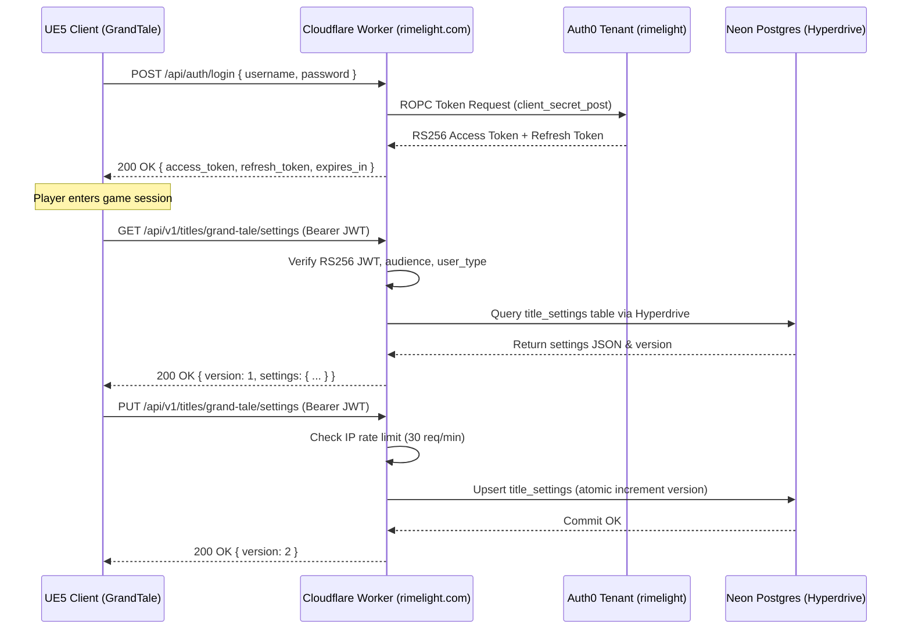

# Rimelight Entertainment Monorepo — Project Specification

> **Status:** Single Source of Truth & Authoritative Monorepo Manual  
> **Primary Technology:** SolidJS 2.0 | Vite+ (`vp`) | Cloudflare Workers | TypeScript  
> **Package Manager:** pnpm 12 (workspaces)

---

## 1. High-Level Vision & Architecture

**Rimelight Entertainment Monorepo** houses the complete web ecosystem, shared packages, and backend web APIs for Rimelight Entertainment. It powers the public company presence, franchise documentation, store, forums, and the headless HTTP backend APIs serving our game clients (including _Grand Tale_).

### Architectural Foundations

1. **SolidJS 2.0 Everywhere:** All web applications and component libraries leverage pure SolidJS 2.0 with fine-grained signals, zero virtual DOM, and native Server-Side Rendering (SSR).
2. **Edge-First Deployment:** Applications and APIs are built with `@cloudflare/vite-plugin` and deployed serverless across Cloudflare Workers, utilizing Cloudflare Hyperdrive for pooled PostgreSQL connections and Cloudflare Turnstile for bot mitigation.
3. **Vite+ Unified Toolchain:** Monorepo orchestration, bundling, linting, formatting, testing, and runtime execution are unified under Vite+ (`vp`), backed by Rolldown, Vitest, Oxlint, Oxfmt, and Vite Task.
4. **Shared Reusable Package Ecosystem:** All domain capabilities (CMS, internationalization, design tokens, security headers, SEO metadata, UI components) are decoupled into independently versionable workspace packages under `packages/*`.

---

## 2. Monorepo Organization & Layout

```
rimelight/
├── apps/
│   └── rimelight.com/           # Main company web application & client game API
├── packages/
│   ├── cms/                     # @rimelight/cms — content delivery & block registry
│   ├── config/                  # @rimelight/config — shared strict TypeScript configs
│   ├── design/                  # @rimelight/design — design tokens & generator
│   ├── i18n/                    # @rimelight/i18n — typed internationalization
│   ├── security/                # @rimelight/security — CSP, SRI, rate limits, Turnstile
│   ├── seo/                     # @rimelight/seo — metadata, sitemaps, JSON-LD, RSS
│   └── ui/                      # @rimelight/ui — SolidJS 2.0 component library
├── .github/workflows/           # CI pipelines (pkg.pr.new previews, tests, checks)
├── AGENTS.md                    # Specific AI assistant operating guidelines & toolchain rules
├── README.md                    # Project overview & local development instructions
├── PROJECT.md                   # Comprehensive project manual & technical specs (this file)
└── PLAN.md                      # Milestone progress tracker & active backlog
```

---

## 3. Applications Catalog

### `apps/rimelight.com` (Company Website & Game API)

_The flagship web application serving public web traffic and game client APIs._

- **Stack:** SolidJS 2.0 with SSR (`solid-js`, `@solidjs/router`, `@solidjs/web`), Vite+ with `@cloudflare/vite-plugin`.
- **Public Portals:**
  - **Company Portal:** About, studio, careers, blog, and legal terms.
  - **Grand Tale Franchise Hub:** News, patch notes, calculators, leaderboards, community forums, and player guides.
  - **Documentation Center:** Automated API and component documentation parsed from source (`src/docs`).
  - **Store:** Merchandising, digital products, and order histories.
- **Backend Services & Client API (`/api/v1/*`):**
  - **Game Authentication:** Integrates Auth0 Resource Owner Password Credential (ROPC) grant to provide headless sign-in for Unreal Engine 5 clients.
  - **Title Settings API:** High-performance REST endpoints storing player settings and placement snapshots.
  - **Database Connection:** Uses `postgres-js` over **Cloudflare Hyperdrive** to query Neon PostgreSQL with sub-millisecond connection pooling.

---

## 4. Packages Catalog

### 4.1 `@rimelight/cms`

_Content management and delivery engine._

- **Typed Collections:** Define structured schemas with custom fields, validation, and route paths (`defineCollection`).
- **Block Registry:** Composable blocks (`defineBlock`) including custom screenplay and lore blocks for game franchise content.
- **Storage Backends:** First-class Drizzle schemas supporting PostgreSQL (`./schema`) and SQLite/Cloudflare D1 (`./schema/sqlite`).
- **Public Delivery API:** Read-only published content endpoints (`/content`, `/search`) with automated taxonomy filtering and byline injection.

### 4.2 `@rimelight/config`

_Shared project and compiler configurations._

- **Strict Base Config:** Monorepo-wide strict TypeScript compiler flags (`noImplicitAny`, `strictNullChecks`, exact optional properties).
- **Solid Config:** Extends base configuration with Solid JSX transformation presets.

### 4.3 `@rimelight/design`

_Universal design token single-source-of-truth._

- **Token Source (`tokens.json`):** Semantic colors, typography scales, spacing, radius, and elevation rules.
- **Multi-Target Generators:** Generates CSS custom properties, UnoCSS theme presets, and Rust/Slint crate tokens (`crate/ui/tokens.slint`).
- **Contrast Auditor:** Automated WCAG 2.1 AA/AAA contrast calculations during generation (`generated/contrast.md`).

### 4.4 `@rimelight/i18n`

_Type-safe, per-route internationalization for Vite and Hono._

- **Format:** Clean JSON dictionaries organized by locale (`en`, `pt`, `es`).
- **Zero Runtime Overhead:** Synchronous `t()` accessor with compile-time checked translation keys.
- **Chunk Splitting:** Route-level dictionary slicing to ensure client pages only load needed translations.
- **External Client Support:** Serves raw dictionary endpoints for game engines (Unreal Engine C++ clients).

### 4.5 `@rimelight/security`

_Enterprise-grade security and request validation middleware._

- **Headers:** Strict Content Security Policy (CSP), Subresource Integrity (SRI) hashing, HSTS, and referrer policies.
- **Rate Limiting:** IP-bucket sliding window rate limiter tailored for high-volume Cloudflare edge deployments.
- **Bot Protection:** Native server-side verification for Cloudflare Turnstile tokens.
- **Construction Mode:** Configurable site-wide maintenance and holding page middleware.

### 4.6 `@rimelight/seo`

_Automated search engine discovery and social card engine._

- **Metadata & Head Injection:** Canonical URLs, localized alternate tags, theme colors, and Open Graph tags.
- **Structured Data:** Safe JSON-LD serialization for articles, breadcrumbs, products, and organizations.
- **Crawlers & Feeds:** Dynamic generation of `sitemap.xml`, `robots.txt`, RSS feeds, `site.webmanifest`, and `llms.txt` for AI crawlers.
- **Social Cards:** Server-side dynamic Open Graph image generation matching individual route patterns.

### 4.7 `@rimelight/ui`

_Accessible, high-performance SolidJS 2.0 component library._

- **Primitives:** Accessible buttons, dialogs, dropdowns, inputs, tabs, notifications, and navigation bars.
- **Styling:** Powered by UnoCSS utilities with custom theme overrides and zero runtime stylesheet injection.
- **A11y:** Fully WAI-ARIA compliant with native keyboard navigation, focus trapping, and screen-reader semantics.

---

## 5. Game Accounts & Settings API Specification

_Directly powers the Unreal Engine 5 Grand Tale client authentication and persistence._

### 5.1 Architecture & Flow



### 5.2 API Endpoints

#### `POST /api/auth/login`

- **Purpose:** Headless sign-in for game players.
- **Payload:** `{ "username": "player@example.com", "password": "...", "client_id": "..." }`
- **Response:** Returns RS256 Bearer JWT token, refresh token, and expiration (`900` seconds target).

#### `POST /api/auth/refresh`

- **Purpose:** Rotates refresh token and issues fresh access token without user prompt.
- **Payload:** `{ "refresh_token": "..." }`

#### `GET /api/v1/profile`

- **Headers:** `Authorization: Bearer <JWT>`
- **Response:** `{ "user_id": "uuid-...", "email": "...", "user_type": "user" }`

#### `GET /api/v1/titles/:title/settings`

- **Headers:** `Authorization: Bearer <JWT>`
- **Response:** `{ "title": "grand-tale", "version": 1, "settings": { "Interface/placements": "..." } }`

#### `PUT /api/v1/titles/:title/settings`

- **Headers:** `Authorization: Bearer <JWT>`
- **Rules:** Client debounces writes by 1 second. IP rate limit enforced at 30 writes/minute.
- **Payload:** `{ "settings": { ... } }`
- **Response:** Returns updated version number.

### 5.3 Security & Session Policies

- **Single Session Policy:** Game client keeps refresh tokens in memory only (never written to disk or registry). Each game launch initiates a fresh authentication session.
- **Audience Enforcement:** All game routes strictly validate `aud === "https://api.rimelight.com"`. Tokens missing this audience are rejected with `500`/`401`.
- **Database Driver:** Production connects through `postgres-js` over Cloudflare Hyperdrive. Legacy `neon-http` is deprecated and removed.

---

## 6. Infrastructure & Deployment Setup

### 6.1 Cloudflare Environment Setup

- **DNS & Routing:** Cloudflare Zone management with SSL/TLS set to Full (Strict).
- **Hyperdrive:** Connected to Neon PostgreSQL pooler. Worker configuration binds Hyperdrive via `env.HYPERDRIVE`.
- **Edge Routing:** Routes defined in `wrangler.toml` targeting `rimelight.com/*` with production bindings for Auth0 client credentials.

### 6.2 Auth0 Tenant Configuration

- **Tenant:** `rimelight` (EU region).
- **Default Directory:** `Username-Password-Authentication` (required for ROPC grant).
- **Database Connection:** Requires email verification before access tokens are issued.
- **Application Settings:** Regular Web App with grant types `authorization_code`, `refresh_token`, and `password`.
- **Post-Login Actions:** Injects `user_type` and custom claims into access tokens.
