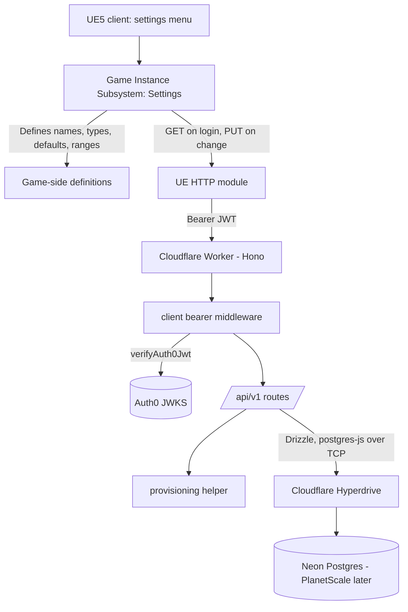

# RFC-0001: Unreal Engine 5 Account Auth & Global Settings API

- **Status**: **Implemented on the server and verified live. Game client in C++ complete. Editor wiring pending.**
- **Author(s)**: idant
- **Created**: 2026-10-26
- **Last Updated**: 2026-10-29
- **Discussion/PR**: TBD

---

## Status update (2026-10-29)

**Read this first.** Parts of the body below were written before the work was done, and some describe states that no longer exist. Where this section and the body disagree, this section is correct.

### What is implemented

- **Server** (`apps/rimelight.com`): `POST /api/auth/login`, `POST /api/auth/refresh`, `GET /api/v1/profile`, `GET` and `PUT /api/v1/titles/grand-tale/settings`, the `title_settings` table (migration applied to the dev database), and rate limits on login and on settings writes.
- **Database**: the whole app and the CMS use postgres-js over Hyperdrive. `neon-http` is gone. §2.1, §2.3 non-goals, and §6 step 0 describe the old state.
- **Audience**: always sent on the ROPC login. There is no `AUTH0_USE_CUSTOM_AUDIENCE` gate in the code. §2.1 and the §6 table row describe a gate that does not exist. On 2026-10-29 the code was changed as follows:
  - `getAuth0ConfigFromEnv` no longer lets an `undefined` override erase the resolved audience.
  - The headless login and refresh routes read the Worker bindings on each request. The module-level config is built at load time, which can run before the bindings are visible.
  - `/api/v1/*` and the headless routes return 500 when `AUTH0_AUDIENCE` is unset. Before this change, `verifyJwtRs256` skipped the audience check when no audience was given, so any tenant token would have been accepted.
- **Live check, 2026-10-29**, against the local Worker and the `rimelight` tenant with a test account:
  - Login returned an RS256 access token. `aud` contains `https://api.rimelight.com`, `user_type` is `user`, and a refresh token was issued.
  - `GET /api/v1/profile` returned 200 with the user's UUID, and the settings `GET` returned version 0 and empty settings.
  - `PUT` returned version 1, and a following `GET` returned the same values.
- **Game client** (GrandTale repo): sign-in, settings, the login gate, the Esc menu, and the settings UI are written in C++. Six automation tests pass. The editor wiring is described in `Docs/editor-handoff.md` in that repo.

### Decisions that changed from the body

- **One session per game run.** The refresh token is held in memory only. It is never written to the OS credential store or to disk, and every launch requires sign-in. This replaces the storage bullet in §3.3.4 and the token storage bullet in §7.
- **No logout.** The game has no log-out item. Each run has one session.
- **Rate limits are per IP**, not per account. The rule type in `packages/security` only keys by IP. Settings writes are limited to 30 per minute per IP, and the game debounces writes by one second so a slider drag sends one request.

### Open issues

These are tenant or configuration problems, not code changes.

1. **Two post-login Actions are deployed and both set `user_type`.** `rimelight-claims` reads `app_metadata.user_type`, which matches §3.3.2. The other, "Add User Roles & Classification", classifies any `@rimelight.com` email as `employee`. The token for `test@rimelight.com` came back as `user`, so the current order seems to favour `rimelight-claims`. That order is not guaranteed. Keep one Action. Staff marking should follow §3.3.2.
2. **Access token lifetime is 86400 seconds** on the `Rimelight API`. §3.3.2 requires 900. Change it before production.
3. **Password logins need a client grant.** The `Rimelight API` has `subject_type_authorization.user.policy = require_client_grant`. Keep the grant for the `rimelight.com` application when changing the API.
4. **Local dev Hyperdrive string is stale.** `.env.local` sets `CLOUDFLARE_HYPERDRIVE_LOCAL_CONNECTION_STRING_HYPERDRIVE` to a different Neon endpoint (`ep-odd-forest…`) from `DATABASE_URL` in `.dev.vars` (`ep-rough-haze…`). The Worker prefers the Hyperdrive value, so every authenticated route fails with "password authentication failed". Make the two match, or remove the `.env.local` entry.
5. **API error messages come back as raw i18n keys**, for example `api.message.bearer-missing`. See the next subsection.

### Why the API returns raw i18n keys

Translations in `@rimelight/i18n` are split into per-route chunks. A chunk is loaded when a page for that route is rendered. The API routes never render a page, so their message chunk is never loaded. `t()` then finds nothing in the dictionary and returns the key. The dev server confirms this with `[i18n] "api.message.bearer-missing" is read in "en", which isn't loaded`.

The fix is not to load the chunk on the server. Clients should not show server prose anyway, so API errors should carry a stable `code` (for example `bearer-missing`) with an English `message` for logs. The game maps codes to localized `FText`. This is not implemented yet.

---

## 1. Summary

Rimelight is building a cross-platform MMO. The Unreal Engine 5 (UE5) client, and later Unreal Engine 6, need to sign players in with a Rimelight account and save global, account-level settings from the in-game settings menu. Any part of the game reads those settings to decide its behavior (audio, video, controls, gameplay).

This RFC covers two things:

1. **Account auth.** Players sign in with their own email and password, managed by Auth0. Social login is out of scope.
2. **Global settings.** The server stores a generic, versioned settings document per player in Postgres. The game owns what each setting means: its name, type, default, and allowed range. The server checks only structure and size.

The work extends the existing `apps/rimelight.com` Cloudflare Worker (Hono, Drizzle, Neon, Auth0). It does not add a second backend.

Save-state (characters, inventory, game modes, progression) is out of scope and will be covered by a follow-up RFC.

---

## 2. Motivation

### 2.1. Current state

Verified against the repository on 2026-10-26.

- **Users table exists.** `apps/rimelight.com/src/db/schema/users.ts` has a uuid PK, a nullable unique `auth0_id`, unique `email`, required `name`, and `tag` (default `"0000"`). The display identity is `name` plus `tag`.
- **Auth0 verification exists.** `packages/auth/src/jwt.ts` (`verifyJwtRs256`) and `packages/auth/src/adapters/auth0.ts` (`verifyAuth0Jwt`) verify RS256 tokens against the tenant JWKS, including issuer and audience.
- **Login exists, but is not yet a game credential.** `POST /api/auth/login` (and `/token`) performs an Auth0 Resource Owner Password (ROPC) exchange and returns tokens. `POST /api/auth/refresh` handles refresh.
  - _Superseded (2026-10-29):_ there was no `AUTH0_USE_CUSTOM_AUDIENCE` gate in the code. The real defect was a `...overrides` spread that could erase the audience, and a module-load read of the bindings. Both are fixed. See the status section.
  - Login uses `AUTH0_CLIENT_ID`, the website's client. There is no separate game application today.
- **Existing sync merges by email.** `syncAuth0UserToDb` (`apps/rimelight.com/src/auth/sync-user.ts`) matches on `auth0_id` or `email`, rebinds `auth0_id` silently, and sets `emailVerified: true` without reading the `email_verified` claim. §3.3.3 forbids the silent merge, so game routes need their own provisioning helper.
- **Session vocabulary differs.** `UserType` in `packages/auth/src/types.ts` is `"user" | "employee" | "guest"`. No code produces `player`.
- **Database client cannot do transactions.** `apps/rimelight.com/src/db/index.ts` and `packages/cms/src/db/index.ts` use `drizzle-orm/neon-http`, which does not support transactions or TCP connection strings. `postgres` is not a dependency.
- **Settings do not exist.** No settings table, no settings routes, no game routes.

### 2.2. Problems

- Players have no account-scoped settings, so every launch starts from the game's defaults.
- A player whose token was issued by a path that skipped the sync has no `users` row, so the game API has to provision lazily.
- Game systems need one place to read settings, so each system does not fetch or interpret its own values.

### 2.3. Goals

- One identity per player (`users.id`, linked by `auth0_id`) across the website and the game.
- Email and password only, through Auth0.
- Bearer-token authentication for `/api/v1/*`. No cookies, no server-side sessions.
- Settings scoped per title. One account can hold separate settings for each title (Grand Tale first).
- The server stores settings as generic JSON and enforces structure, size, and rate. It does not need to know what any setting means.
- The game defines every setting (name, type, default, range) in one place, enforces it on read, and reads from a local cache through a Game Instance Subsystem.
- Portable SQL that works on Neon now and PlanetScale Postgres later.

### 2.4. Non-goals

- Social login (Steam, Epic, Google, Apple).
- Save-state of any kind: characters, inventory, progression, game modes. Separate RFC.
- Per-character or per-game-mode settings. Settings are per account and per title in v1, not per character or mode.
- MFA inside the game client. Auth0 handles MFA on its hosted pages.
- Employee and staff access. Employees keep their separate `employees` table and flows.
- Replacing the website's Auth0 Universal Login.

---

## 3. Detailed Design

### 3.1. Proposed API / Usage

#### 3.1.1. Endpoints

All game endpoints require `Authorization: Bearer <access_token>`, an Auth0 access token whose `aud` equals `AUTH0_AUDIENCE`.

| Method | Path                                 | Purpose                                                                          |
| ------ | ------------------------------------ | -------------------------------------------------------------------------------- |
| `GET`  | `/api/v1/profile`                    | Current player profile. Creates the `users` row if it is missing.                |
| `GET`  | `/api/v1/titles/grand-tale/settings` | The player's stored settings document and its version. Empty if none are stored. |
| `PUT`  | `/api/v1/titles/grand-tale/settings` | Per-key merge into the stored document. Returns the merged document.             |

Login uses the existing `POST /api/auth/login` and `POST /api/auth/refresh`.

#### 3.1.2. Settings document

The stored document is two levels deep: a category, then a key, then a scalar value.

```json
{
  "audio": { "masterVolume": 0.8, "musicVolume": 0.5 },
  "video": { "qualityPreset": "high", "vsync": true },
  "controls": { "mouseSensitivity": 1.2 }
}
```

Allowed value types: string (max 256 characters), finite number, boolean, or `null`. `null` removes the key, so the game falls back to its default. Objects and arrays are not allowed as values.

Allowed names: categories and keys match `^[a-z][a-zA-Z0-9]{0,63}$`. Keys are case-sensitive. Names are chosen by the game; the server does not check whether a name is meaningful.

#### 3.1.3. Example payloads

```json
// GET /api/v1/profile
{
  "id": "5f1c2a8e-0d3b-4e8a-9b7e-2c1a6f0d9e11",
  "email": "player@example.com",
  "name": "Player",
  "tag": "0000",
  "created_at": "2026-10-26T12:00:00.000Z"
}
```

```json
// PUT /api/v1/titles/grand-tale/settings  (only the keys being changed)
{
  "audio": { "masterVolume": 0.8 },
  "controls": { "mouseSensitivity": 1.2, "invertY": null }
}

// 200 response: the full stored document after the merge
{
  "success": true,
  "version": 7,
  "settings": {
    "audio": { "masterVolume": 0.8, "musicVolume": 0.5 },
    "video": { "qualityPreset": "high", "vsync": true },
    "controls": { "mouseSensitivity": 1.2 }
  }
}
```

`GET` on a player with no stored settings returns `{ "success": true, "version": 0, "settings": {} }`. Defaults are not stored or returned by the server.

#### 3.1.4. Error shape

Every error uses `{ "error": string, "message": string }`, matching the existing auth routes.

| Status | When                                                                                                                                                                                        |
| ------ | ------------------------------------------------------------------------------------------------------------------------------------------------------------------------------------------- |
| `400`  | Structure is invalid: not an object, nesting deeper than two levels, a name that fails the pattern, a value that is an object, array, or non-finite number, or a string over 256 characters |
| `401`  | Missing, malformed, expired, or invalid token, including a token whose `aud` is not `AUTH0_AUDIENCE`. `verifyAuth0Jwt` returns `null` for all of these, so they are not distinguished.      |
| `403`  | Token `https://rimelight.com/user_type` claim is not `user`                                                                                                                                 |
| `409`  | Provisioning finds a `users` row with the token's email and a different or null `auth0_id` (§3.3.3)                                                                                         |
| `413`  | Body exceeds 16 KB, or the stored document would exceed 64 KB                                                                                                                               |
| `429`  | Rate limited                                                                                                                                                                                |

### 3.2. Architecture & File Structure



#### 3.2.1. Server files

Added:

- `apps/rimelight.com/src/db/schema/title-settings.ts`: `titleSettings` table, with relations.
- `apps/rimelight.com/src/api/routes/v1/index.ts`: v1 router, mounted at `/v1` in `src/api/server.ts`.
- `apps/rimelight.com/src/api/routes/v1/middleware.ts`: bearer-token middleware built on `verifyAuth0Jwt`.
- `apps/rimelight.com/src/api/routes/v1/provision.ts`: lazy provisioning helper with the §3.3.3 collision rule. Separate from `syncAuth0UserToDb`.
- `apps/rimelight.com/src/api/titles.ts`: title slug registry (`grand-tale`). Unknown titles get `404`.
- `apps/rimelight.com/src/api/routes/v1/title-settings.ts`: structural Zod schema, the `TitleSettingsDocument` type, and the merge function.
- `apps/rimelight.com/drizzle/<timestamp>_title_settings/`: hand-written migration (§6).
- `docs/auth0-setup.md`: Auth0 tenant setup (§3.3.2).

Modified:

- `apps/rimelight.com/src/db/schema/index.ts`: export `./title-settings.ts`.
- `apps/rimelight.com/src/db/schema/relations.ts`: add the `titleSettings` relation.
- `apps/rimelight.com/src/api/server.ts`: mount `/v1`.
- `apps/rimelight.com/src/db/index.ts`: switch from `neon-http` to postgres-js over Hyperdrive (§6, step 0).
- `packages/cms/src/db/index.ts`: same driver switch for `getCmsDb` (§6, step 0).
- `apps/rimelight.com/package.json`: add `postgres`.
- `apps/rimelight.com/cloudflare.config.ts`: declare `AUTH0_DOMAIN`, `AUTH0_CLIENT_ID`, and `AUTH0_AUDIENCE` as bindings (none are declared today).
- `packages/auth/src/adapters/auth0.ts`: stop gating `audience` in `getAuth0ConfigFromEnv` on `AUTH0_USE_CUSTOM_AUDIENCE`. The audience is always sent on ROPC.

Not added: a second auth middleware in `src/middleware/`, or any settings registry on the server.

### 3.3. Key Components

#### 3.3.1. Database schema

The primary key and foreign key use `users.id` (uuid). The Auth0 `sub` is looked up through `users.auth0_id`.

```typescript
// apps/rimelight.com/src/db/schema/title-settings.ts (proposed)
import { integer, jsonb, pgTable, timestamp, uuid } from "drizzle-orm/pg-core";
import { users } from "./users.ts";
import type { TitleSettingsDocument } from "#api/routes/v1/title-settings"; // defined in title-settings.ts

export const titleSettings = pgTable("title_settings", {
  userId: uuid("user_id")
    .primaryKey()
    .references(() => users.id, { onDelete: "cascade" }),
  settings: jsonb("settings").$type<TitleSettingsDocument>().default({}).notNull(),
  version: integer("version").default(0).notNull(),
  updatedAt: timestamp("updated_at", { withTimezone: true }).defaultNow().notNull(),
});
```

- `settings` holds whatever the game has written for this account, within the structural rules in §3.1.2.
- `version` starts at `0` (no row) and increments on every successful write. The game can compare it to decide whether to re-fetch.
- The server never stores defaults. A game-side default change applies to every player who has not written that key.

#### 3.3.2. Auth0 configuration

Tenant setup, documented in `docs/auth0-setup.md`:

1. **API.** Create an API with identifier `https://api.rimelight.com`. Signing algorithm `RS256`. Set `AUTH0_AUDIENCE` to this identifier.
2. **Web application.** Use the existing website application (`AUTH0_CLIENT_ID`) for both website and game login. Enable the Password grant on it, because headless login uses ROPC. Keep refresh token rotation enabled. No separate native application is created for v1.
3. **Tokens.** Access tokens expire after 15 minutes. Refresh tokens rotate on use. ROPC must send `audience` so the access token has `aud = AUTH0_AUDIENCE`. The refresh grant keeps the audience from the original login.
4. **Connection.** Database connection only. No social connections enabled for the game application. Email verification required. Auth0 enforces this on password login, so the Worker does not check `email_verified` itself.
5. **MFA.** Enabled in tenant policy. The game client does not handle MFA challenges in v1. If an MFA-enabled account attempts ROPC, Auth0 returns `mfa_required`. The login route maps that to a specific error (for example `error: "mfa_required"`) that tells the player to complete MFA on the website. This is a known limitation.
6. **Login Action (required).** A Login (post-login) Action sets two claims on the access token and the ID token:
   - `https://rimelight.com/user_type` to `user` or `employee`. Value `user` matches `UserType` in `packages/auth`. The Action must always set this claim, because the game middleware denies tokens without it.
   - `https://rimelight.com/email` to the account email. Auth0 does not include `email` in access tokens by default, and provisioning needs it (§3.3.3).
     The existing `mapAuth0PayloadToSession` reads the `user_type` claim.
7. **No other Action.** Item 6 is the only Action. Users are provisioned on the login path (`syncAuth0UserToDb`) and, as a fallback, on the first game API call (§3.3.3).

#### 3.3.3. Bearer middleware and lazy provisioning

```typescript
// apps/rimelight.com/src/api/routes/v1/middleware.ts (proposed sketch)
import { createMiddleware } from "hono/factory";
import { verifyAuth0Jwt } from "@rimelight/auth/auth0";

export const requireClientToken = createMiddleware<{
  Bindings: Env;
  Variables: { jwtPayload: Record<string, any>; userId: string };
}>(async (c, next) => {
  const header = c.req.header("Authorization") ?? "";
  const token = header.startsWith("Bearer ") ? header.slice(7) : null;
  if (!token) return c.json({ error: "Unauthorized", message: "Missing bearer token." }, 401);

  // Read these bindings directly. getAuth0ConfigFromEnv() drops the audience unless a flag is set.
  const payload = await verifyAuth0Jwt(token, {
    domain: c.env.AUTH0_DOMAIN,
    audience: c.env.AUTH0_AUDIENCE, // single string; arrays skip the aud check
  });
  if (!payload?.sub) return c.json({ error: "Unauthorized", message: "Invalid token." }, 401);

  if (payload["https://rimelight.com/user_type"] !== "user") {
    return c.json({ error: "Forbidden", message: "Player account required." }, 403);
  }

  c.set("jwtPayload", payload);
  await next();
});
```

Lazy provisioning is a helper in `provision.ts`, called by every game route. The login path already creates rows (§2.1), so this covers tokens that did not pass through login. Steps:

1. Select `users` where `auth0_id = sub`. If found, return it.
2. Select `users` where `email` = the token's `https://rimelight.com/email` claim. If found with a different or null `auth0_id`, return `409`, log the event for manual review, and do not modify the row. Do not call `syncAuth0UserToDb` here, because it merges.
3. Otherwise insert with `auth0_id` = `sub`, `email`, `name` defaulted from the email local part, and `tag` `"0000"`, using `ON CONFLICT (auth0_id) DO NOTHING`. Then select by `auth0_id`.
4. Two concurrent first calls both reach step 3, and the unique constraint keeps one row. If the insert fails on the `email` constraint, retry once from step 1.

Cookie sessions are not read on `/api/v1/*`. The global `auth()` middleware in `fetch.ts` still runs but does not block these routes.

#### 3.3.4. Login flow for UE5

The UE5 client logs in with `POST /api/auth/login`. The Worker forwards email and password to Auth0's ROPC endpoint, using `AUTH0_CLIENT_ID` and `audience = AUTH0_AUDIENCE`, and returns Auth0 tokens. The existing implementation covers this apart from the two changes in §3.2.1 and §3.3.2.

- Pros: Auth0 remains the single identity store, so `sub` matches the website. Rate limiting and logging live in one place.
- Cons: the Worker sees raw passwords. The endpoint needs rate limiting (§7.3) and must never log request bodies.

Direct Auth0 ROPC from the client is not used. Worker-issued game tokens are not used.

Token handling in the client:

- The bearer for `/api/v1/*` is `access_token`. The `user` field in the login response is built from the ID token, and is informational only.
- Hold the refresh token in memory for the current game run only. Do not write it to the OS credential store or to disk. Every launch requires sign-in. _(Changed 2026-10-29; see the status section.)_
- Refresh the access token shortly before expiry. On `401`, refresh once and retry once. If the refresh fails, return the player to the login screen.
- Do not log tokens.

#### 3.3.5. Server-side settings storage

The server handles `PUT` as follows:

1. Validate the body against the structural schema in §3.1.2 (`settings.ts`). Reject with `400` if it fails.
2. In one transaction:
   1. `INSERT ... ON CONFLICT (user_id) DO NOTHING` to create the row if it does not exist.
   2. `SELECT ... FOR UPDATE` to lock and read the row.
   3. Apply the per-key merge in TypeScript. `null` values remove their key. Enforce the 64 KB stored-document cap with `413`.
   4. Write the document back with `version = version + 1`.
3. Return the merged document and the new version.

The insert comes first because `SELECT ... FOR UPDATE` locks nothing when no row exists yet. Without it, two first writes could both proceed without serializing. The transaction needs the driver switch in §6, step 0, because `neon-http` does not support transactions.

Because the merge is per key, two clients writing different keys do not overwrite each other. Two writes to the same key resolve as last-write-wins. The behavior is as described here; the exact code is decided during implementation.

The server does not know what any setting means. Renaming or retiring a setting is a game-side change: the game stops reading the old key and ignores it. Stored values for retired keys are harmless and are dropped when the player next writes that category.

#### 3.3.6. Unreal Engine client

The game owns the settings definitions. Each entry in the game's definition table has:

- the category and key name,
- the type (`float`, `bool`, `string`, or enum),
- the default,
- the range or allowed values.

The definition table is the only place these are written. The settings menu reads it to build sliders and toggles, and the subsystem reads it to validate values.

Settings are read through a **Game Instance Subsystem** (`UGameInstanceSubsystem`). It lives for the whole session across level loads, and any actor, widget, or component can reach it through `GetGameInstance()->GetSubsystem<UGameSettingsSubsystem>()`.

```cpp
// Sketch only.
UCLASS()
class UGameSettingsSubsystem : public UGameInstanceSubsystem
{
    GENERATED_BODY()
public:
    virtual void Initialize(FSubsystemCollectionBase& Collection) override;

    // Returns the stored value if it is present and valid, otherwise the game default.
    // Never makes a network call.
    float GetFloat(FName Category, FName Key) const;
    bool GetBool(FName Category, FName Key) const;
    FString GetString(FName Category, FName Key) const;

    // Clamps to the definition's range, updates the local cache, broadcasts,
    // then PUTs the change in the background.
    void SetFloat(FName Category, FName Key, float Value);

    DECLARE_MULTICAST_DELEGATE_TwoParams(FOnSettingChanged, FName /*Category*/, FName /*Key*/);
    FOnSettingChanged OnSettingChanged;

private:
    TMap<FName, TMap<FName, FSettingValue>> Cache; // from GET, plus local writes
};
```

Behavior:

- **On login.** `GET /api/v1/titles/grand-tale/settings` fills the cache. Until it arrives, reads return the game defaults.
- **Reads.** Always from the cache, and always checked against the definition. A stored value of the wrong type or outside its range falls back to the default. Unknown keys are ignored.
- **Writes.** Clamp to the definition, update the cache, broadcast `OnSettingChanged`, then send `PUT` in the background. On failure, keep the local value, retry with backoff, and do not discard the player's change.
- **Version.** Track the last server `version`. If a `PUT` returns a higher version than expected, re-fetch with `GET` and reconcile.

The UE6 port keeps the same HTTP contract and the same stored document. Only the subsystem implementation changes if the engine API changes.

### 3.4. Consolidation of earlier documents

`docs/ue5-auth-architecture.md` was removed when this RFC was created. Its content is folded in as follows:

- Auth0 as the single identity source, and the ROPC trade-offs (§3.3.4, §4).
- Token lifetime (§3.3.4). Storage is in memory only, per the status section.
- The `players`/`employees` split is replaced by one `users` table with a `user_type` claim. Employees keep their own table.
- The Worker-issued JWT option, the social-login options, and the separate `players` table are not carried forward.
- PlanetScale is future. Neon is the current database.

---

## 4. Drawbacks & Trade-offs

- **The server accepts any well-formed setting.** A modified client can store values the game does not recognize. The game ignores or clamps them, so the effect is limited to that player's own game. Settings are not used for fairness, which keeps this acceptable. Any future setting that does affect other players must be checked server-side.
- **Raw passwords pass through the Worker.** Mitigation: rate limiting, no body logging, HTTPS only.
- **ROPC is discouraged by Auth0.** It must be enabled per application, and Auth0 may restrict it. This is a vendor-policy risk.
- **MFA is not supported in the game client in v1.** Players with MFA enabled must complete it on the website first.
- **Email verification depends on Auth0.** The Worker does not read `email_verified`. Auth0's connection setting blocks unverified accounts from password login. `syncAuth0UserToDb` still sets `emailVerified: true` unconditionally, so that setting is only correct because of Auth0.
- **Lazy provisioning.** `users` rows appear on login or on the first game call, not at account creation.
- **Definitions live only in the game.** Changing a default or range is a game build, with no server change. The trade-off is that the server cannot report what settings exist.
- **Settings are per title.** Per-character or per-mode overrides will need a schema change later.
- **Shared Worker.** Game traffic shares a Worker with the website.

---

## 5. Alternatives Considered

1. **Worker-issued game tokens.** Rejected. It forks identity from Auth0 and adds a signing key to manage.
2. **Direct Auth0 ROPC from the client.** Rejected. It puts Auth0 client configuration in the game and bypasses our rate limiting.
3. **Social login (Device Authorization Grant).** Out of scope per decision.
4. **Server-side settings registry (TypeScript).** Rejected. It needs a duplicate definition in the game (the C++ mirror), and the two copies drift. The server gains little, because settings do not affect fairness.
5. **Settings fetched on every read.** Rejected. Settings are read constantly, so reads are local.
6. **Separate game backend service.** Rejected for v1. It duplicates auth, database access, and deploys.
7. **Separate `players` and `employees` tables.** Rejected. One `users` table with a `user_type` claim matches the existing schema.
8. **Typed JSON columns per setting.** Rejected. Every new setting would need a migration.

---

## 6. Adoption & Migration Strategy

- **Breaking change?** No. All changes are additive, plus small edits to the schema index, relations, server mount, database clients, Auth0 audience handling, and Cloudflare config.
- **Migration.** One migration adds `title_settings`. It is hand-written, because `drizzle-kit generate` currently reports 18 items of drift in the snapshot (existing tables such as `users` are not in it). Fix the snapshot drift in its own change, then use `drizzle-kit generate` for later migrations. Apply with `drizzle-kit migrate`. Do not use `drizzle-kit push` against shared environments.
- **Existing users.** No backfill. Rows are created on the login path (already true today) or on the first game call.
- **Prerequisites.** None of these are complete. Each was checked against the repository on 2026-10-26. Production and Auth0 dashboard state cannot be checked from the repo.

  | Item                                                                                | Where                             | State                                                                                                                                                                |
  | ----------------------------------------------------------------------------------- | --------------------------------- | -------------------------------------------------------------------------------------------------------------------------------------------------------------------- |
  | `AUTH0_DOMAIN`                                                                      | `apps/rimelight.com/.dev.vars`    | Placeholder (`your-tenant.us.auth0.com`). Set to the real tenant. The code falls back to `rimelight.eu.auth0.com` if unset, which may or may not be the real tenant. |
  | `AUTH0_CLIENT_ID`                                                                   | `.dev.vars`                       | Placeholder. Website client. Must be set for the website as well.                                                                                                    |
  | `AUTH0_CLIENT_SECRET`                                                               | `.dev.vars`                       | Placeholder.                                                                                                                                                         |
  | `AUTH0_AUDIENCE`                                                                    | `.dev.vars`                       | `https://api.rimelight.com`, copied from the example. Matches the API identifier in §3.3.2.                                                                          |
  | `AUTH0_USE_CUSTOM_AUDIENCE`                                                         | not set                           | Resolved. No gate exists in code, and the audience is always sent.                                                                                                   |
  | `AUTH0_DOMAIN`, `AUTH0_CLIENT_ID`, `AUTH0_AUDIENCE`                                 | `cloudflare.config.ts`            | Not declared as bindings. Declare them. `AUTH0_CLIENT_SECRET` and `AUTH0_SECRET` are declared as secrets.                                                            |
  | Production values for the above                                                     | Cloudflare dashboard              | Not verifiable from the repo. Confirm each is set.                                                                                                                   |
  | Auth0 tenant: API, web application with Password grant, Login Action, DB connection | Auth0 dashboard                   | Verified live 2026-10-29: password grant on `rimelight.com`, API `https://api.rimelight.com` (RS256), two post-login Actions deployed (see the status section).      |
  | `postgres` dependency                                                               | `apps/rimelight.com/package.json` | Not installed.                                                                                                                                                       |
  | `DATABASE_URL`                                                                      | `.dev.vars`                       | Set. Used by `drizzle.config.ts` and the current `neon-http` client.                                                                                                 |
  | `HYPERDRIVE` binding                                                                | `cloudflare.config.ts`            | Declared, and used by the postgres-js client. Step 0 is done.                                                                                                        |

- **Database driver.** Move the whole app from `neon-http` to Hyperdrive with a TCP Postgres driver (`postgres` / postgres.js with `drizzle-orm/postgres-js`). This covers `apps/rimelight.com/src/db/index.ts` and the CMS's `getCmsDb` in `packages/cms/src/db/index.ts`, which currently sends SQL over HTTP to `https://<host>/sql`. The rest of the app depends on the same client, so this is the first rollout step, not a later change.
- **Rollout order:**
  - Before step 0: complete the prerequisites above.
  - 0. Switch the app's database client to Hyperdrive with postgres-js, including the CMS's `getCmsDb`. Add the `postgres` dependency in the same change. Verify the CMS still works in production.
  1. Schema and migration.
  2. Remove the audience gate in `getAuth0ConfigFromEnv`. Bearer middleware, provisioning helper, `GET /profile`.
  3. Structural validation, `GET` and `PUT /settings`.
  4. Rate limiting on `/api/auth/login` and on `PUT /settings`.
  5. UE5 definitions table, subsystem, and settings menu.
- **PlanetScale later.** Keep SQL portable. The move is a separate RFC.

---

## 7. Cross-Cutting Concerns

### 7.1. Performance & Bundle Size

- Game routes add nothing to the website bundle.
- Settings reads in the game are local. The server sees one `GET` per login and one `PUT` per settings change batch.
- Each request does one indexed lookup on `users.auth0_id` and one primary-key read or write on `title_settings`.
- JWKS responses are cached by `verifyJwtRs256`.

### 7.2. Accessibility (a11y)

The API has no UI. The settings the game stores (text scale, subtitles, colorblind modes) need accessibility review in the UE5 UI, tracked separately.

### 7.3. Security & Privacy

- **Credential stuffing.** Per-IP limit on `/api/auth/login`: 10 attempts per minute per IP, through the `RATE_LIMIT` binding. The binding is currently `100` requests per `60` seconds for all routes, so the login limit needs a route rule in `packages/security`. No per-account lockout in v1. Auth0's brute-force protection on the database connection covers account-level attacks, and should be confirmed enabled in the tenant.
- **Write abuse.** Rate limit `PUT /settings` per account, and keep the 16 KB body and 64 KB stored-document caps.
- **Token validation.** RS256 only, `iss`, single-string `aud`, and `exp`. Reject `alg: none`. The existing verifier restricts algorithms to RS256.
- **Authorization.** `user_type` must be `user` on game routes (§3.3.3).
- **Data exposure.** Settings are visible only to their owner. Never return other users' rows. Never log bearer tokens or bodies. The existing `console.error` in the login handler logs Auth0's error text only; keep it that way.
- **Token storage.** In memory for one game run. Nothing is persisted (status section).
- **Privacy.** Settings are personal data. Document them in the privacy policy. Account deletion cascades to `title_settings`.

---

## 8. Verification & Testing Plan

### 8.1. Automated Tests

- **Middleware.** Missing token, wrong audience (returns `401`), wrong issuer, expired token, `alg: none`, `user_type = employee` (returns `403`), valid user token. Model on `packages/auth/test/jwt-native.test.ts` and `token-tampering-and-replay.test.ts`.
- **Login.** The ROPC request sends `audience` = `AUTH0_AUDIENCE` and `client_id` = `AUTH0_CLIENT_ID`, regardless of any custom-audience flag. This is a regression test for §2.1.
- **Provisioning.** First call creates the row. Second call returns the same row. Concurrent first calls create exactly one row. Email collision with a different `auth0_id` returns `409` and does not modify the row. Email collision with a null `auth0_id` returns `409`.
- **Structural validation.** Accepts valid documents. Rejects non-object bodies, depth over two levels, invalid names, object or array values, non-finite numbers, and strings over 256 characters, each with `400`.
- **Merge.** `PUT` touches only the sent keys. `null` removes a key. `version` increments by one per write. Two concurrent writes to different keys both persist. Two concurrent first writes, with no row yet, both persist and produce one row.
- **Limits.** Body over 16 KB returns `413`. A write that would exceed 64 KB stored returns `413`.
- **Game side.** Definition table: out-of-range and wrong-type stored values fall back to the default. Unknown keys are ignored. `SetFloat` clamps before sending.
- **Commands:**
  ```bash
  vp check
  vp test
  vp run -r build
  ```

### 8.2. Manual Verification

1. Run the Worker locally with `.dev.vars` pointing at a dev Auth0 tenant.
2. Log in with a test player through `POST /api/auth/login`. Decode the returned `access_token` and confirm `aud`, `https://rimelight.com/user_type`, and `https://rimelight.com/email`.
3. `curl` each endpoint with and without the bearer token, and with an employee token.
4. In a minimal UE5 level, open the settings menu, change a value, restart the editor, log in again, and confirm the value persists.
5. Confirm that a website cookie alone does not authorize `/api/v1/*`.

---

## 9. Decisions

### 9.1. Resolved

| #   | Question               | Decision                                                                                                                                                                |
| --- | ---------------------- | ----------------------------------------------------------------------------------------------------------------------------------------------------------------------- |
| 1   | Social login at launch | No. Email and password only.                                                                                                                                            |
| 2   | In-game MFA at launch  | Auth0 handles MFA. The game has no step-up flow in v1.                                                                                                                  |
| 3   | Settings key style     | Nested categories (`audio.masterVolume`).                                                                                                                               |
| 4   | Settings merge         | Per key within each category. `null` removes a key.                                                                                                                     |
| 5   | Save-state             | Out of scope. Separate RFC.                                                                                                                                             |
| 6   | Naming                 | `profile`.                                                                                                                                                              |
| 7   | Auth0 Action           | Required. One Login Action sets the `user_type` and `email` claims (§3.3.2). The earlier "Post-Login Action not used" decision conflicted with that, so it is replaced. |
| 8   | PlanetScale timing     | Future. Separate RFC when scheduled.                                                                                                                                    |
| 9   | Rate limits            | 10 login attempts per minute per IP. No per-account lockout in v1.                                                                                                      |
| —   | Game login client      | The existing web application (`AUTH0_CLIENT_ID`), with the Password grant enabled. No separate native application.                                                      |
| —   | API identifier         | `https://api.rimelight.com`.                                                                                                                                            |
| —   | Claim value            | `user` and `employee`. No `player`.                                                                                                                                     |
| —   | Settings scope         | Per account and per title. Not per character or mode.                                                                                                                   |
| —   | Title naming           | Slug in the path and the table, for example `grand-tale`. Registry in `src/api/titles.ts`.                                                                              |
| —   | Settings model         | Server stores generic, versioned JSON. The game owns definitions, defaults, and ranges.                                                                                 |
| —   | Client access          | Game Instance Subsystem with a local cache.                                                                                                                             |
| —   | Database connection    | Hyperdrive with a TCP Postgres driver, app-wide.                                                                                                                        |
| —   | Settings definitions   | Hand-written C++ table in the game module for v1.                                                                                                                       |
| —   | Retired-key cleanup    | Lazy, on the next write to that category.                                                                                                                               |
| —   | Wrong-audience status  | `401`. `verifyAuth0Jwt` does not distinguish audience failures from other invalid tokens. Earlier drafts said `403`.                                                    |

### 9.2. Open

1. **Login email merge (follow-up, not blocking).** `syncAuth0UserToDb` links an existing account to a new login when the email matches, even if the `auth0_id` differs. The game path rejects that case with `409` (§3.3.3). Making website login reject it too would change behavior for existing accounts, so it needs a check of current data first. Recommended: leave it as is for v1 and track it separately.

**Resolved since last draft:**

- Retired-key cleanup is lazy, on the next write to that category. No cleanup endpoint.
- Settings definitions live in a C++ table in the game module for v1. A shared JSON file is a later option if more modules need the same defaults.
- The Auth0 Action is required (§9.1 row 7).
- Game login uses the existing web application. No separate native client.
- The API identifier is `https://api.rimelight.com`.
- The claim value is `user`, matching `UserType`.
- Lockout is per IP only, with no per-account counter in v1.
