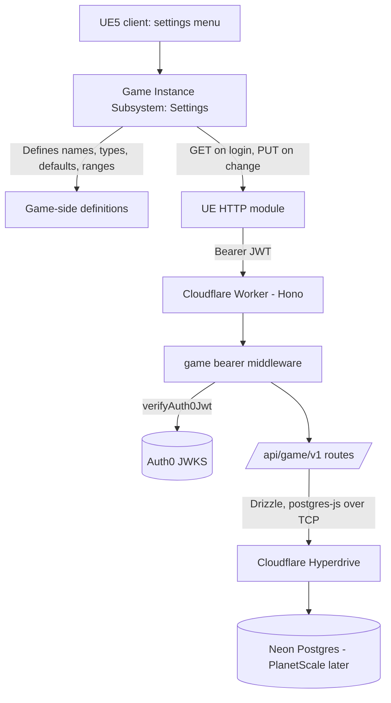

# RFC-0001: Unreal Engine 5 Account Auth & Global Settings API

- **Status**: **Draft**
- **Author(s)**: idant
- **Created**: 2026-10-26
- **Last Updated**: 2026-10-26
- **Discussion/PR**: TBD

---

## 1. Summary

Rimelight is building a cross-platform MMO. The Unreal Engine 5 (UE5) client, and later Unreal Engine 6, need to sign players in with a Rimelight account and save global, account-level settings from the in-game settings menu. Any part of the game reads those settings to decide its behavior (audio, video, controls, gameplay).

This RFC covers two things:

1. **Account auth.** Players sign in with their own email and password, managed by Auth0. Social login is out of scope.
2. **Global settings.** The server stores a generic, versioned settings document per player in Postgres. The game owns what each setting means: its name, type, default, and allowed range. The server checks only structure and size.

The work extends the existing `apps/rimelight.com` Cloudflare Worker (Hono, Drizzle, Neon, Auth0). It does not add a second backend.

Save-state (characters, inventory, game modes, progression) is out of scope and will be covered by a follow-up RFC.

---

## 2. Motivation

### 2.1. Current state

- **Users table exists.** `apps/rimelight.com/src/db/schema/users.ts` has a uuid PK, a nullable unique `auth0_id`, unique `email`, required `name`, and `tag` (default `"0000"`). The display identity is `name` plus `tag`.
- **Auth0 verification exists.** `packages/auth/src/jwt.ts` (`verifyJwtRs256`) and `packages/auth/src/adapters/auth0.ts` (`verifyAuth0Jwt`) verify RS256 tokens against the tenant JWKS, including issuer and audience.
- **Login exists.** `POST /api/auth/login` (and `/token`) performs an Auth0 Resource Owner Password (ROPC) exchange and returns tokens. `POST /api/auth/refresh` handles refresh. `syncAuth0UserToDb` upserts the user on login.
- **Settings do not exist.** No settings table, no settings routes, no game routes.

### 2.2. Problems

- Players have no account-scoped settings, so every launch starts from the game's defaults.
- A player whose token was issued by a path that skipped the sync has no `users` row, so the game API has to provision lazily.
- Game systems need one place to read settings, so each system does not fetch or interpret its own values.

### 2.3. Goals

- One identity per player (`users.id`, linked by `auth0_id`) across the website and the game.
- Email and password only, through Auth0.
- Bearer-token authentication for `/api/game/v1/*`. No cookies, no server-side sessions.
- The server stores settings as generic JSON and enforces structure, size, and rate. It does not need to know what any setting means.
- The game defines every setting (name, type, default, range) in one place, enforces it on read, and reads from a local cache through a Game Instance Subsystem.
- Portable SQL that works on Neon now and PlanetScale Postgres later.

### 2.4. Non-goals

- Social login (Steam, Epic, Google, Apple).
- Save-state of any kind: characters, inventory, progression, game modes. Separate RFC.
- Per-character or per-game-mode settings. Settings are global to the account in v1.
- MFA inside the game client. Auth0 handles MFA on its hosted pages.
- Employee and staff access. Employees keep their separate `employees` table and flows.
- Replacing the website's Auth0 Universal Login.

---

## 3. Detailed Design

### 3.1. Proposed API / Usage

#### 3.1.1. Endpoints

All game endpoints require `Authorization: Bearer <access_token>`, an Auth0 access token whose `aud` equals `AUTH0_AUDIENCE`.

| Method | Path                    | Purpose                                                                          |
| ------ | ----------------------- | -------------------------------------------------------------------------------- |
| `GET`  | `/api/game/v1/profile`  | Current player profile. Creates the `users` row on first call.                   |
| `GET`  | `/api/game/v1/settings` | The player's stored settings document and its version. Empty if none are stored. |
| `PUT`  | `/api/game/v1/settings` | Per-key merge into the stored document. Returns the merged document.             |

Login uses the existing `POST /api/auth/login` and `POST /api/auth/refresh`.

#### 3.1.2. Settings document

The stored document is two levels deep: a category, then a key, then a scalar value.

```json
{
  "audio": { "masterVolume": 0.8, "musicVolume": 0.5 },
  "video": { "qualityPreset": "high", "vsync": true },
  "controls": { "mouseSensitivity": 1.2 }
}
```

Allowed value types: string (max 256 characters), finite number, boolean, or `null`. `null` removes the key, so the game falls back to its default. Objects and arrays are not allowed as values.

Allowed names: categories and keys match `^[a-z][a-zA-Z0-9]{0,63}$`. Keys are case-sensitive. Names are chosen by the game; the server does not check whether a name is meaningful.

#### 3.1.3. Example payloads

```json
// GET /api/game/v1/profile
{
  "id": "5f1c2a8e-0d3b-4e8a-9b7e-2c1a6f0d9e11",
  "email": "player@example.com",
  "name": "Player",
  "tag": "0000",
  "created_at": "2026-10-26T12:00:00.000Z"
}
```

```json
// PUT /api/game/v1/settings  (only the keys being changed)
{
  "audio": { "masterVolume": 0.8 },
  "controls": { "mouseSensitivity": 1.2, "invertY": null }
}

// 200 response: the full stored document after the merge
{
  "success": true,
  "version": 7,
  "settings": {
    "audio": { "masterVolume": 0.8, "musicVolume": 0.5 },
    "video": { "qualityPreset": "high", "vsync": true },
    "controls": { "mouseSensitivity": 1.2 }
  }
}
```

`GET` on a player with no stored settings returns `{ "success": true, "version": 0, "settings": {} }`. Defaults are not stored or returned by the server.

#### 3.1.4. Error shape

Every error uses `{ "error": string, "message": string }`, matching the existing auth routes.

| Status | When                                                                                                                                                                                        |
| ------ | ------------------------------------------------------------------------------------------------------------------------------------------------------------------------------------------- |
| `400`  | Structure is invalid: not an object, nesting deeper than two levels, a name that fails the pattern, a value that is an object, array, or non-finite number, or a string over 256 characters |
| `401`  | Missing, malformed, expired, or invalid token                                                                                                                                               |
| `403`  | Wrong audience, or token `user_type` is not `player`                                                                                                                                        |
| `413`  | Body exceeds 16 KB, or the stored document would exceed 64 KB                                                                                                                               |
| `429`  | Rate limited                                                                                                                                                                                |

### 3.2. Architecture & File Structure



#### 3.2.1. Server files

Added:

- `apps/rimelight.com/src/db/schema/game.ts`: `userSettings` table, with relations.
- `apps/rimelight.com/src/api/routes/game/v1.ts`: game router, mounted at `/game/v1` in `src/api/server.ts`.
- `apps/rimelight.com/src/api/routes/game/middleware.ts`: bearer-token middleware built on `verifyAuth0Jwt`.
- `apps/rimelight.com/src/api/routes/game/settings.ts`: structural Zod schema and the merge function.
- `apps/rimelight.com/drizzle/<timestamp>_game_settings/`: generated migration.
- `docs/game-auth-setup.md`: Auth0 tenant setup (§3.3.2).

Modified:

- `apps/rimelight.com/src/db/schema/index.ts`: export `./game.ts`.
- `apps/rimelight.com/src/db/schema/relations.ts`: add the `userSettings` relation.
- `apps/rimelight.com/src/api/server.ts`: mount `/game/v1`.
- `apps/rimelight.com/cloudflare.config.ts`: add `AUTH0_DOMAIN` and `AUTH0_AUDIENCE` if `getAuth0ConfigFromEnv` does not already read them under those names. Reuse existing names.

Not added: a second auth middleware in `src/middleware/`, or any settings registry on the server.

### 3.3. Key Components

#### 3.3.1. Database schema

The primary key and foreign key use `users.id` (uuid). The Auth0 `sub` is looked up through `users.auth0_id`.

```typescript
// apps/rimelight.com/src/db/schema/game.ts (proposed)
import { integer, jsonb, pgTable, timestamp, uuid } from "drizzle-orm/pg-core";
import { users } from "./users.ts";

export const userSettings = pgTable("user_settings", {
  userId: uuid("user_id")
    .primaryKey()
    .references(() => users.id, { onDelete: "cascade" }),
  settings: jsonb("settings").$type<SettingsDocument>().default({}).notNull(),
  version: integer("version").default(0).notNull(),
  updatedAt: timestamp("updated_at", { withTimezone: true }).defaultNow().notNull(),
});
```

- `settings` holds whatever the game has written for this account, within the structural rules in §3.1.2.
- `version` starts at `0` (no row) and increments on every successful write. The game can compare it to decide whether to re-fetch.
- The server never stores defaults. A game-side default change applies to every player who has not written that key.

#### 3.3.2. Auth0 configuration

Tenant setup, documented in `docs/game-auth-setup.md`:

1. **API.** Create an API with identifier `https://api.<game-domain>/v1` and signing algorithm `RS256`. Set `AUTH0_AUDIENCE` to this identifier.
2. **Application.** Create a Native application for UE5. Enable the Password grant (off by default). Enable refresh token rotation.
3. **Tokens.** Access tokens expire after 15 minutes. Refresh tokens rotate on use.
4. **Connection.** Database connection only. No social connections enabled for the game application. Email verification required.
5. **MFA.** Enabled in tenant policy. The game client does not handle MFA challenges in v1. If an MFA-enabled account attempts ROPC, the login fails with a clear error, and the player is directed to complete MFA on the website. This is a known limitation.
6. **Custom claims.** An Auth0 Action adds `https://rimelight.com/user_type` (`player` or `employee`). The existing `mapAuth0PayloadToSession` reads it.
7. **Post-Login Action.** Not used. Users are created on first game API call (§3.3.3).

#### 3.3.3. Bearer middleware and lazy provisioning

```typescript
// apps/rimelight.com/src/api/routes/game/middleware.ts (proposed sketch)
import { createMiddleware } from "hono/factory";
import { verifyAuth0Jwt } from "@rimelight/auth/auth0";

export const requireGameToken = createMiddleware<{
  Bindings: Env;
  Variables: { jwtPayload: Record<string, any>; userId: string };
}>(async (c, next) => {
  const header = c.req.header("Authorization") ?? "";
  const token = header.startsWith("Bearer ") ? header.slice(7) : null;
  if (!token) return c.json({ error: "Unauthorized", message: "Missing bearer token." }, 401);

  const payload = await verifyAuth0Jwt(token, {
    domain: c.env.AUTH0_DOMAIN,
    audience: c.env.AUTH0_AUDIENCE, // single string; arrays skip the aud check
  });
  if (!payload?.sub) return c.json({ error: "Unauthorized", message: "Invalid token." }, 401);

  if (payload["https://rimelight.com/user_type"] !== "player") {
    return c.json({ error: "Forbidden", message: "Player account required." }, 403);
  }

  c.set("jwtPayload", payload);
  await next();
});
```

Lazy provisioning is a helper used by every game route:

- Insert into `users` with `auth0_id` = `sub`, `email` from the token, `name` defaulted from the email local part, and `tag` `"0000"`, using `INSERT ... ON CONFLICT (auth0_id) DO NOTHING`. Then select by `auth0_id`. Concurrent first calls are safe because of the unique constraint.
- `email` is unique. If a `users` row already exists with the same email but a different or null `auth0_id`, the request fails with `409` and is logged for manual review. It is not silently merged.

Cookie sessions are not read on `/api/game/v1/*`. The global `auth()` middleware in `fetch.ts` still runs but does not block these routes.

#### 3.3.4. Login flow for UE5

The UE5 client logs in with `POST /api/auth/login`. The Worker forwards email and password to Auth0's ROPC endpoint and returns Auth0 tokens. This is the existing implementation.

- Pros: Auth0 remains the single identity store, so `sub` matches the website. Rate limiting and logging live in one place.
- Cons: the Worker sees raw passwords. The endpoint needs rate limiting (§7.3) and must never log request bodies.

Direct Auth0 ROPC from the client is not used. Worker-issued game tokens are not used.

Token handling in the client:

- Store the refresh token in the OS credential store (Windows Credential Manager, macOS Keychain). Never in a plain config file.
- Refresh the access token shortly before expiry. On `401`, refresh once and retry once. If the refresh fails, return the player to the login screen.
- Do not log tokens.

#### 3.3.5. Server-side settings storage

The server handles `PUT` as follows:

1. Validate the body against the structural schema in §3.1.2 (`settings.ts`). Reject with `400` if it fails.
2. In one transaction, read the stored document, apply the per-key merge, and write it back with `version = version + 1`. `null` values remove their key. Enforce the 64 KB stored-document cap with `413`.
3. Return the merged document and the new version.

Because the merge is per key, two clients writing different keys do not overwrite each other. Two writes to the same key resolve as last-write-wins. The connection is a TCP Postgres connection through Hyperdrive, so the merge runs in a single transaction: lock the row, read it, apply the merge in TypeScript, and write it back with `version = version + 1`. A row lock (`SELECT ... FOR UPDATE`) keeps concurrent writes from overwriting each other. The behavior is as described here; the exact code is decided during implementation.

The server does not know what any setting means. Renaming or retiring a setting is a game-side change: the game stops reading the old key and ignores it. Stored values for retired keys are harmless and are dropped when the player next writes that category.

#### 3.3.6. Unreal Engine client

The game owns the settings definitions. Each entry in the game's definition table has:

- the category and key name,
- the type (`float`, `bool`, `string`, or enum),
- the default,
- the range or allowed values.

The definition table is the only place these are written. The settings menu reads it to build sliders and toggles, and the subsystem reads it to validate values.

Settings are read through a **Game Instance Subsystem** (`UGameInstanceSubsystem`). It lives for the whole session across level loads, and any actor, widget, or component can reach it through `GetGameInstance()->GetSubsystem<UGameSettingsSubsystem>()`.

```cpp
// Sketch only.
UCLASS()
class UGameSettingsSubsystem : public UGameInstanceSubsystem
{
    GENERATED_BODY()
public:
    virtual void Initialize(FSubsystemCollectionBase& Collection) override;

    // Returns the stored value if it is present and valid, otherwise the game default.
    // Never makes a network call.
    float GetFloat(FName Category, FName Key) const;
    bool GetBool(FName Category, FName Key) const;
    FString GetString(FName Category, FName Key) const;

    // Clamps to the definition's range, updates the local cache, broadcasts,
    // then PUTs the change in the background.
    void SetFloat(FName Category, FName Key, float Value);

    DECLARE_MULTICAST_DELEGATE_TwoParams(FOnSettingChanged, FName /*Category*/, FName /*Key*/);
    FOnSettingChanged OnSettingChanged;

private:
    TMap<FName, TMap<FName, FSettingValue>> Cache; // from GET, plus local writes
};
```

Behavior:

- **On login.** `GET /api/game/v1/settings` fills the cache. Until it arrives, reads return the game defaults.
- **Reads.** Always from the cache, and always checked against the definition. A stored value of the wrong type or outside its range falls back to the default. Unknown keys are ignored.
- **Writes.** Clamp to the definition, update the cache, broadcast `OnSettingChanged`, then send `PUT` in the background. On failure, keep the local value, retry with backoff, and do not discard the player's change.
- **Version.** Track the last server `version`. If a `PUT` returns a higher version than expected, re-fetch with `GET` and reconcile.

The UE6 port keeps the same HTTP contract and the same stored document. Only the subsystem implementation changes if the engine API changes.

### 3.4. Consolidation of earlier documents

`docs/ue5-auth-architecture.md` was removed when this RFC was created. Its content is folded in as follows:

- Auth0 as the single identity source, and the ROPC trade-offs (§3.3.4, §4).
- Token lifetime and OS credential storage (§3.3.4).
- The `players`/`employees` split is replaced by one `users` table with a `user_type` claim. Employees keep their own table.
- The Worker-issued JWT option, the social-login options, and the separate `players` table are not carried forward.
- PlanetScale is future. Neon is the current database.

---

## 4. Drawbacks & Trade-offs

- **The server accepts any well-formed setting.** A modified client can store values the game does not recognize. The game ignores or clamps them, so the effect is limited to that player's own game. Settings are not used for fairness, which keeps this acceptable. Any future setting that does affect other players must be checked server-side.
- **Raw passwords pass through the Worker.** Mitigation: rate limiting, no body logging, HTTPS only.
- **ROPC is discouraged by Auth0.** It must be enabled per application, and Auth0 may restrict it. This is a vendor-policy risk.
- **MFA is not supported in the game client in v1.** Players with MFA enabled must complete it on the website first.
- **Lazy provisioning.** `users` rows appear on first game call, not at account creation.
- **Definitions live only in the game.** Changing a default or range is a game build, with no server change. The trade-off is that the server cannot report what settings exist.
- **Settings are global.** Per-character or per-mode overrides will need a schema change later.
- **Shared Worker.** Game traffic shares a Worker with the website.

---

## 5. Alternatives Considered

1. **Worker-issued game tokens.** Rejected. It forks identity from Auth0 and adds a signing key to manage.
2. **Direct Auth0 ROPC from the client.** Rejected. It puts Auth0 client configuration in the game and bypasses our rate limiting.
3. **Social login (Device Authorization Grant).** Out of scope per decision.
4. **Server-side settings registry (TypeScript).** Rejected. It needs a duplicate definition in the game (the C++ mirror), and the two copies drift. The server gains little, because settings do not affect fairness.
5. **Settings fetched on every read.** Rejected. Settings are read constantly, so reads are local.
6. **Separate game backend service.** Rejected for v1. It duplicates auth, database access, and deploys.
7. **Separate `players` and `employees` tables.** Rejected. One `users` table with a `user_type` claim matches the existing schema.
8. **Typed JSON columns per setting.** Rejected. Every new setting would need a migration.

---

## 6. Adoption & Migration Strategy

- **Breaking change?** No. All changes are additive, plus small edits to the schema index, relations, server mount, and Cloudflare config.
- **Migration.** One generated migration adds `user_settings`. Run `drizzle-kit generate`, then `drizzle-kit migrate`. Do not use `drizzle-kit push` against shared environments.
- **Existing users.** No backfill. Rows are created on first game call.
- **Rollout order:** 0. Switch the app's database client to Hyperdrive with postgres-js, including the CMS's `getCmsDb`. Verify the CMS still works in production.
  1. Schema and migration.
  2. Bearer middleware, lazy provisioning, `GET /profile`.
  3. Structural validation, `GET` and `PUT /settings`.
  4. Rate limiting on `/api/auth/login` and on `PUT /settings`.
  5. UE5 definitions table, subsystem, and settings menu.
- **Database driver.** Move the whole app from `neon-http` to Hyperdrive with a TCP Postgres driver (`postgres` / postgres.js with `drizzle-orm/postgres-js`), with `nodejs_compat` enabled on the Worker. This covers `apps/rimelight.com/src/db/index.ts` and the CMS's `getCmsDb` in `packages/cms/src/db/index.ts`, which currently sends SQL over HTTP to `https://<host>/sql`. The rest of the app depends on the same client, so this is the first rollout step, not a later change.
- **PlanetScale later.** Keep SQL portable. The move is a separate RFC.

---

## 7. Cross-Cutting Concerns

### 7.1. Performance & Bundle Size

- Game routes add nothing to the website bundle.
- Settings reads in the game are local. The server sees one `GET` per login and one `PUT` per settings change batch.
- Each request does one indexed lookup on `users.auth0_id` and one primary-key read or write on `user_settings`.
- JWKS responses are cached by `verifyJwtRs256`.

### 7.2. Accessibility (a11y)

The API has no UI. The settings the game stores (text scale, subtitles, colorblind modes) need accessibility review in the UE5 UI, tracked separately.

### 7.3. Security & Privacy

- **Credential stuffing.** Rate limiting on `/api/auth/login`, using the `RATE_LIMIT` binding in `cloudflare.config.ts`, per IP and per account: 10 attempts per minute per IP, and 5 failed attempts per account per 15 minutes.
- **Write abuse.** Rate limit `PUT /settings` per account, and keep the 16 KB body and 64 KB stored-document caps.
- **Token validation.** RS256 only, `iss`, single-string `aud`, and `exp`. Reject `alg: none`. The existing verifier restricts algorithms to RS256.
- **Authorization.** `user_type` must be `player` on game routes (§3.3.3).
- **Data exposure.** Settings are visible only to their owner. Never return other users' rows. Never log bearer tokens or bodies.
- **Token storage.** OS credential store only (§3.3.4).
- **Privacy.** Settings are personal data. Document them in the privacy policy. Account deletion cascades to `user_settings`.

---

## 8. Verification & Testing Plan

### 8.1. Automated Tests

- **Middleware.** Missing token, wrong audience, wrong issuer, expired token, `alg: none`, `user_type = employee`, valid player token. Model on `packages/auth/test/jwt-native.test.ts` and `token-tampering-and-replay.test.ts`.
- **Provisioning.** First call creates the row. Second call returns the same row. Concurrent first calls create exactly one row. Email collision with a different `auth0_id` returns `409`.
- **Structural validation.** Accepts valid documents. Rejects non-object bodies, depth over two levels, invalid names, object or array values, non-finite numbers, and strings over 256 characters, each with `400`.
- **Merge.** `PUT` touches only the sent keys. `null` removes a key. `version` increments by one per write. Two concurrent writes to different keys both persist.
- **Limits.** Body over 16 KB returns `413`. A write that would exceed 64 KB stored returns `413`.
- **Game side.** Definition table: out-of-range and wrong-type stored values fall back to the default. Unknown keys are ignored. `SetFloat` clamps before sending.
- **Commands:**
  ```bash
  vp check
  vp test
  vp run -r build
  ```

### 8.2. Manual Verification

1. Run the Worker locally with `.dev.vars` pointing at a dev Auth0 tenant.
2. Log in with a test player through `POST /api/auth/login`.
3. `curl` each endpoint with and without the bearer token, and with an employee token.
4. In a minimal UE5 level, open the settings menu, change a value, restart the editor, log in again, and confirm the value persists.
5. Confirm that a website cookie alone does not authorize `/api/game/v1/*`.

---

## 9. Decisions

### 9.1. Resolved

| #   | Question               | Decision                                                                                |
| --- | ---------------------- | --------------------------------------------------------------------------------------- |
| 1   | Social login at launch | No. Email and password only.                                                            |
| 2   | In-game MFA at launch  | Auth0 handles MFA. The game has no step-up flow in v1.                                  |
| 3   | Settings key style     | Nested categories (`audio.masterVolume`).                                               |
| 4   | Settings merge         | Per key within each category. `null` removes a key.                                     |
| 5   | Save-state             | Out of scope. Separate RFC.                                                             |
| 7   | Naming                 | `profile`.                                                                              |
| 8   | Post-Login Action      | Not used. Lazy provisioning on first game call.                                         |
| 9   | PlanetScale timing     | Future. Separate RFC when scheduled.                                                    |
| 10  | Rate limits            | 10 login attempts per minute per IP; 5 failed attempts per account per 15 minutes.      |
| —   | Settings scope         | Global to the account. Not per character or mode.                                       |
| —   | Settings model         | Server stores generic, versioned JSON. The game owns definitions, defaults, and ranges. |
| —   | Client access          | Game Instance Subsystem with a local cache.                                             |
| —   | Database connection    | Hyperdrive with a TCP Postgres driver, app-wide.                                        |
| —   | Settings definitions   | Hand-written C++ table in the game module for v1.                                       |
| —   | Retired-key cleanup    | Lazy, on the next write to that category.                                               |

### 9.2. Open

1. **Production Hyperdrive host.** Before step 0 of the rollout, confirm in the Cloudflare dashboard which host the production `HYPERDRIVE` binding points to, so the CMS's current HTTP path can be checked against it.

**Resolved since last draft:**

- Retired-key cleanup is lazy, on the next write to that category. No cleanup endpoint.
- Settings definitions live in a C++ table in the game module for v1. A shared JSON file is a later option if more modules need the same defaults.
