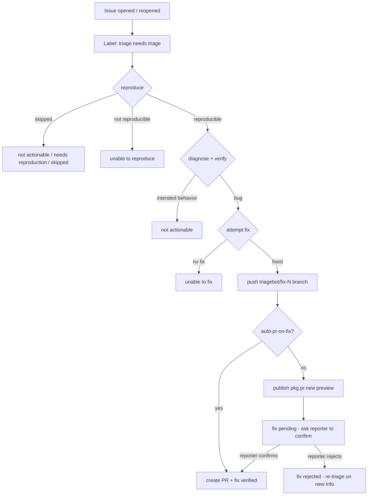

# RFC-0008: Automatic Issue Triage via `withastro/triagebot-action`

- **Status**: Draft
- **Author(s)**: Rimelight Engineering
- **Created**: 2026-09-22
- **Last Updated**: 2026-09-22
- **Discussion/PR**: [Link to PR/Issue]

---

## 1. Summary

Adopt [`withastro/triagebot-action`](https://github.com/withastro/triagebot-action) in the rimelight monorepo. On every new issue, the action runs a label-driven state machine backed by an AI agent that **reproduces** the reported bug, **diagnoses** the root cause, **verifies** it is actually a bug, and **attempts a fix**. If a fix is found it pushes a branch and publishes a preview release via pkg.pr.new; it only opens a pull request after the reporter confirms the fix (or immediately if we enable `auto-pr-on-fix`).

The action is a two-layer system: the **action-owned** layer (finite state machine encoded as GitHub labels, GitHub API interactions, LLM calls — all upstream, versioned by a pinned tag) and a **project-owned** layer (five skill files under `.agents/skills/triage/` that teach the agent how our monorepo builds, tests, and is structured). We own the skills; upstream owns the machinery. The same action is used in production on the Astro monorepo, and our repo matches its expected shape (`pnpm` workspace, `packages/*`, preview releases already published with `pkg-pr-new`).

The design is proven, not hypothetical (Astro's "How we built a software factory" engineering post): since turning this pipeline on, Astro drove its open issues from **200+ down to ~30 and is projecting zero** — a first in the repository's 5+ year history. Astro did this without auto-closing tickets or "issue bankruptcy"; the reduction came from treating every agent failure as a **signal about the codebase** (an opaque abstraction, missing documentation, or a test gap) rather than a bot defect, so each corrected failure improves the bot and the next human contributor at the same time.

**Recommendation: adopt with the confirmation flow enabled (`auto-pr-on-fix: false`), avoid auto-merging (never supported by the action), and drive LLM costs through Cloudflare Workers AI (Kimi K2) rather than the Anthropic defaults.**

---

## 2. Motivation

### Pain Points

- **Triage is manual and unprioritized.** Every incoming issue requires a maintainer to read it, reproduce it locally, find the root cause, and decide whether it is a real bug. This does not scale as the monorepo (8 packages, 2 apps) and external adopters grow.
- **Bug reports without reproductions stall.** Issues frequently lack enough detail to act on, and nothing enforces the "good reproduction" bar at the moment the issue is opened.
- **`fix verified` / `wontfix` signals are informal.** There is no persistent, label-driven record of what was triaged, which issues are awaiting reporter confirmation, and which are already fixed — the open-source convention we already use for the rest of GitHub tooling.
- **We are an Astro/Cloudflare shop.** We already run Flue-adjacent agent tooling (`vp`, `vite-plus`, `@rimelight/*` skills under `.agents/`) and already publish preview releases to pkg.pr.new on every push. The marginal cost of the triage pipeline is mostly configuration, not new infrastructure.
- **The failure mode is proven solvable in our exact peer group.** Astro's pipeline cut open issues from 200+ to ~30 in a few months and is heading to zero; the maintainers report the automation _increased_ meaningful human engagement (Discord, RFCs, feature work) rather than making the project feel like a bot-driven echo chamber (`src/` is public for auditing the agent's reasoning at any time).

### Goals

- Every issue gets a triage label within minutes of opening, plus a structured comment (reproduction status, diagnosis, verdict, fix attempt, priority and package labels).
- Actionable, reproducible bugs can reach a **testable preview release** without a maintainer writing the fix.
- Maintainers review the bot's work through normal GitHub review flow; **the bot never merges**.
- The pipeline runs entirely on GitHub Actions + our existing preview-release infra; no new long-running services.
- Establish a **self-improving loop**: when an agent fails, the fix is a comment, a test, or a clearer boundary — work that makes the bot better and the next human contributor better identically.

### Non-Goals

- Auto-merging pull requests. The action intentionally stops at PR creation; humans review and merge.
- Triage of pull request activity. The action never acts on PRs (`src/router.ts` returns `skip` for any PR event).
- Replacing our human maintenance process or CODEOWNERS; it augments it.
- Supporting arbitrary issue text meaningfully — non-actionable issues, feature requests, and environment-specific reports are labelled and parked.

---

## 3. Detailed Design

### 3.1. Proposed Configuration

Add a single workflow file:

```yaml
# .github/workflows/triage.yml
name: Issue Triage

on:
  issues:
    types: [opened, reopened, closed]
  issue_comment:
    types: [created]

permissions: {}

concurrency:
  group: triage-${{ github.event.issue.number }}
  cancel-in-progress: false

jobs:
  triage:
    runs-on: ubuntu-latest
    timeout-minutes: 60
    permissions:
      contents: read
      issues: read
      id-token: write
    steps:
      - uses: actions/checkout@v4
        with:
          fetch-depth: 0
          persist-credentials: false

      - uses: withastro/triagebot-action@v1
        with:
          read-token: ${{ secrets.GITHUB_TOKEN }}
          write-token: ${{ secrets.BOT_GITHUB_TOKEN }}
          cloudflare-api-key: ${{ secrets.CLOUDFLARE_API_KEY }}
          cloudflare-account-id: ${{ secrets.CLOUDFLARE_ACCOUNT_ID }}
          triage-model: cloudflare-workers-ai/@cf/moonshotai/kimi-k2.7-code
          verification-model: cloudflare-workers-ai/@cf/moonshotai/kimi-k2.6
          triage-skill: .agents/skills/triage
          bot-logins: rimelight-bot
```

Two tokens are required:

- **`read-token`**: the default `GITHUB_TOKEN` (issue/label/PR reads).
- **`write-token`** (`BOT_GITHUB_TOKEN`): a GitHub App token or PAT with write access to issues and contents — it posts comments, swaps labels, force-pushes `triagebot/fix-<n>` branches, and creates PRs.

LLM credentials: one of Anthropic, OpenAI, or Cloudflare Workers AI. **Recommendation: Cloudflare Workers AI (Kimi K2)**, because we already operate a Cloudflare account for `rimelight.com`/`starter.rimelight.com` (Wrangler, D1, Drizzle), `CLOUDFLARE_ACCOUNT_ID` likely already exists in org secrets, and Kimi K2 is dramatically cheaper than the Anthropic defaults (`claude-opus-4-6` for triage, `claude-sonnet-4-6` for verification) while running over an OpenAI-compatible REST endpoint on a standard runner.

Alternatively, for maximum quality we can use the Anthropic defaults and accept the higher per-issue cost; the model choices are isolated in action inputs so we can switch providers without touching the pipeline.

### 3.2. Architecture & File Structure

Files added/modified:

```
.github/workflows/triage.yml          # new
.agents/skills/triage/SKILL.md        # new — orchestration: step order and early exits
.agents/skills/triage/reproduce.md    # new — how to reproduce bugs in our repo
.agents/skills/triage/diagnose.md     # new — how to find root causes in our packages
.agents/skills/triage/verify.md       # new — how to distinguish bugs from intended behavior
.agents/skills/triage/fix.md          # new — how to write and verify fixes
```

Starter templates are provided upstream in the repo's `examples/skills/triage/` directory with `<!-- CUSTOMIZE -->` markers; the production reference is `withastro/astro` `.agents/skills/triage`.

The action flow (verified against `src/`):



Key mechanics from the source:

- **Isolated subagents per phase.** Each pipeline stage (`reproduce`, `diagnose`, `verify`, `fix`) runs as its own isolated subagent; findings are compiled into a `report.md` and handed forward sequentially rather than kept in one long-running context. Astro shipped this specifically to defeat the LLM bias toward forcing a fix even when the reported behavior isn't a bug — each agent's reasoning and shell history is also posted back to the issue for full auditability.
- **Retries:** pipeline failures are recorded with an HTML marker comment; retried up to `MAX_TRIAGE_FAILURES = 3`, then parked on `triage: failed` until a maintainer intervenes (`src/triage.ts`).
- **Fix branch:** created as `git checkout -B triagebot/fix-<n>` on top of `main`, force-pushed with the write token. The agent's working changes never land directly on `main` (`src/triage.ts`).
- **Preview release:** run via `pnpm dlx pkg-pr-new publish --pnpm --compact --no-template --comment=off ...` over changed package directories, resolved against `git diff main`. The changed-packages regex (`packages/...`) matches our `packages/*` layout.
- **PR creation:** only happens on reporter confirmation (default flow) or immediately with `auto-pr-on-fix: true`. PR base is `main`. The PR gets the `fix verified` label.
- **Branch cleanup:** closing the issue triggers a cleanup handler that removes the fix branch.
- **Re-triage:** new comments on re-triageable labels are evaluated for new actionable information before re-running (`src/retriage.ts`).

### 3.3. Key Components

1. **FSM router** (`src/router.ts`) — maps `(event, current label)` to one of `triage`, `verify-fix`, `retriage`, `cleanup`, `skip`. Ignoring bot logins prevents self-triggering loops.
2. **Triage pipeline handler** (`src/handlers/triage.ts`) — runs the four Flue skill steps in order, with early exits at reproduce/verify; commits, force-pushes, publishes previews, generates the comment, swaps labels, and selects priority + package labels from repo-defined label lists.
3. **Fix verification handler** (`src/handlers/verify-fix.ts`) — classifies the latest non-bot comment as `confirmed` / `rejected` / `inconclusive` (LLM) and creates the PR only on `confirmed`.
4. **Project skills** — the five `.agents/skills/triage/*.md` files we own. Quality gate: how well the agent reproduces and fixes depends almost entirely on these.
5. **Label set** — ten `triage:*` labels plus the PR `fix verified` label; all names are customizable via inputs; defaults mimic Astro's convention. Labels are created on first use by the write token.

### 3.4. Failure Is a Design Signal (Upstream Track Record)

Astro's operational philosophy — and our operating assumption — is that the agents should resolve the **vast majority** of incoming issues. When one fails, that failure is treated as evidence of a code-health problem, not a bot defect, pointing to one of three areas:

1. **Opaque Abstractions** — the agent cannot interpret the boundary between components; neither can humans.
2. **Missing Documentation** — critical code lacks comments explaining _why_ it is written that way.
3. **Insufficient Testing** — the repo lacks unit tests around the affected logic.

The canonical example from Astro: a cluster of Hot Module Replacement (HMR) bugs where the bot repeatedly rewrote a single `if` condition. Each change fixed the reported bug but regressed something else, because that condition had no test coverage. Astro added a descriptive comment explaining the exact logic governing the statement; the bot stopped making incorrect modifications there.

The practical consequence for rimelight: **we should expect to budget recurring, small code-health commits** (comments, tests, boundary clarifications) in the first months of operation. Each one measurably improves the bot's fix rate and simultaneously de-risks the codebase for our own developers. The RFC's decision to start with `auto-pr-on-fix: false` is what makes this feedback loop safe: premature PRs would surface these failures directly into the review queue instead of behind a reporter confirmation gate.

---

## 4. Drawbacks & Trade-offs

- **Recurring cost is volume-proportional.** Each issue drives multiple LLM agent sessions (reproduce, diagnose, verify, fix, comment/label generation, plus verification classification and retriage checks). With the default Anthropic models this is expensive per issue (potentially dollars' worth of tokens on a hard reproduction); with Cloudflare Kimi K2 the cost is an order of magnitude lower. If our issue volume stays low (the current reality), even the Anthropic option is affordable, but we should monitor usage.
- **GitHub Actions minutes.** The repo is private, so actions minutes are metered beyond the free quota (2,000 min/month on the free plan). The workflow has a 60-minute timeout and a hard reproduction can legitimately run 10–30+ minutes of runner time (installs, builds, tests) before the pipeline concludes. Expect minutes to be the first budget line to notice.
- **Autonomy boundary is a real risk.** The agent executes arbitrary shell commands on the runner (build, install, test) with a write token in the environment and force-pushes branches. Mitigations: scoped GitHub App token, no auto-merge, `runs-on: ubuntu-latest` ephemeral runner, and human review of the generated PR. The agent also has `GITHUB_*` context but not cloud credentials (no Cloudflare keys are needed to run the action itself).
- **Skill-file quality is the ceiling.** Generic skills will reproduce/fix nothing useful and burn tokens; writing and iterating the five skill files is a genuine, ongoing engineering cost.
- **Upstream is deliberately "young and evolving."** Astro ships `triagebot-action` as a working reference rather than a finished product and expects teams to fork or adapt it. Expect upstream churn; we pin to a reviewed tag and treat the repository as reading material we can fork if it diverges from our needs.
- **Label clutter / issue noise.** Ten `triage:*` labels on the repo and an automated comment on every issue. Acceptable for a public-facing repo; worth calling out if the org prefers minimal issue surfaces.
- **LLM classification is fallible.** Reporter comments are classified as confirmed/rejected by an LLM; edge cases (reporters who say "works" but actually only acknowledged) are possible. The `inconclusive` path takes no action, which bounds the damage.

---

## 5. Alternatives Considered

- **A. Astro's production setup as-is (`auto-pr-on-fix: false`) — RECOMMENDED.** Human confirmation gate on every fix; preview releases stay publishable by us through the existing `preview.yml` flow regardless. This is exactly the (Cloudflare Kimi) configuration Astro runs in production today to drive its backlog toward zero.
- **B. `auto-pr-on-fix: true`.** PRs open the moment a fix is pushed, skipping the preview/confirmation loop — higher throughput and no reporter round-trip, but the bot's unconfirmed diagnosis reaches our PR queue automatically. Rejected for v1; revisit when the skills are proven on a batch of issues.
- **C. GitHub Copilot (built-in) Actions / Copilot code review on issues.** Not label-driven, no reproduction pipeline, no preview releases; it reviews PRs rather than triaging issues. Not a substitute; could complement later.
- **D. In-house bot (Flue + our own FSM).** Maximum control, but duplicates an entire well-tested upstream system (state machine, GitHub interactions, retries, branch cleanup) for zero marginal benefit. Only worth it if we need deep divergence from the upstream model.
- **E. Do nothing / manual triage.** The status quo; no cost, no automation, but no reproduction discipline either. Not viable once external consumers file issues.
- **F. Alternatives rejected on license/scope:** other issue bots (e.g., OpsBot, Zulip-style) don't run an agent pipeline with preview publishing; `pkg-pr-new` overlay via the action's `--comment=off` flag is used precisely so previews don't double-comment given our existing `preview.yml`.

---

## 6. Adoption & Migration Strategy

- **Non-breaking.** Adds a workflow, five skill files, and ten labels to the rimelight repo. No package code changes, no runtime/dependency changes.
- **Phases:**
  1. **Pilot (this repo):** add workflow + skills, seed the ten labels, set `auto-pr-on-fix: false`, model = Cloudflare Kimi. Verify on a handful of synthetic bug issues (opened by staff).
  2. **Soft-launch:** keep the confirmation gate; monitor cost (Actions minutes + LLM usage) and fix quality for 2–4 weeks.
  3. **Harden:** if PR quality and costs are acceptable, consider `auto-pr-on-fix: true`; if quality lags, invest in the skill files rather than adding models.
- **Secrets to provision before rollout:** `BOT_GITHUB_TOKEN` (GitHub App, issues + contents write, org-scoped), `CLOUDFLARE_API_KEY` (Workers AI tag) and `CLOUDFLARE_ACCOUNT_ID`.
- **Backward compatibility:** nothing existing breaks; `preview.yml` continues to publish on every push including bot branches.

---

## 7. Cross-Cutting Concerns

### 7.1. Performance & Bundle Size

- No runtime impact: the action never ships code into any package or app — it operates purely on the GitHub API and the CI runner. No bundle size, SSR, or page-load effect.

### 7.2. Accessibility (a11y)

- Not applicable. No UI is added to any Rimelight product.

### 7.3. Security & Privacy

- The runner environment must not receive cloud credentials; the workflow only exposes `GITHUB_TOKEN`/`BOT_GITHUB_TOKEN` and the Workers AI key to the job. The agent's shell access has no network-path into D1/wrangler secrets.
- The write token is the highest-value secret (force-push + PR creation); use a dedicated GitHub App with the narrowest scopes, and rotate if the repo's membership changes.
- LLM prompting sends issue text + our repository (via tool calls) to the model provider. Public issue content only is sent in the _verification_ path; during triage the agent operates locally on the checkout. Acceptable for open-source content; flag if we start triaging private/security-sensitive repos in the future — **security reports should continue to use GitHub's private vulnerability reporting, outside this bot's scope**.
- No new dependencies are added to packages (no `package.json` bloat); only a CI workflow and markdown skills.

---

## 8. Verification & Testing Plan

### 8.1. Automated Tests

- The action ships its own unit and LLM-eval suites upstream (`pnpm test`, `pnpm test:evals`); we do not re-implement them.
- Run standard checks on the skill files and workflow (YAML validity):
  ```bash
  vp check
  vp test
  ```

### 8.2. Manual Verification (Pilot Checklist)

1. Create the ten `triage:*` labels in the repo settings (or let the bot create them on first use).
2. Open a synthetic bug issue with a clear reproduction (e.g., in `@rimelight/ui` or `@rimelight/seo`) and confirm the label sequence: `needs triage` → reproduced → preview release URLs in the comment → `fix pending`.
3. Reply "it works" on the issue and confirm a PR is created with the `fix verified` label; reply with "still broken" on another and confirm `fix rejected`.
4. Open a feature-request style issue and confirm it lands on `not actionable` without a fix attempt.
5. Close a `fix pending` issue and confirm the branch cleanup runs.
6. Review the Actions minutes and LLM usage dashboard after the pilot batch; compare expected cost per issue against the budget in section 4.
7. Audit a sample of agent failures against section 3.4: each failure should resolve to an opaque abstraction, a missing comment, or a test gap — if it instead indicates a bot defect, capture it as feedback for the skill files or as an upstream issue.

---

## 9. Unresolved Questions

1. **Budget ceiling:** what is the acceptable per-issue cost target (LLM + Actions minutes)? This drives whether we stay on Cloudflare Kimi or allow the Anthropic Opus defaults for hard reproductions.
2. **Pilot scope:** do we pilot on the rimelight monorepo only, or also seed it on a client repo (e.g., `queerkit.com` / `idantity.me`) where the skills would need adaptation?
3. **Issue volume forecast:** what intake do we actually expect? Astro's win (200+ → ~30 over a few months) came at high volume; if our intake is near-zero for months, does the maintenance overhead justify the automation, or is this a hedge for when external adopters start filing?
4. **`auto-pr-on-fix` timing:** after the soft-launch, what quality bar do we publish for flipping it on? (Suggestion: N consecutive accepted `/ reviewed` bot PRs.)
5. **Label org conventions:** do we adopt Astro's exact label names (`triage: ...`) or shorten them to a Rimelight convention before the bot creates them? Renaming later is a config change but re-deriving history is messy.
6. **Notification routing:** who gets pinged when an issue lands on `triage: failed` or `triage: fix rejected` repeatedly?
7. **Security-sensitive issue flow:** confirm private vulnerability reports stay entirely outside the triage workflow (they fire on `issues` events only from public/standard issue creation; verify the org's settings).
