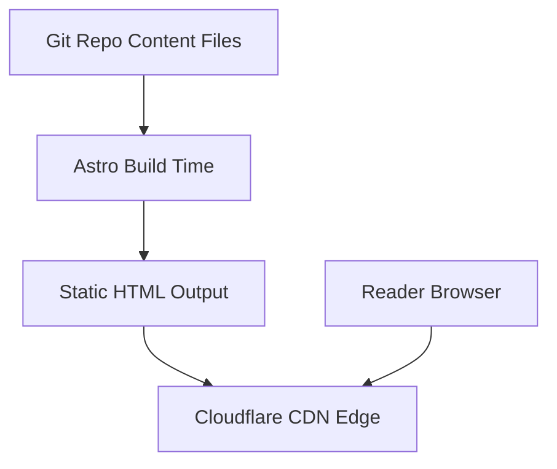
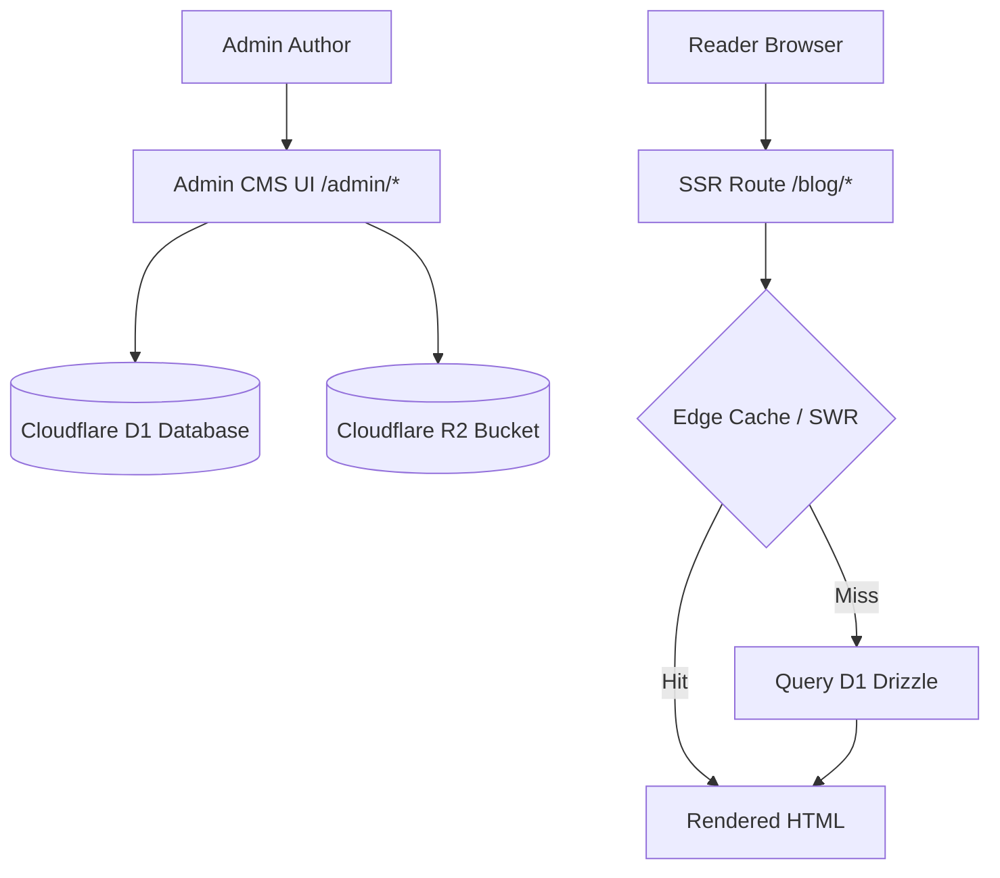

# RFC: Migrating Content (Blog, Docs, Legal) to D1 & R2 Serverless Architecture

## Status
* **Proposed**: June 14, 2026
* **Author**: Antigravity (Coding Assistant)

---

## 1. Context & Objectives

Currently, `starter.rimelight.com` uses Astro's file-based Content Collections (`astro:content` via glob loaders reading from `src/content/`) for blog posts, documentation, and legal documents. While file-based content is convenient for developers, it presents several limitations:
1. **Author Friction**: Editors must use Git, clone the repo, format markdown, and commit changes to publish.
2. **Build Overhead**: Any typo fix, new post, or image addition requires triggering a full project rebuild and deployment (~40+ seconds).
3. **Media Management**: Adding images requires manually uploading, compressing, and referencing local files or external links.

### Objectives
* Transition **blog posts, documentation pages, and legal documents** from static files inside the repo to Cloudflare D1 (SQLite) and Cloudflare R2 (Blob Storage).
* Provide a zero-friction **Admin CMS Panel** allowing real-time publishing, editing, and paste-to-upload WebP compressed media without requiring Git commits or site rebuilds.
* Maintain edge caching performance to keep pages loading instantly (<50ms).

---

## 2. Current vs. Proposed Architecture

### Current


### Proposed


---

## 3. Database Schemas

We will expand our Drizzle schemas to manage blog posts, documentation categories, and legal documents.

```typescript
// src/db/schema/content.ts
import { sqliteTable, text, integer } from "drizzle-orm/sqlite-core";

// Base table for all text content structures
export const d1Content = sqliteTable("d1_content", {
  id: text("id").primaryKey().$defaultFn(() => crypto.randomUUID()),
  contentType: text("content_type").notNull(), // 'blog' | 'docs' | 'legal'
  locale: text("locale").default("en").notNull(),
  slug: text("slug").notNull(),
  title: text("title").notNull(),
  description: text("description"),
  content: text("content").notNull(), // Markdown/MDX raw text
  coverImage: text("cover_image"),
  metadata: text("metadata"), // JSON string for content-type specific attributes
  status: text("status").default("draft").notNull(), // 'draft' | 'published'
  createdAt: integer("created_at", { mode: "timestamp" }).$defaultFn(() => new Date()).notNull(),
  updatedAt: integer("updated_at", { mode: "timestamp" }).$onUpdate(() => new Date()).notNull(),
});
```

---

## 4. Necessary Changes

### 4.1. Seeding / Migration Script
Before swapping routes, we need a CLI utility script to read existing Markdown/MDX files in `src/content/**/*`, parse frontmatter, and seed them into the D1 local/remote databases.
* **Script location**: `scripts/migrate-md-to-d1.ts`
* **Command**: `npx wrangler d1 execute DB --local --file=...` (or a node execution script inserting via drizzle).

### 4.2. Route Modifications
Currently, routes utilize `getEntry('blog', ...)` or glob loader files.
* **Blog Route** ([src/pages/[locale]/blog/[...slug].astro](file:///c:/Users/idant/WebstormProjects/rimelight/packages/starter.rimelight.com/src/pages/[locale]/blog/[...slug].astro)):
  * Remove `import { getEntry } from 'astro:content'`.
  * Replace with a Drizzle query fetching by slug and locale:
    ```typescript
    const post = await db.select()
      .from(d1Content)
      .where(and(
        eq(d1Content.slug, slug),
        eq(d1Content.contentType, 'blog'),
        eq(d1Content.locale, activeLocale),
        eq(d1Content.status, 'published')
      )).get();
    ```
* **Docs & Legal Routes**: Make similar changes to query from the `d1Content` table.

### 4.3. Search Index Sync
Currently, [syncSearch.ts](file:///c:/Users/idant/WebstormProjects/rimelight/packages/starter.rimelight.com/src/pages/api/syncSearch.ts) reads from local files to populate the `search_index` virtual table.
* **Change**: Update the search sync routine to load entries directly from the `d1Content` database table.

### 4.4. RSS & Sitemap Generation
* **RSS** ([rss.xml.js](file:///c:/Users/idant/WebstormProjects/rimelight/packages/starter.rimelight.com/src/pages/rss.xml.js)): Query D1 for published blog posts instead of calling `getCollection('blog')`.
* **Sitemap**: Astro's sitemap integration depends on static routes or endpoints. We will need to write custom sitemap handlers or configure dynamic sitemap helper hooks to read the slugs list from D1.

---

## 5. Security (Authentication & Authorization)

### Temporary Transition State (Basic Auth)
For local testing and the initial transition phase, the CMS routes (`/admin/*`) are temporarily protected via **HTTP Basic Auth**:

#### 1. Credentials
* **Local Development**: 
  * **Username**: `admin`
  * **Password**: `admin` (configured in your local-only, git-ignored `.dev.vars` file).
* **Production Deployment**: 
  * **Username**: `admin`
  * **Password**: Whatever secret string you configure on Cloudflare (see step 3).

#### 2. User Experience (No Login Page)
There is no HTML login page. When you navigate to `/admin/*`, the server returns a `401 Unauthorized` response with a `WWW-Authenticate: Basic realm="Admin"` header. Your web browser will intercept this and automatically show a **native browser login prompt** asking for the Username and Password.

#### 3. Setting Production Secrets on Cloudflare
Do **not** commit production passwords to the repository. Instead, configure it in Cloudflare using one of the following methods:

**Option A (Terminal / Wrangler CLI)**:
Run the following command from your terminal. It will prompt you to type the secret password securely:
```bash
# For Cloudflare Pages:
npx wrangler pages secret put ADMIN_PASSWORD

# For Cloudflare Workers:
npx wrangler secret put ADMIN_PASSWORD
```

**Option B (Cloudflare Dashboard)**:
1. Log in to the Cloudflare Dashboard -> **Workers & Pages** -> Select your project.
2. Go to **Settings** -> **Variables**.
3. Under **Environment variables**, click **Add variable**.
4. Name: `ADMIN_PASSWORD` | Type: **Encrypt (Secret)** | Value: `YourSecurePasswordHere`.
5. Save and deploy.

---

### Production State (Better-Auth Integration)
All `/admin/*` operations and `/api/upload` endpoints will ultimately be migrated to use the project's pre-configured **Better-Auth** middleware:
1. Enforce that only users with the `admin` role can access CMS dashboards and upload endpoints.
2. Require CSRF token headers for form submissions and uploads.

---

## 6. Performance & Caching Strategy

Since database queries are slower than static files, we will leverage **Stale-While-Revalidate (SWR)** and Edge caching in Astro:
```typescript
// astro.config.ts
routeRules: {
  "/[locale]/blog/[...slug]": {
    swr: 3600 // Cache for 1 hour, revalidate in background
  },
  "/[locale]/docs/[...slug]": {
    swr: 86400 // Cache for 24 hours
  }
}
```
This guarantees a `<50ms` TTFB since the Cloudflare Edge network serves the cached HTML instantly while refreshing the content in the background from D1 when changes occur.
