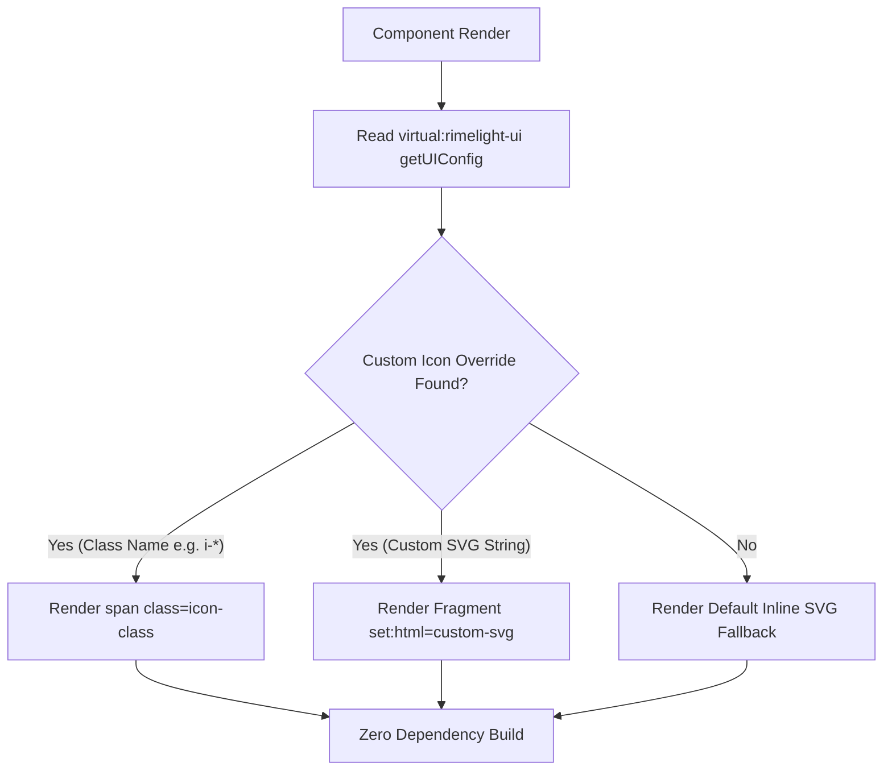

# RFC-0004: Decoupling Icon Dependencies via Slot Fallbacks & Inline SVGs

- **Status**: **Draft**
- **Author(s)**: Antigravity / AI Coding Assistant
- **Created**: 2026-07-02
- **Last Updated**: 2026-07-02
- **Discussion/PR**: N/A

---

## 1. Summary

This proposal addresses the build-time dependency on `@iconify-json/lucide` in `@rimelight/ui`. Currently, the library hardcodes UnoCSS icon classes (`i-lucide-*`), forcing downstream applications to resolve this large JSON icon package at compile time.

We propose decoupling this dependency entirely by utilizing **native slot fallbacks** containing a tiny set of **inlined, optimized SVGs** directly inside the component templates. Consumers retain full override flexibility via slot injections, while downstream build dependencies and resolution warnings are completely eliminated.

---

## 2. Motivation

- **Strict package manager constraints**: In strict, non-hoisted pnpm workspaces, downstream projects consuming `@rimelight/ui` struggle to resolve `@iconify-json/lucide` unless it is explicitly hoisted or declared in their root `dependencies`.
- **Zero-config & offline builds**: Developers should be able to drop `@rimelight/ui` into an Astro app and have standard components (Accordions, Selects, Buttons) compile and render icons successfully with zero configuration, even in restricted/offline CI environments.
- **Dependency bloat**: Downstream consumers shouldn't download a package containing 10,000+ icon definitions when the UI library only requires ~12 standard UI icons for its default layout states.

---

## 3. Detailed Design

### 3.1. Proposed API / Usage

The default slot fallback renders our local, static SVGs automatically. The consumer does not have to change how they use standard components.

```astro
<!-- 1. Default usage (uses internal inline SVGs inside slots) -->
<RLAAccordion title="FAQ">
  Default accordion renders default chevron-down SVG.
</RLAAccordion>

<!-- 2. Overriding default icons via standard slots -->
<RLAAccordion title="FAQ">
  <span slot="trailing-icon" class="i-heroicons-arrow-circle-down" />
  Custom icon from another package will completely override the default fallback.
</RLAAccordion>
```

#### Global Overrides via Integration Configuration

Like Nuxt UI, consumers can override the default icons globally inside the Astro integration configuration in `astro.config.ts`. They can map standard keys to custom icon classes or raw SVG strings.

We define a strong TypeScript interface to provide autocomplete and validation:

```typescript
export interface RimelightIcons {
  chevronDown?: string
  chevronRight?: string
  chevronLeft?: string
  close?: string
  check?: string
  uploadCloud?: string
  loaderCircle?: string
  search?: string
  info?: string
  alertTriangle?: string
  circleX?: string
  circleCheck?: string
  [key: string]: string | undefined
}

// In astro.config.ts
import { defineConfig } from "astro/config"
import { ui } from "@rimelight/ui/integrations"

export default defineConfig({
  integrations: [
    ui({
      icons: {
        chevronDown: "i-heroicons-chevron-down-20-solid",
        close: "i-lucide-x",
        loaderCircle: "i-svg-spinners-clock"
      }
    })
  ]
})
```

---

### 3.2. Architecture & File Structure

Default icons will be declared in a centralized icons file inside `@rimelight/ui/src/utils/icons.ts` or directly within the component templates where appropriate.



---

### 3.3. Global Icon Override System & Styling Wrappers

Under the hood, `@rimelight/ui` maps keys to class names or SVG strings. The component template dynamically resolves if the icon is a CSS class or an inline SVG string.

#### Sizing and Animation Wrappers

To ensure consistent sizing (`w-4 h-4`, etc.) and micro-animations (such as rotating on open) function correctly whether using a class name override, an inline SVG fallback, or a custom slotted element, components should wrap the slot in a dedicated wrapper element.

Furthermore, all local inline SVG definitions must omit static `width` and `height` attributes (defining only `viewBox="0 0 24 24"`) and inherit dimensions (`width="100%" height="100%"` or via CSS classes).

```astro
---
// RLAAccordion.astro
import { getUIConfig } from "virtual:rimelight-ui"
import { DEFAULT_ICONS } from "../../utils/icons"

const config = getUIConfig()
const resolvedIcon = config.icons?.chevronDown || DEFAULT_ICONS.chevronDown
const isClassName = typeof resolvedIcon === "string" && resolvedIcon.startsWith("i-")
---
<button class="accordion-trigger group">
  <slot name="title" />

  <!-- The wrapper controls base size and animation, regardless of the underlying icon strategy -->
  <span class="w-4 h-4 shrink-0 transition-transform duration-200 group-open:rotate-180">
    <slot name="trailing-icon">
      {isClassName ? (
        <span class:list={[resolvedIcon, "w-full h-full block"]} />
      ) : (
        <Fragment set:html={resolvedIcon} />
      )}
    </slot>
  </span>
</button>
```

> [!IMPORTANT]
> If a custom element is injected via the slot (`slot="trailing-icon"`), it replaces the slot contents but remains wrapped by the parent `<span>` wrapper. This preserves the layout constraints and CSS transitions. If consumers wish to completely bypass the wrapper styling (e.g. override sizing), they can apply style overrides or custom selectors.

---

### 3.4. Key Components

1. **`packages/ui/src/utils/icons.ts`**: Contains optimized SVG strings for the core set of default icons:
   - `chevron-down` / `chevron-right` / `chevron-left`
   - `close` (X)
   - `check` (checkmark)
   - `upload-cloud`
   - `loader-circle` (spinner)
   - `search`
   - `info` / `alert-triangle` / `circle-x` / `circle-check` (callout states)
2. **`packages/ui/src/integrations/ui.ts`**: Added `icons` dictionary option to the `UIOptions` integration schema and passed them into the virtual config.
3. **Component Templates**: Replace the hardcoded `i-lucide-*` `<span>` elements with a `<slot>` block wrapping the fallback inline SVG or resolved class name.

---

## 4. Drawbacks & Trade-offs

- **Small Source Size Increase**: Inlining raw SVG path strings adds a tiny amount of static text to the library templates (a few KBs in total), though this is practically negligible.
- **Maintenance Cost**: If we want to change a default icon, we must update the local SVG path strings instead of changing a string class name.

---

## 5. Alternatives Considered

1. **Peer Dependencies**: Move `@iconify-json/lucide` to `peerDependencies`. _Rejected_: Triggers peer installation warnings for consumers, and breaks their builds if they ignore the warnings.
2. **Dynamic Runtime Icons**: Load icons in the browser asynchronously via Iconify's API script. _Rejected_: Causes layout shifting (CLS) and fails completely in offline web apps.
3. **Pure Option 5 (No Default Icons)**: Forcing consumers to supply an icon for every Accordion, Dropdown, or Button. _Rejected_: Ruins the developer experience and layout defaults.
4. **Local SVG Files (`.svg`) instead of Inline TS Strings**: Storing the assets as standalone files in the repository. _Rejected_: Astro/Vite packages have difficulty resolving relative asset path endpoints across SSR and production environments (especially when hosted in serverless contexts like Cloudflare Pages). Standalone SVGs also require file-system reading (`fs`) or raw Vite loaders at build time, whereas TS inline strings are easily imported, typed, and tree-shaken as standard code.

---

## 6. Adoption & Migration Strategy

This is a non-breaking, fully backward-compatible change:

- **Existing overrides**: Users who are currently passing custom icons via slots will continue to see their custom icons override the defaults.
- **Default users**: Users currently relying on the default icons will see their chevrons/spinners transition to raw SVGs inline, requiring zero changes in their project configurations.
- **Cleanup**: Consumers can safely remove `@iconify-json/lucide` from their package configuration if they don't use it elsewhere in their applications.

### Documentation Updates (`rimelight.com`)

The documentation inside `packages/rimelight.com/src/content/docs/v1/en/packages/rimelight-ui/architecture/icons.mdx` will be updated to:

1. **Remove standard Lucide dependencies** from the Setup guidelines, indicating it is no longer required for core components to render out-of-the-box.
2. **Document global overrides** by highlighting the new `icons` integration option interface, showing clear examples of injecting custom CSS class prefixes and raw SVGs.

---

## 7. Cross-Cutting Concerns

### 7.1. Performance & Bundle Size

- **Build speed**: Speeds up the compilation process in UnoCSS as it no longer needs to resolve external icon packages.
- **Runtime bundle**: Zero impact on downstream applications. Only the specific SVGs embedded in the imported components will be shipped to the client.

### 7.2. Accessibility (a11y)

All default fallback SVGs will feature appropriate accessibility attributes (e.g., `aria-hidden="true"`, `focusable="false"`) to prevent screen readers from reading them as text content.

### 7.3. Security & Privacy

Decreases supply chain risk by removing a third-party dependency from the package graph.

---

## 8. Visual Verification Plan (Temporary Test Page)

To verify the visual output of the inline fallback SVGs, global configuration overrides, and slot overrides side-by-side without committing tests to git, reviewers can follow this visual smoke test procedure.

### Step 1: Create a Temporary Page

Create an untracked file at `packages/rimelight.com/src/pages/test-icons.astro`:

```astro
---
// packages/rimelight.com/src/pages/test-icons.astro
import RLAAccordion from "@rimelight/ui/components/astro/RLAAccordion.astro"
import RLAApp from "@rimelight/ui/components/astro/RLAApp.astro"
import RLAButton from "@rimelight/ui/components/astro/RLAButton.astro"

// Test config values directly (simulating virtual:rimelight-ui resolution values)
const mockRawSvg = `<svg viewBox="0 0 24 24" fill="none" stroke="currentColor" stroke-width="2" class="w-full h-full"><polygon points="5 3 19 12 5 21 5 3"/></svg>`
---

<RLAApp>
  <div class="p-8 max-w-xl mx-auto space-y-8">
    <h1 class="text-2xl font-bold mb-6">Icon Decoupling Smoke Test</h1>

    <!-- 1. Default fallback icons (uses inline optimized SVGs) -->
    <section class="space-y-2 border p-4 rounded">
      <h2 class="text-sm font-semibold text-gray-500">1. Default Inline SVG Fallbacks</h2>
      <RLAAccordion title="Accordion (Default Chevron SVG)">
        This accordion renders the local inline chevron-down SVG asset by default.
      </RLAAccordion>
      <RLAButton>Button (Default Loading State Spinner)</RLAButton>
    </section>

    <!-- 2. Overriding via Slots (Consumer project provides icons/classes/SVGs) -->
    <section class="space-y-2 border p-4 rounded">
      <h2 class="text-sm font-semibold text-gray-500">2. Slot-Injected Custom Icons</h2>
      <RLAAccordion title="Accordion (Slot Override: Custom Span Icon)">
        <span slot="trailing-icon" class="i-heroicons-arrow-circle-down w-5 h-5 text-primary-500 block" />
        This accordion overrides the chevron with an Iconify CSS icon slot injection.
      </RLAAccordion>
    </section>

    <!-- 3. Config-Driven Overrides (Class Names & Custom SVGs) -->
    <section class="space-y-2 border p-4 rounded">
      <h2 class="text-sm font-semibold text-gray-500">3. Config-Driven Mock Overrides</h2>
      <RLAButton icon="i-heroicons-sparkles">Button with custom class prop</RLAButton>
    </section>
  </div>
</RLAApp>
```

### Step 2: Spin up Dev Server

Run the local Vite+ dev command in the workspace root:

```bash
vp dev
```

### Step 3: Verify & Clean Up

1. Open the browser to `http://localhost:4321/test-icons` (or the active port returned by dev server).
2. Inspect the trailing chevron elements. Ensure:
   - Sizing matches standard layouts (`w-4 h-4` or equivalent).
   - Chevron rotates 180 degrees smoothly when the accordion toggles open/close.
   - SVG markup is clean and features standard a11y labels.
3. Delete the temporary `test-icons.astro` page before committing changes to git.
