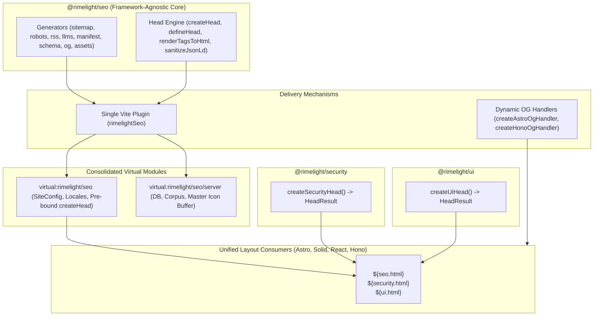

# RFC: Decoupling `@rimelight/seo` into a Generic Vite-Based Package

- **Status**: **Draft (Incremented: Security, DevX, Simplification & Multi-Package Head Pattern Unification)**
- **Author(s)**: Rimelight Engineering
- **Created**: 2026-09-20
- **Last Updated**: 2026-09-20
- **Discussion/PR**: [Link to PR/Issue]

---

## 1. Summary

This RFC proposes decoupling `@rimelight/seo` from Astro. The package will transition from an Astro-specific integration into a **framework-agnostic TypeScript core** bundled with a **consolidated Vite Plugin** (`rimelightSeo()` / `@rimelight/seo/plugin`) and a **safe, universal Head tag generator** (`createHead()` / `defineSeoConfig()`).

Furthermore, this RFC establishes a **Unified Head Contract (`HeadResult { html, tags }`)** across all Rimelight packages that inject content into the document `<head>` (`@rimelight/seo`, `@rimelight/security`, `@rimelight/ui`). While each package remains strictly independent with **zero cross-dependencies**, they all adopt the exact same ergonomic API signature.

By making this transition:

1. All Astro runtime, dev, and peer dependencies (`astro`, `@astrojs/check`) are completely dropped from `@rimelight/seo`.
2. Standard endpoints (`/robots.txt`, `/sitemap.xml`, `/llms.txt`, `/site.webmanifest`, `/favicon.ico`, etc.) are served via secure Vite dev middleware in development and emitted statically at build time via Rollup/Vite `generateBundle`.
3. Head metadata tags and JSON-LD schemas can be generated safely in any JavaScript context (Astro, Solid, React, Svelte, Hono, Node, Edge Workers) via pure importable functions with built-in XSS protection and JSON-LD script-breakout neutralization.
4. Layout boilerplate is unified across `@rimelight/seo`, `@rimelight/security`, and `@rimelight/ui` using identical `{ html, tags }` contracts, eliminating `.astro` head component lock-in across the monorepo.
5. Virtual module sprawl is consolidated from 7 fragmented IDs into 2 unified modules (`virtual:rimelight/seo` for client/isomorphic usage, `virtual:rimelight/seo/server` for server loaders).
6. `@rimelight/seo` aligns directly with other Rimelight packages (`@rimelight/auth`, `@rimelight/i18n`, `@rimelight/ui`) which operate as native Vite plugins in `@rimelight/config`.

---

## 2. Motivation

### Pain Points

- **Framework Lock-In**: `@rimelight/seo` currently requires Astro integration APIs (`astro:config:setup`, `injectRoute`) and `.astro` template components (`SEOHead.astro`, `AgentDirective.astro`). This prevents its rich SEO engines, sitemaps, and schema builders from being used in non-Astro Vite apps or standard edge runtimes (e.g. Hono / Cloudflare Workers / SolidStart).
- **Head Component Fragmentation**: In existing layouts (`AppLayout.astro`, `DocsLayout.astro`, `BlankLayout.astro`), three separate `.astro` components are imported and stacked: `<SEOHead />`, `<SecurityHead />`, and `<UIHead />`. Because these are implemented as Astro template components, none of them can be used in non-Astro frontends or SSR backends, and they tie all three packages to the Astro compiler.
- **Dependency & Bundle Overhead**: The package has `astro` as a `peerDependency` (`>=7.0.0`) and `devDependency`, requiring `@astrojs/check` in its build script and tying `@rimelight/seo` release cycles and typechecking directly to Astro versions. Additionally, `takumi-js` (Canvas/WASM/Font dependencies) is unconditionally bundled even for consumers only requiring sitemaps and `<head>` metadata.
- **Inconsistent Monorepo Patterns**: In `packages/config/astro/index.ts`, packages such as `@rimelight/auth`, `@rimelight/i18n`, and `@rimelight/ui` are seamlessly registered as Vite plugins (`plugins.push(...)`), whereas `@rimelight/seo` remains an exception requiring Astro `integrations.push(...)`.
- **Virtual Module Fragmentation**: Previous iterations created multiple overlapping virtual modules (`virtual:rimelight-seo/config`, `virtual:rimelight/seo`, `virtual:rimelight-seo/site-config`, `virtual:rimelight-seo/options`, `virtual:rimelight-seo/assets`, `virtual:rimelight-seo/db`, `virtual:rimelight-seo/corpus`), causing boilerplate confusion and brittle typing.

### Goals

- Extract all SEO routing, asset emission, and virtual modules into a single, consolidated Vite plugin.
- Replace `<SEOHead.astro>` with a pure JS/TS `createHead()` / `defineSeoConfig()` engine that outputs sanitized HTML (`.html`) and structured tag descriptors (`.tags`).
- Establish a **Unified Head Pattern** across `@rimelight/seo`, `@rimelight/security`, and `@rimelight/ui` with identical function contracts and zero cross-package dependencies.
- Ensure built-in **XSS defense** and **JSON-LD `</script>` tag breakout prevention** so consumer injection (`<Fragment set:html={head.html} />` or `dangerouslySetInnerHTML`) is 100% secure.
- Provide ergonomic site-config auto-binding and turn-key dynamic OG route handlers (`createAstroOgHandler`, `createHonoOgHandler`).
- Consolidate virtual modules into `virtual:rimelight/seo` and `virtual:rimelight/seo/server`.
- Make `takumi-js` an optional/lazy-loaded dependency.
- Remove `astro` and `@astrojs/check` dependencies from `@rimelight/seo`.

### Non-Goals

- Introducing tight coupling or direct dependencies between `@rimelight/seo`, `@rimelight/security`, and `@rimelight/ui`. Each package remains completely standalone.
- Changing the underlying SEO/schema data structures or sitemap XML generation standards.
- Disallowing Astro usage; Astro remains a premier first-class consumer via standard Vite plugin loading and clean 1-line `<Fragment set:html={head.html} />` layout injection.

---

## 3. Detailed Design

### 3.1. The Unified Head Pattern Across Rimelight Packages

To bring architectural cohesion to the monorepo while keeping all packages decoupled, any Rimelight package that outputs document `<head>` elements adheres to a standardized **Head Contract**:

```typescript
/**
 * Discriminated union of all supported head tag shapes.
 * Typed per-tag so JSX consumers get autocomplete and safety on .tags without
 * needing to fall back to raw .html.
 */
export type HeadTag =
  | { tag: "title"; children: string; props?: never }
  | {
      tag: "meta"
      props:
        | { name: string; content: string }
        | { property: string; content: string }
        | { charset: string }
        | { "http-equiv": string; "content": string }
      children?: never
    }
  | {
      tag: "link"
      props: { rel: string; href: string; [k: string]: string | undefined }
      children?: never
    }
  | { tag: "script"; props?: { type?: string; [k: string]: string | undefined }; children: string }
  | { tag: "style"; props?: { [k: string]: string | undefined }; children: string }

export interface HeadResult {
  /** Sanitized raw HTML ready for direct insertion into <head>. All attribute values are
   *  escapeHtml()-encoded; JSON-LD content is serializeJsonLd()-encoded. Safe for
   *  set:html / dangerouslySetInnerHTML consumption without further escaping. */
  readonly html: string
  /** Strongly-typed tag list for JSX, SSR AST walkers, or client meta-managers.
   *  Use this instead of .html when you need programmatic tag access or deduplication. */
  readonly tags: HeadTag[]
  /**
   * Return a new HeadResult with the given props merged on top of this one.
   * Deduplication is last-wins per identity key:
   *   - `<title>`           — always singular; child overrides parent.
   *   - `<meta name="…">`  — keyed on `name`; child wins.
   *   - `<meta property="…">` — keyed on `property`; child wins.
   *   - `<link rel="…">`   — keyed on `rel` (except `rel="alternate"`, which is keyed on `hreflang`).
   *   - `<script type="application/ld+json">` — appended (never deduplicated; schemas accumulate).
   * Props not present in `overrides` are inherited as-is from the parent HeadResult.
   */
  extend(overrides: HeadProps): HeadResult
}
```

#### The Package Ecosystem Trio

Each package exports an independent function matching this contract:

```
@rimelight/seo      ──>  createSeoHead(props) / createHead(props)  ──>  HeadResult
@rimelight/security ──>  createSecurityHead(props)                 ──>  HeadResult
@rimelight/ui       ──>  createUiHead(props)                       ──>  HeadResult
```

1. **`@rimelight/seo` (`createHead` / `createSeoHead`)**:
   - Computes title formatting, meta descriptions, canonical URLs, language alternates, OpenGraph/Twitter tags, icons, manifests, and JSON-LD schemas.
2. **`@rimelight/security` (`createSecurityHead`)**:
   - Injects Trusted Types policy script, CSP nonce propagation listeners, and dev-mode CSP violation reporters.
3. **`@rimelight/ui` (`createUiHead`)**:
   - Injects anti-theme-flash scripts (`data-theme`), Header Stack manager scripts (`RLHeaderStack`), and optional client router configurations.

---

### 3.2. Proposed Usage & Developer Experience (DevX)

#### 1. Universal & Secure Head Tag Generation (`createHead` / `defineSeoConfig`)

Two entry-points serve distinct use-cases, mirroring the `defineConfig` convention from Vite:

- **`createHead(props)`** — call directly; auto-inherits site config from the virtual module when imported from `virtual:rimelight/seo`.
- **`defineSeoConfig(siteConfig)`** — a factory that returns a pre-configured `createHead` bound to a custom `SiteConfig`. Use this outside virtual module context (e.g. in Edge Workers, unit tests, or multi-tenant servers that serve multiple sites in the same process).

> **Note:** The function previously named `defineHead` is renamed `defineSeoConfig` to mirror Vite's `defineConfig` ergonomics, disambiguate it from generic "define head" semantics, and make the returned value's purpose self-evident at call-site.

```typescript
// seo.config.ts — for multi-site or non-Vite contexts
import { defineSeoConfig } from "@rimelight/seo"
export const createHead = defineSeoConfig({
  name: "Acme Corp",
  url: "https://acme.com",
  seo: { titleTemplate: "%s | Acme", maxDescriptionLength: 160 }
})

// page.ts
import { createHead } from "./seo.config"
const head = createHead({
  title: "Pricing Plans",
  description: "Simple, transparent pricing for teams and creators.",
  canonical: "https://acme.com/pricing"
})
```

When imported from `virtual:rimelight/seo` in a Vite app, the `createHead` export is already pre-bound to the plugin-resolved `SiteConfig` — no `defineSeoConfig` call needed:

```typescript
// Astro / Solid / React inside a Vite project
import { createHead } from "virtual:rimelight/seo"
const head = createHead({
  title: "Pricing Plans",
  description: "Simple, transparent pricing for teams and creators.",
  canonical: "https://rimelight.com/pricing"
})
```

```
// head.html — all attributes escapeHtml()-encoded, JSON-LD serializeJsonLd()-encoded:
// <title>Pricing Plans | Rimelight</title>
// <meta name="description" content="Simple, transparent pricing for teams and creators." />
// <meta property="og:title" content="Pricing Plans | Rimelight" />
// <link rel="canonical" href="https://rimelight.com/pricing" />
// <script type="application/ld+json">{"@context":"https://schema.org",\u003c neutralized \u003e}</script>

// head.tags — strongly typed HeadTag discriminated union:
// [
//   { tag: "title", children: "Pricing Plans | Rimelight" },
//   { tag: "meta", props: { name: "description", content: "..." } },
//   { tag: "link", props: { rel: "canonical", href: "..." } }
// ]
```

#### 2. Layout Merging & Tag Deduplication

When nested layouts or child pages both define head tags, `createHead` provides deterministic tag deduplication based on `tag` name, `property`, `rel`, and `name` attributes:

```typescript
// Child page overrides title and canonical, inheriting layout defaults
const layoutHead = createHead(globalDefaults)
const pageHead = layoutHead.extend({
  title: "Special Feature",
  description: "Custom description for this page"
})
```

#### 3. Unified Layout Examples

##### In Astro Layouts (`AppLayout.astro`):

```astro
---
import { createHead } from "virtual:rimelight/seo"
import { createSecurityHead } from "@rimelight/security"
import { createUiHead } from "@rimelight/ui"

const seo = createHead({
  title: Astro.props.title,
  description: Astro.props.description,
  canonical: Astro.url.href
})
const security = createSecurityHead()
const ui = createUiHead()
---
<head>
  <Fragment set:html={seo.html} />
  <Fragment set:html={security.html} />
  <Fragment set:html={ui.html} />
  <slot name="head" />
</head>
```

##### In JSX Frameworks (Solid / React):

```tsx
import { createHead } from "@rimelight/seo"
import { createSecurityHead } from "@rimelight/security"
import { createUiHead } from "@rimelight/ui"

export function DocumentHead(props: HeadProps) {
  const seo = createHead(props)
  const security = createSecurityHead()
  const ui = createUiHead()

  const allTags = [...seo.tags, ...security.tags, ...ui.tags]

  return (
    <>
      {allTags.map((t, i) => {
        const Tag = t.tag as any
        // Only <script> and <style> children are raw HTML — set them via dangerouslySetInnerHTML.
        // <title> children are plain text and must be rendered as React children to avoid
        // double-encoding (React text nodes are auto-escaped; dangerouslySetInnerHTML is not).
        if ((t.tag === "script" || t.tag === "style") && t.children) {
          return <Tag key={i} {...t.props} dangerouslySetInnerHTML={{ __html: t.children }} />
        }
        return (
          <Tag key={i} {...t.props}>
            {t.children}
          </Tag>
        )
      })}
    </>
  )
}
```

> **Note on `transitions`**: The `HeadProps.transitions` field (Astro's `<ClientRouter>` toggle) is an Astro-specific concern and should **not** appear on the universal `HeadProps` interface. Astro consumers needing this prop should use the framework-specific extension type:
>
> ```typescript
> // @rimelight/seo — universal interface (no Astro deps)
> export interface HeadProps {
>   /* ... */
> }
>
> // @rimelight/seo/astro — Astro-specific extension (optional adapter import)
> export interface AstroHeadProps extends HeadProps {
>   /** Enables Astro's <ClientRouter> (View Transitions). Astro-only. */
>   transitions?: boolean
> }
> ```
>
> Layouts using `transitions` import from `@rimelight/seo/astro` instead of `@rimelight/seo`.

##### In Hono / Edge SSR:

```typescript
import { Hono } from "hono"
import { createHead } from "@rimelight/seo"
import { createSecurityHead } from "@rimelight/security"
import { createUiHead } from "@rimelight/ui"

const app = new Hono()

app.get("*", (c) => {
  const seo = createHead({ title: "Rimelight", url: c.req.url })
  const security = createSecurityHead()
  const ui = createUiHead()

  return c.html(`
    <!doctype html>
    <html>
      <head>
        ${seo.html}
        ${security.html}
        ${ui.html}
      </head>
      <body><div id="root"></div></body>
    </html>
  `)
})
```

#### 4. Turn-Key Dynamic OG Route Handlers

To eliminate boilerplate for dynamic SSR OG card generation, turnkey route handlers are provided:

```typescript
// src/pages/open-graph/[...route].png.ts (Astro Endpoint)
import { createAstroOgHandler } from "@rimelight/seo/og"
export const GET = createAstroOgHandler()

// In Hono
import { createHonoOgHandler } from "@rimelight/seo/og"
app.get("/open-graph/*", createHonoOgHandler())
```

---

### 3.3. Architecture & File Structure



#### File Layout in `packages/seo`:

```
packages/seo/
├── src/
│   ├── index.ts           # Core exports (createHead, defineSeoConfig, generators, default Vite plugin)
│   ├── plugin.ts          # Single Consolidated Vite Plugin (virtual modules, dev server, generateBundle)
│   ├── head.ts            # createHead, defineSeoConfig, tag AST, deduplication, renderTagsToHtml
│   ├── sanitize.ts        # escapeHtml, serializeJsonLd, sanitizeUrl (XSS & javascript: protection)
│   ├── meta.ts            # Title, canonical, description, robots meta builders
│   ├── schema.ts          # JSON-LD Schema builders (WebSite, Article, Breadcrumbs)
│   ├── sitemap.ts         # XML Sitemap & Index builders
│   ├── robots.ts          # Robots.txt builder
│   ├── rss.ts             # RSS feed builder
│   ├── llms.ts            # llms.txt & llms-full.txt builders
│   ├── manifest.ts        # site.webmanifest builder
│   ├── catalog.ts         # api-catalog builder
│   ├── security-txt.ts    # security.txt builder (NOT @rimelight/security — named to avoid confusion)
│   ├── og/
│   │   ├── index.ts       # Takumi OG card layouts & renderers (lazy-imported)
│   │   ├── handler.ts     # Generic Web Request/Response OG handler
│   │   ├── astro.ts       # createAstroOgHandler wrapper
│   │   └── hono.ts        # createHonoOgHandler wrapper
│   ├── assets.ts          # Icon and asset generators
│   ├── astro.ts           # AstroHeadProps extension (transitions, set:html helpers). No Astro runtime dep.
│   └── types.ts           # Shared TypeScript interfaces
├── package.json
└── tsconfig.json
```

---

### 3.5. Design Decisions

#### Virtual Module Namespace Convention

The monorepo currently has two conflicting virtual module naming styles:

- `@rimelight/security` uses `virtual:rimelight-security-config`, `virtual:sri-manifest` (hyphen-flat)
- This RFC proposes `virtual:rimelight/seo`, `virtual:rimelight/seo/server` (slash-namespaced)

**Decision: adopt the slash-namespaced, hierarchical convention monorepo-wide.** The `virtual:namespace/package[/sub]` pattern is the emerging standard in the Vite ecosystem (used by Astro, SolidStart, Nuxt). As part of this RFC, `@rimelight/security` migrates its virtual IDs to match:

| Old ID                              | New ID                              |
| ----------------------------------- | ----------------------------------- |
| `virtual:rimelight-security-config` | `virtual:rimelight/security/config` |
| `virtual:sri-manifest`              | `virtual:rimelight/security/sri`    |

Consumers importing the old IDs will get a deprecation warning at dev-server startup for one minor release before removal.

#### `RimelightSeoOptions` Site Config Layering

`RimelightSeoOptions` currently exposes two overlapping ways to provide site identity: flat top-level fields (`name`, `url`, `author`, `email`, `branding`) and a nested `site: Partial<SiteConfig>` object covering the same properties. This creates ambiguity about which wins.

**Decision: flat fields take precedence over `site`, with explicit merge semantics:**

```typescript
// Merge order (higher = wins):
// 1. Explicit top-level fields in RimelightSeoOptions (highest priority)
// 2. Fields in RimelightSeoOptions.site
// 3. Package defaults
```

The flat fields are **not deprecated** — they remain the primary ergonomic surface for common options. The `site` field is for passing a pre-constructed `SiteConfig` object when one already exists (e.g. from a shared config package). Consumers should not use both for the same field.

---

### 3.4. Key Components & Implementation

#### 1. Single Consolidated Vite Plugin (`plugin.ts`)

Instead of maintaining multiple disjoint plugins, a single `rimelightSeo(options)` plugin orchestrates the entire lifecycle:

1. **Virtual Modules (`resolveId` / `load`)**:
   - `virtual:rimelight/seo`: Provides isomorphic access to `siteConfig`, `SEO_LOCALES`, `PRIVATE_PATH_PREFIXES`, and pre-bound `createHead()`.
   - `virtual:rimelight/seo/server`: Server-only virtual module providing `db`, `corpusPages`, and `masterIconBuffer`.
2. **Development Middleware (`configureServer`)**:
   - Securely intercepts requests for static assets (`/robots.txt`, `/sitemap.xml`, `/rss.xml`, `/llms.txt`, `/site.webmanifest`, `/favicon.ico`, `/apple-touch-icon.png`, `/icon-*.png`, `/og.png`).
   - Validates that icon/asset paths do not traverse outside the project root.
3. **Production Static Asset Emission (`generateBundle`)**:
   - Calls `this.emitFile({ type: "asset", fileName: "...", source: ... })` to generate static files in the output directory during `vite build`.

#### 2. Head Engine & Sanitization (`head.ts`, `sanitize.ts`)

Encapsulates metadata generation with robust sanitization:

```typescript
// sanitize.ts

export function escapeHtml(str: string): string {
  return str
    .replace(/&/g, "&amp;")
    .replace(/</g, "&lt;")
    .replace(/>/g, "&gt;")
    .replace(/"/g, "&quot;")
    .replace(/'/g, "&#039;")
}

/**
 * Escapes <, >, and / in JSON-LD to neutralize </script> breakouts in all browser
 * parsing modes. Matches the strategy used by React's server renderer and Next.js.
 * Note: > and / are escaped in addition to < to handle legacy quirks-mode parsers
 * and the --> HTML comment terminator.
 */
export function serializeJsonLd(schema: unknown): string {
  return JSON.stringify(schema)
    .replace(/</g, "\\u003c")
    .replace(/>/g, "\\u003e")
    .replace(/\//g, "\\u002f")
}

const SAFE_URL_PROTOCOLS = /^(?:(?:https?|mailto|tel):\/\/|\/(?!\/)|(?:\.\.?\/))/i

/**
 * Allowlist URL protocols for href/src attributes to block javascript: and protocol-relative injection.
 * Permits absolute (https://, mailto:, tel:), root-relative (/path, blocking //), and relative (./path, ../path).
 * Applied to: canonical, ogImage, favicon, appleTouchIcon, rssFeed.href,
 * languageAlternates[].href, versionAlternates[].href, and all link tag hrefs.
 * Returns an empty string for any URL that does not match the allowlist.
 */
export function sanitizeUrl(url: string): string {
  return SAFE_URL_PROTOCOLS.test(url.trim()) ? url : ""
}
```

- When `createHead().html` builds tag strings, all attribute values are passed through `escapeHtml()`.
- All URL-typed attributes (`href`, `src`, `content` on `og:url`/`og:image`) are additionally passed through `sanitizeUrl()` before `escapeHtml()`.
- All JSON-LD `<script type="application/ld+json">` contents are serialized via `serializeJsonLd()`.
- **OG input capping**: `createHead()` applies `buildSafeDescription()` truncation to `title` (200 chars) and `description` (300 chars) before emitting — the same caps enforced by the OG handler — ensuring consistent rendering whether the consumer uses the OG endpoint or constructs tags directly.

#### 3. CSP Nonce Threading

When a site uses a `Content-Security-Policy` with `script-src 'nonce-xxx'`, inline `<script>` blocks emitted by `createHead()` (JSON-LD, anti-flash, Trusted Types) must carry the same nonce or they will be blocked. Since `@rimelight/seo` and `@rimelight/security` are intentionally cross-dependency-free, the nonce is passed as a first-class prop:

```typescript
// The nonce is generated per-request by @rimelight/security middleware
// and propagated to createHead() by the layout — no package coupling needed.

const nonce = response.locals.cspNonce // or Astro.locals.nonce, c.get("nonce"), etc.

const seo = createHead({ title, canonical, nonce })
const security = createSecurityHead({ nonce })
const ui = createUiHead({ nonce })
```

`createHead()` forwards the nonce to any emitted `<script>` tags. If `nonce` is omitted, no `nonce` attribute is emitted (safe for sites without strict CSP).

`HeadProps` is updated accordingly:

```typescript
export interface HeadProps {
  // ... existing fields ...
  /**
   * CSP nonce for inline <script> tags emitted by createHead() (JSON-LD, etc.).
   * Provided by @rimelight/security middleware via request locals — not generated here.
   */
  nonce?: string
}
```

---

## 4. Security & Privacy

### 4.1. XSS & HTML Injection Prevention

- **The Issue**: In Astro and JSX, injecting raw HTML via `<Fragment set:html={head.html} />` or `dangerouslySetInnerHTML` bypasses the template engine's auto-escaping. If user-supplied titles, descriptions, breadcrumb labels, or canonical queries contain unescaped quotes or HTML tags, attribute breakouts or script execution can occur.
- **Mitigation**:
  1. `renderTagsToHtml()` escapes all HTML tag attributes (`name`, `content`, `href`, `property`, `title`, etc.) via `escapeHtml()`.
  2. `serializeJsonLd()` prevents `</script><script>` breakouts by replacing `<`, `>`, and `/` with their Unicode escape sequences (`\u003c`, `\u003e`, `\u002f`). Escaping all three is necessary: `>` alone can form `-->` in legacy quirks-mode parsers; `/` neutralizes `</script>` even if `<` were somehow missed. This matches React's server renderer and Next.js.
  3. All URL-typed attributes (`href`, `src`, content values for `og:url`, `og:image`, etc.) are passed through `sanitizeUrl()` before `escapeHtml()`. `sanitizeUrl()` returns an empty string for any URL not matching `https?://`, `mailto:`, or `tel:` — blocking `javascript:` injection that would survive standard HTML attribute escaping.

### 4.2. Dynamic OG Handler Hardening (DoS & SSRF Defense)

- **The Issue**: Dynamic OG image generation using Canvas/WASM (`takumi-js`) can be abused via query parameter manipulation to induce CPU/memory exhaustion or trigger SSRF when loading arbitrary remote images/fonts.
- **Mitigation**:
  1. **Strict Input Caps**: Dynamic string lengths are strictly bounded (max title length: 200 chars, description: 300 chars). These same caps are applied upstream in `createHead()` via `buildSafeDescription()` so the OG handler and head tag output are always consistent.
  2. **SSRF Restrictions**: Remote images are restricted to explicitly configured `allowedImageDomains`.
  3. **Aggressive CDN Caching**: Endpoints automatically set `Cache-Control: public, max-age=86400, s-maxage=604800, stale-while-revalidate=86400` to prevent rendering storms on uncached repeated requests.

### 4.3. Dev Server Middleware Path Containment

- In `configureServer`, custom `icon` and asset path resolutions enforce strict root directory containment to prevent arbitrary file system reads via path traversal.
- **Implementation**: Use `path.resolve()` on both sides to collapse `..` segments, then call `fs.realpathSync()` to dereference symlinks before the containment check. A symlink target can reside outside `rootDir` while its logical path passes a naive `startsWith` check — `realpathSync` eliminates this:
  ```typescript
  import { realpathSync } from "node:fs"
  import { resolve } from "node:path"

  function isContained(rootDir: string, requestedPath: string): boolean {
    const realRoot = realpathSync(resolve(rootDir))
    const realPath = realpathSync(resolve(rootDir, requestedPath))
    return realPath.startsWith(realRoot + "/") || realPath === realRoot
  }
  ```
  URL-encoded traversal sequences (e.g. `%2F..%2F`) are handled by Vite's request parsing before reaching the middleware, but `path.resolve()` provides defense-in-depth.

---

## 5. Performance & Bundle Size

### 5.1. Optional / Lazy `takumi-js` Loading

- Consumers that only use metadata tag generation and static XML sitemaps do not need the heavy Canvas/WASM dependencies of `takumi-js`.
- `takumi-js` is dynamically imported (`await import("takumi-js")`) only when `assets` or `og` generation is active.

### 5.2. Build & CI Acceleration

- Removing `astro` and `@astrojs/check` from `@rimelight/seo`'s build script speeds up package typechecks (`vp check`) and eliminates package dependency churn across Astro releases.

---

## 6. Drawbacks & Trade-offs

- **Manual Dynamic OG Endpoint Declarations**:
  - In Astro integrations, `injectRoute` automatically mounted dynamic routes. With generic Vite plugins, applications declaring dynamic SSR OG cards add a 2-line endpoint file utilizing `createAstroOgHandler()`.
- **Layout Migration**:
  - Existing Astro layouts in `rimelight.com` and `starter.rimelight.com` replace `<SEOHead ... />`, `<SecurityHead />`, and `<UIHead />` with their respective `create*Head()` calls and `<Fragment set:html={...} />`.

---

## 7. Adoption & Migration Strategy

### Step 1: Package Modernization (`@rimelight/seo`)

1. Implement `src/head.ts`, `src/sanitize.ts`, and `src/plugin.ts` in `packages/seo`.
2. Consolidate virtual modules into `virtual:rimelight/seo` and `virtual:rimelight/seo/server`.
3. Remove `src/components/` and `src/routes/`.
4. Update `package.json` to remove `astro` and `@astrojs/check`, and lazy-load `takumi-js`.

### Step 2: Head Standardization in Sister Packages (`@rimelight/security`, `@rimelight/ui`)

1. Export `createSecurityHead()` from `@rimelight/security` returning `{ html, tags }`.
2. Export `createUiHead()` from `@rimelight/ui` returning `{ html, tags }`.

### Step 3: `@rimelight/config` Integration

Update `packages/config/astro/index.ts`. `rimelightSeo` is the canonical, stable named export from `@rimelight/seo` — import it directly:

```typescript
// packages/config/astro/index.ts
if (options.seo) {
  const { rimelightSeo } = await import("@rimelight/seo")
  const seoOpts = typeof options.seo === "object" ? options.seo : {}
  plugins.push(
    rimelightSeo({
      id: domain,
      url: site || (domain ? `https://${domain}` : undefined),
      ...seoOpts
    })
  )
}
```

### Step 4: Layout Updates in Apps

Update layouts (`AppLayout.astro`, `DocsLayout.astro`, `BlankLayout.astro`) in `apps/rimelight.com` and `apps/starter.rimelight.com`:

```astro
---
import { createHead } from "virtual:rimelight/seo"
import { createSecurityHead } from "@rimelight/security"
import { createUiHead } from "@rimelight/ui"

const seo = createHead({ ...Astro.props })
const security = createSecurityHead()
const ui = createUiHead()
---
<head>
  <Fragment set:html={seo.html} />
  <Fragment set:html={security.html} />
  <Fragment set:html={ui.html} />
  <slot name="head" />
</head>
```

---

## 8. Verification & Testing Plan

### 8.1. Automated Security & Unit Tests

- **XSS & Escape Verification**: Unit tests ensuring HTML characters (`<`, `>`, `"`, `&`) in titles, descriptions, and custom tags are escaped.
- **JSON-LD Script Breakout Tests**:
  - `<` → `\u003c`, `>` → `\u003e`, `/` → `\u002f` in all JSON-LD output.
  - Payloads containing `</script><script>`, `-->`, and bare `>` are all neutralized.
- **`sanitizeUrl` Tests**: Assert that `javascript:`, `data:`, `vbscript:`, and relative-protocol `//evil.com` URLs are stripped. Assert that `https://`, `mailto:`, and `tel:` pass through.
- **URL Attribute Sanitization Integration**: Confirm `ogImage`, `canonical`, `rssFeed.href`, and `languageAlternates[].href` with `javascript:` payloads produce empty `href`/`src` attributes in `head.html`.
- **Nonce Threading Test**: Assert that when `nonce: "abc123"` is passed to `createHead()`, all emitted `<script>` tags include `nonce="abc123"`. Assert that omitting `nonce` produces no `nonce` attribute.
- **Head Contract Parity**: Unit tests verifying that `createHead()`, `createSecurityHead()`, and `createUiHead()` strictly conform to the `{ html, tags, extend }` schema.
- **`HeadTag` Discriminated Union Coverage**: TypeScript `expectType` assertions that each tag variant's `props` and `children` types are correctly narrowed.
- **Tag Deduplication & Merging Tests**: Verification that nested `.extend()` calls correctly apply last-wins deduplication for `title`, `meta[name]`, `meta[property]`, `link[rel]`, and accumulation for `script[type="application/ld+json"]`.
- **Path Containment Tests**: Assert that `isContained()` correctly rejects paths containing `../`, URL-encoded `%2F..%2F`, and paths that resolve via symlink to outside the project root.
- **Config Layering Tests**: Assert that flat `RimelightSeoOptions` fields override same-key fields in `options.site`, and that `options.site` overrides package defaults.
- **Virtual Module Migration**: Integration tests confirming the deprecated `virtual:rimelight-security-config` ID still resolves (with warning) during the deprecation window, and the new `virtual:rimelight/security/config` ID resolves cleanly.
- **Vite Plugin Tests**: Middleware and static asset emission (`generateBundle`) tests.
- Monorepo checks:
  ```bash
  pnpm --filter @rimelight/seo check
  pnpm --filter @rimelight/seo test
  pnpm --filter @rimelight/security check
  pnpm --filter @rimelight/security test
  ```

### 8.2. Manual Verification

- Start dev server in `apps/rimelight.com` and `apps/starter.rimelight.com`.
- Verify dev endpoints: `http://localhost:4321/robots.txt`, `http://localhost:4321/sitemap.xml`, `http://localhost:4321/site.webmanifest`.
- Inspect rendered page `<head>` to verify structured schemas, canonical links, OpenGraph meta tags, security scripts, and theme anti-flash scripts.
- Verify nonce attribute is present on `<script>` tags when CSP middleware is active.
- Run `pnpm build` and verify that all static SEO assets are emitted to the `dist/` directory.

---

## 9. Unresolved Questions

1. **`@solidjs/meta` adapter** (`@rimelight/seo/solid`): Now that `HeadTag` is a strongly-typed discriminated union, the generic `head.tags` mapping is sufficient for SolidJS consumers without a dedicated adapter. A `@rimelight/seo/solid` export can be added later as a convenience wrapper if demand emerges. **Resolved: not needed at launch.**

2. **Sitemap streaming for large sites**: Chunked index building (splitting into `sitemap-0.xml`, `sitemap-1.xml`, etc.) is sufficient for the current scale of Rimelight-hosted sites. Background streaming is deferred to a future RFC once a concrete site exceeds 50,000 pages. **Resolved: defer.**
