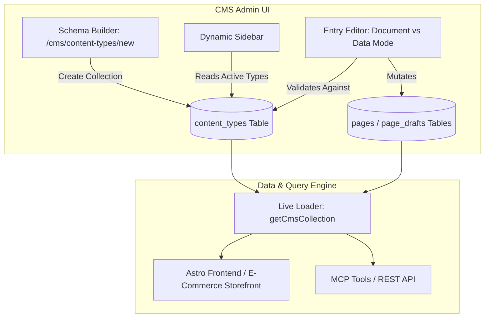

# RFC-0007: Database-Backed Dynamic Content Types & E-Commerce Collections Architecture

- **Status**: **Draft**
- **Author(s)**: Idan T. / Antigravity
- **Created**: 2026-08-25
- **Last Updated**: 2026-08-25
- **Discussion/PR**: N/A

---

## 1. Summary

This RFC proposes evolving `@rimelight/cms` from a code-defined, page-centric system (where content types and schemas are hardcoded in TypeScript via `page-definitions.ts`) into a **Database-Backed Dynamic Content Types and Collections Engine**.

Under this model, developers and non-technical administrators can create, modify, and manage new content models (e.g. **E-commerce Products**, **Game Entities**, **Tournament Brackets**, **Digital Asset Stores**, **Staff Profiles**) directly through the CMS Admin UI (`/cms/content-types`) without deploying code or rebuilding the application.

Because this represents a fundamental paradigm shift in how Rimelight CMS structures, validates, queries, and type-checks data, this RFC comprehensively explores architectural models, storage strategies, e-commerce mechanics, and critical open questions for team alignment.

---

## 2. Motivation & Problem Statement

### 2.1. The Status Quo

Currently, `@rimelight/cms` relies on a static code registry:

- Every page type (`BlogPost`, `Location`, `Species`, `Character`, `Hero`, `PatchNote`) is hardcoded in `packages/cms/src/core/page-definitions.ts`.
- Field definitions, options, and default blocks require code commits, pull requests, and Cloudflare Worker redeployments.
- Everything is treated conceptually as a "Page" rendered via the visual block editor, even when the content represents pure structured data (e.g., store products, inventory, configuration records).

### 2.2. The Opportunity

1. **Zero-Deploy Content Modeling**: Admins can spin up new collections (e.g., "Merch Store", "Community Fan Art", "Patch Schedules") in seconds.
2. **E-Commerce & Structured Catalog Support**: Native handling of prices, SKUs, inventory levels, variant matrices, and digital asset fulfillment from Cloudflare R2 without building custom separate dashboards.
3. **Hybrid Architecture**: Preserve the strengths of code-defined system types (type safety, version control) while unlocking database-driven agility for dynamic business and gaming needs.

---

## 3. Architectural Design



---

### 3.1. Database Schema (`content_types`)

We introduce a dedicated table to persist dynamic collection schemas:

```typescript
// packages/cms/src/schema/content_types.ts
import { boolean, jsonb, pgTable, text, timestamp, uuid } from "drizzle-orm/pg-core"
import type { Localized } from "../core/types/pages"
import type { BaseBlock } from "../core/types/blocks"

export type CollectionMode = "document" | "data" | "singleton"

export interface DynamicFieldDefinition {
  type:
    "text" | "number" | "boolean" | "enum" | "media" | "relation" | "currency" | "array" | "json"
  label: Localized
  description?: Localized
  required?: boolean
  defaultValue?: any
  options?: { label: Localized; value: string }[]
  allowedCollections?: string[] // For relation fields (e.g. ['characters', 'locations'])
  validation?: {
    min?: number
    max?: number
    pattern?: string
  }
}

export interface EcomSettings {
  enabled: boolean
  currencyDefault: string
  trackInventory: boolean
  hasVariants: boolean
  allowDigitalDownloads: boolean
  stripeSync?: boolean
}

export const contentTypes = pgTable("content_types", {
  id: uuid("id").defaultRandom().primaryKey(),
  slug: text("slug").notNull().unique(), // e.g. "products", "weapons", "tournaments"
  name: jsonb("name").$type<Localized>().notNull(),
  description: jsonb("description").$type<Localized>(),
  icon: text("icon").default("i-lucide-box").notNull(),
  mode: text("mode").$type<CollectionMode>().default("document").notNull(),

  // Visual groups and dynamic field definitions
  fieldSchema: jsonb("field_schema")
    .$type<Record<string, { label: Localized; fields: Record<string, DynamicFieldDefinition> }>>()
    .default({})
    .notNull(),

  // E-commerce specific configurations
  ecomSettings: jsonb("ecom_settings").$type<EcomSettings>(),

  // Template blocks seeded on creation (for 'document' mode)
  initialBlocks: jsonb("initial_blocks").$type<BaseBlock[]>().default([]).notNull(),

  // Metadata & System Flags
  isSystem: boolean("is_system").default(false).notNull(), // System types (blog, legal) cannot be deleted
  createdAt: timestamp("created_at", { withTimezone: true }).defaultNow().notNull(),
  updatedAt: timestamp("updated_at", { withTimezone: true }).$onUpdate(() => new Date())
})
```

---

### 3.2. Three Primary Collection Modes

1. **`document` Mode (Rich Visual Content)**:
   - _Use Cases_: Blog posts, lore chapters, wiki guides, landing pages.
   - _Editor_: Visual split-pane block canvas + sticky property sidebar.
   - _Output_: Array of AST blocks (`blocks`) + metadata properties.

2. **`data` Mode (Structured Records & E-Commerce)**:
   - _Use Cases_: Store products, game items, character stats, coupon codes.
   - _Editor_: Form & tabular layout with validation, SKU generator, currency inputs, inventory counters, variant matrices, and media picker.
   - _Output_: Pure structured `properties` payload.

3. **`singleton` Mode (Global Settings & Menus)**:
   - _Use Cases_: Navigation bar links, store announcements, site footer, global SEO config.
   - _Editor_: Direct form editing for a single persistent record without a collection list.

---

### 3.3. E-Commerce Integration Model

For collections flagged with `ecomSettings.enabled: true`, the CMS automatically enriches the entity schema with standard commerce primitives:

| E-Com Field           | Data Type         | Purpose                                                          |
| :-------------------- | :---------------- | :--------------------------------------------------------------- |
| `priceCents`          | Integer           | Normalized smallest currency unit (e.g. `$24.99` -> `2499`)      |
| `compareAtPriceCents` | Integer           | Original price for discount/sale badges                          |
| `currency`            | Text (3-char ISO) | Default `USD`, `EUR`, `BRL`                                      |
| `sku`                 | Text (Unique)     | Stock keeping unit                                               |
| `inventoryQuantity`   | Integer           | Live stock tracking                                              |
| `isDigital`           | Boolean           | Digital delivery vs physical shipment                            |
| `digitalAsset`        | Media Key (R2)    | Secured private R2 file delivered via signed temporary URLs      |
| `variants`            | JSON Array        | Matrix of options (e.g. Size `[S, M, L]` x Color `[Black, Red]`) |

---

## 4. Thorough Exploration & Critical Open Questions

Because moving schema definitions from static code to a live database affects type safety, migrations, and developer ergonomics, the following questions require explicit decisions:

### Question 1: How should TypeScript Type Safety work for dynamic collections?

- _Option A (Runtime loose typing)_: `entry.data.properties.price` typed as `any` or `Record<string, unknown>`.
- _Option B (Generated Types CLI)_: Add a CLI command `pnpm rimelight cms:types` that queries the database schema and generates `src/types/cms-schema.d.ts` for full autocomplete.
- _Option C (Zod schema generation)_: Dynamically generate Zod validators at runtime from the `field_schema` JSON.

### Question 2: Hybrid vs. Pure Database Model?

- Should we allow code-defined schemas in `rimelight.config.ts` to coexist with database-defined schemas?
- _Scenario_: If code defines `BlogPost` and DB defines `BlogPost`, which takes precedence?
- _Proposed Policy_: Code schemas serve as defaults/fallback. Database schemas take active precedence and can be exported back to code.

### Question 3: How should Schema Migrations / Breaking Changes be handled?

- If an admin deletes a field `price` or renames it to `unit_price` in the Content Types UI, what happens to existing published pages?
- _Strategy A (Non-destructive)_: Retain old data in `pages.content.properties`; simply ignore it in the UI unless explicitly purged.
- _Strategy B (Migration Runner)_: Prompt the admin with a data migration preview before saving schema alterations.

### Question 4: Should E-Commerce live directly inside the CMS or as a separate `@rimelight/store` module?

- Is it better to have e-commerce fields be standard CMS dynamic field plugins (Currency field, SKU field, Inventory field), or should e-commerce be a dedicated companion package that hooks into the CMS?

### Question 5: Inventory Concurrency & Edge Scalability

- The CMS uses D1 / PostgreSQL. For high-volume product flash sales (where inventory updates hundreds of times per second), should inventory count be managed in Durable Objects or D1 transactions?

### Question 6: Relational Integrity & Dynamic Cross-References

- When a `Product` links to a `Hero` or `Character` (e.g. "Buy this hero's collectible skin"), how should relational integrity be maintained if the target character is unpublished or deleted?
- _Proposed Policy_: Soft relations via `id` / `slug` with fallback UI ("Referenced item unavailable").

---

## 5. Drawbacks & Trade-offs

1. **Loss of Instant Static Type Safety**: In a pure code-based schema, TypeScript catches typos like `page.props.prce` at build time. Dynamic DB schemas require runtime validation or type-generation workflows.
2. **Schema Drift across Environments**: Local dev databases, staging, and production environments might have different dynamic content types unless an export/import or sync tool is provided.
3. **Admin UI Complexity**: Building a robust visual schema builder (drag-and-drop fields, validation rules, relational selectors) requires substantial UI development in `@rimelight/ui`.

---

## 6. Adoption & Phased Implementation Strategy

### Phase 1: Database Schema & Dynamic Registry

- Create `content_types` table in `@rimelight/cms`.
- Update `getCmsCollection()` and `getPageDefinition()` to query `content_types` from DB first, falling back to static `PAGE_MAP`.

### Phase 2: Schema Builder Admin UI (`/cms/content-types`)

- Build visual builder UI for creating and editing Content Types and field schemas.
- Dynamically render the CMS sidebar categories from the database.

### Phase 3: Dynamic Property Inspector & Data-Mode Editor

- Update `RimelightPropertiesPanel` to dynamically render inputs according to the active `fieldSchema`.
- Introduce the pure `data` table/form editor for non-document collections.

### Phase 4: E-Commerce Primitives & Schema Sync CLI

- Add Currency, SKU, Inventory, and R2 Digital File field types.
- Add `pnpm rimelight cms:sync` / `pnpm rimelight cms:types` CLI tools to synchronize DB schemas with local TypeScript definitions.

---

## 7. Verification & Testing Plan

### 7.1. Automated Tests

- Unit tests verifying dynamic schema validation (required fields, numeric constraints, enum validation).
- Live loader tests verifying dynamic collection queries with filtering, sorting, and pagination.
- Serialization tests ensuring both `document` and `data` modes persist and version cleanly in `pages` and `page_versions`.

### 7.2. Manual Verification

1. Navigate to `/cms/content-types/new` and create a "Merchandise" content type with `price`, `sku`, and `stock` fields.
2. Verify that "Merchandise" immediately appears in the CMS dashboard navigation.
3. Create, edit, and publish a new product.
4. Query the product from an Astro test page using `getCmsCollection(db, { type: "merchandise" })`.
