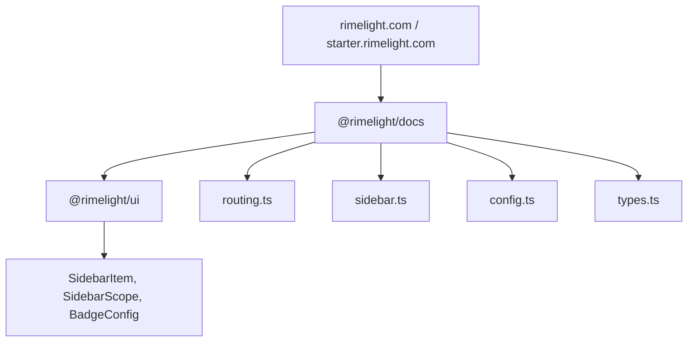

# RFC-0003: Extract `@rimelight/docs` Package

- **Status**: **Draft**
- **Author**: Daniel Marchi
- **Created**: 2026-07-18
- **Last Updated**: 2026-07-18
- **Discussion/PR**: —

---

## 1. Summary

Extract the documentation routing, navigation, and metadata system from `@rimelight/ui` into a standalone `@rimelight/docs` package. This separates docs infrastructure (sidebar resolution, versioned URL routing, prev/next navigation, component API metadata types) from the UI component library, which remains focused on components, themes, and runtime utilities.

---

## 2. Motivation

The `@rimelight/ui` package currently bundles docs-specific logic alongside its core UI concerns:

- **Leaky re-export.** `src/utils/index.ts` re-exports everything from `src/docs`, so any consumer importing from `@rimelight/ui/utils` pulls in docs routing, sidebar resolution, and metadata types even when they only need `addToast` or `resolveClasses`.
- **Duplicated types.** `rimelight.com/src/docs/types.ts` is a byte-for-byte copy of `packages/ui/src/docs/types.ts`. The local utils (`kebabToPascal`, `filterProps`, `generateThemeCode`) are also duplicated. A shared package eliminates this drift.
- **Unused export path.** The `"./docs"` export in `package.json` exists but no consumer imports from `@rimelight/ui/docs` directly — everything goes through the `utils` barrel. This indicates the docs module was always intended to be separate but never was.
- **Consumers that need docs don't need UI runtime.** The sidebar resolution and versioned routing logic is consumed by `rimelight.com` and `starter.rimelight.com` at build time. These consumers already depend on `@rimelight/ui` for components, but the docs logic has no runtime coupling to the component tree.

---

## 3. Detailed Design

### 3.1. Proposed API / Usage

Consumer imports change from the catch-all `@rimelight/ui/utils` to a focused `@rimelight/docs` entry point:

```typescript
// Before
import { defineDocsConfig } from "@rimelight/ui/utils"
import { getDocsSidebar, getSurroundItems } from "@rimelight/ui/utils"
import { getDocsVersions, parseDocsSlug } from "@rimelight/ui/utils"
import type { ResolvedSidebarItem } from "@rimelight/ui/utils"

// After
import { defineDocsConfig } from "@rimelight/docs"
import { getDocsSidebar, getSurroundItems } from "@rimelight/docs"
import { getDocsVersions, parseDocsSlug } from "@rimelight/docs"
import type { ResolvedSidebarItem } from "@rimelight/docs"
```

### 3.2. Architecture & File Structure



**New package:**

```
packages/docs/
  package.json
  tsconfig.json
  src/
    index.ts          # barrel re-export
    config.ts         # defineDocsConfig, DocsConfig
    sidebar.ts        # getDocsSidebar, getSurroundItems, ResolvedSidebarItem, ResolvedScope
    routing.ts        # getDocsVersions, parseDocsSlug, formatDocsUrl, DocEntry
    types.ts          # PropMeta, SlotMeta, EmitMeta, ThemeMeta, ComponentMeta, ComponentMetaMap
```

### 3.3. Key Components

#### What Moves

**Functions (from `packages/ui/src/docs/utils.ts`):**

| Export               | Destination  | Purpose                                                                   |
| -------------------- | ------------ | ------------------------------------------------------------------------- |
| `defineDocsConfig()` | `config.ts`  | Type helper for docs config files                                         |
| `getDocsSidebar()`   | `sidebar.ts` | Resolves sidebar items, scopes, and active scope for a given path         |
| `getSurroundItems()` | `sidebar.ts` | Produces prev/next navigation from a resolved sidebar tree                |
| `getDocsVersions()`  | `routing.ts` | Extracts version strings from content collection entries                  |
| `parseDocsSlug()`    | `routing.ts` | Parses dynamic route slugs against available versions                     |
| `formatDocsUrl()`    | `routing.ts` | Fills `{locale}` templates and inserts version segments (internal helper) |

Private helpers (`findFirstHref`, `getScopePrefix`, `hasPath`) move with their parent function into `sidebar.ts`.

**Types (from `packages/ui/src/docs/types.ts` and `packages/ui/src/docs/utils.ts`):**

| Type                                                                                 | Destination  | Purpose                        |
| ------------------------------------------------------------------------------------ | ------------ | ------------------------------ |
| `PropMeta`, `SlotMeta`, `EmitMeta`, `ThemeMeta`, `ComponentMeta`, `ComponentMetaMap` | `types.ts`   | Component API metadata shapes  |
| `ResolvedSidebarItem`, `ResolvedScope`                                               | `sidebar.ts` | Resolved navigation item types |
| `DocEntry`                                                                           | `routing.ts` | Content collection entry shape |

**Interface (from `packages/ui/src/components/sidebar/sidebar.ts`):**

| Type         | Destination | Purpose                            |
| ------------ | ----------- | ---------------------------------- |
| `DocsConfig` | `config.ts` | Top-level docs configuration shape |

This interface references `SidebarItem`, `SidebarScope`, and `BadgeConfig` from the same file. These generic primitives stay in `@rimelight/ui` — the docs package imports them back via `@rimelight/ui/components/sidebar/sidebar`.

#### What Stays in `@rimelight/ui`

| Item                                                                                                    | Reason                                             |
| ------------------------------------------------------------------------------------------------------- | -------------------------------------------------- |
| `SidebarItem`, `SidebarScope`, `BadgeConfig`, `SidebarProps`, `TableOfContentsConfig`, `EditLinkConfig` | Generic sidebar component types, not docs-specific |
| All 148 components (including `RLASidebar`, `RLATableOfContents`, `RLASurround`, etc.)                  | General-purpose UI                                 |
| `src/utils/` (toast, shortcuts, color, scroll, embed, etc.)                                             | Runtime utilities                                  |
| `src/themes/`, `src/icons/`, `src/presets/`                                                             | Core UI infrastructure                             |

#### Functions That Stay Local in `rimelight.com`

The following functions exist in both `packages/ui/src/docs/utils.ts` and `packages/rimelight.com/src/docs/utils.ts` (local copies). They are only used by `rimelight.com`'s API-reference extractors and are not part of the docs routing/navigation system:

| Function              | Reason to keep local                                                 |
| --------------------- | -------------------------------------------------------------------- |
| `kebabToPascal()`     | String utility used only by API-ref extractors                       |
| `filterProps()`       | Filters `PropMeta[]`, only used in API-ref rendering                 |
| `generateThemeCode()` | Generates Rimelight config code snippets, only used in API-ref pages |

These remain as local code in `rimelight.com/src/docs/utils.ts`. The duplicated `rimelight.com/src/docs/types.ts` is deleted — it imports from `@rimelight/docs` instead.

#### Dependencies

```
@rimelight/docs
  └── @rimelight/ui (peer dependency — for SidebarItem, SidebarScope, BadgeConfig types)
```

No runtime dependencies. The docs package is pure TypeScript with no framework coupling.

#### Exports

```json
{
  ".": "./src/index.ts",
  "./*": "./src/*"
}
```

---

## 4. Drawbacks & Trade-offs

- **Breaking change for internal consumers.** Any import from `@rimelight/ui/utils` that uses docs functions will break. Mitigated by the fact that the only consumers are `rimelight.com` and `starter.rimelight.com` — both internal packages.
- **Additional package to maintain.** A new package means another `package.json`, `tsconfig.json`, and publish step. The overhead is minimal since the package is pure TypeScript with no build step.
- **Cross-package type imports.** `@rimelight/docs` imports `SidebarItem`/`SidebarScope`/`BadgeConfig` back from `@rimelight/ui`. This creates a dependency edge, but these types are stable and small.

---

## 5. Alternatives Considered

- **Keep docs in UI but stop re-exporting through utils.** This would mean removing `export * from "../docs"` from `src/utils/index.ts` and having consumers import from `@rimelight/ui/docs` directly. This is simpler but doesn't address the duplicated types in `rimelight.com` or the conceptual coupling.
- **Extract sidebar primitives to a shared types package.** Moving `SidebarItem`, `SidebarScope`, `BadgeConfig` to a `@rimelight/types` package would decouple the dependency direction. Rejected because these types are small, stable, and tightly coupled to the sidebar component — extracting them adds complexity without meaningful benefit.
- **Merge docs utils into `rimelight.com`.** Moving all docs functions into `rimelight.com` instead of a shared package. Rejected because `starter.rimelight.com` also consumes these functions.

---

## 6. Adoption & Migration Strategy

This is a **breaking change** for the `@rimelight/ui` package (removing the `./docs` export and the docs re-export from `./utils`). Since all consumers are internal, the migration is straightforward.

### Migration Steps

1. Create `packages/docs/` with `package.json`, `tsconfig.json`, and source files.
2. Move types and functions from `packages/ui/src/docs/` to `packages/docs/src/`.
3. Move `DocsConfig` out of `sidebar.ts` into the docs package (importing `SidebarItem`/`SidebarScope`/`BadgeConfig` back from UI).
4. Update `packages/ui/src/utils/index.ts` to remove the docs re-export.
5. Update `packages/ui/package.json` to remove `"./docs"` and `"./docs/*"` export paths.
6. Delete `packages/ui/src/docs/`.
7. Update all consumer imports in `rimelight.com` and `starter.rimelight.com`.
8. Delete `rimelight.com/src/docs/types.ts` (duplicate) — update imports to use `@rimelight/docs`.
9. Add `@rimelight/docs` as a dependency in consumer `package.json` files.
10. Run `vp check` and `vp test` across all packages.

### Files to Update in `rimelight.com`

- `src/config/docs.config.ts`
- `src/layouts/DocsLayout.astro`
- `src/pages/[locale]/company/docs/[...slug].astro`
- `src/pages/[locale]/company/docs/index.astro`
- `src/docs/types.ts` — delete (import from `@rimelight/docs`)
- All files under `src/docs/extractors/` and `src/docs/components/` that import from local `types.ts`

### Files to Update in `starter.rimelight.com`

- `src/config/docs.config.ts`
- `src/layouts/DocsLayout.astro`
- `src/pages/[locale]/docs/[...slug].astro`
- `src/pages/[locale]/docs/index.astro`

---

## 7. Cross-Cutting Concerns

### 7.1. Performance & Bundle Size

No runtime impact. The docs package is consumed at build time only (Astro SSR routes and config files). Bundle size is unaffected since the code was already tree-shaken.

### 7.2. Accessibility (a11y)

No UI changes. All docs-related UI components (`RLASidebar`, `RLATableOfContents`, `RLASurround`, etc.) remain in `@rimelight/ui` and are unchanged.

### 7.3. Security & Privacy

No security implications. The docs package contains pure utility functions with no external network calls, authentication, or data persistence.

---

## 8. Verification & Testing Plan

### 8.1. Automated Tests

- Run across all packages:
  ```bash
  vp check
  vp test
  ```
- Verify that all consumer imports resolve correctly after the move.
- Verify that `vp check` passes type checking for the new package.

### 8.2. Manual Verification

- Build `rimelight.com` and `starter.rimelight.com` — confirm docs pages render correctly (sidebar, prev/next navigation, version switching).
- Verify that `@rimelight/ui/utils` no longer exports docs functions (only runtime utils remain).

---

## 9. Unresolved Questions

1. **Should `@rimelight/docs` be versioned independently or lock-stepped with `@rimelight/ui`?** Independent versioning makes sense since the docs system evolves at a different pace, but lock-stepping simplifies release coordination.
2. **Should the `DocsConfig` interface stay in `@rimelight/ui` (in `sidebar.ts`) with the docs package importing it, or move entirely to `@rimelight/docs` with the docs package defining it using the generic sidebar types?** The latter is cleaner but means the canonical definition of `DocsConfig` lives outside the UI package.
