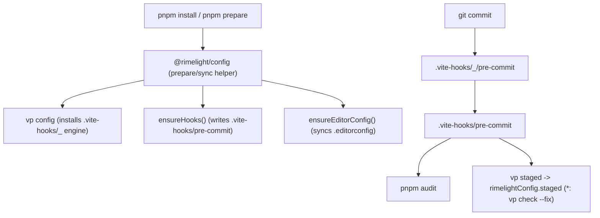

# RFC: Abstracting Git Hooks & Tooling Config (.editorconfig) via @rimelight/config

- **Status**: **Draft**
- **Author(s)**: Rimelight Team
- **Created**: 2026-09-17
- **Last Updated**: 2026-09-17
- **Discussion/PR**: [Pending]

---

## 1. Summary

Currently, repositories across the Rimelight ecosystem each maintain a `.vite-hooks` directory tracked in Git containing boilerplate hook files such as `.vite-hooks/pre-commit` (running `pnpm audit && vp staged`). While internal runner plumbing (`.vite-hooks/_/`) is already gitignored, managing `.vite-hooks` and its hook definitions manually across multiple individual projects creates boilerplate duplication and drift.

Additionally, editor/IDE-level dotfiles like `.editorconfig` require a physical file in the root filesystem for editors (e.g. WebStorm, VS Code) to resolve rules, leading to similar boilerplate duplication across standalone project repositories.

This RFC proposes abstracting Git hook setup and standard toolfile synchronization (specifically `.editorconfig`) into `@rimelight/config` (via a unified prepare/sync helper) so that required files are automatically generated, synchronized, and maintained across consumer repositories.

---

## 2. Motivation

- **Repetitive Boilerplate**: Every project repo repeats identical `.vite-hooks/pre-commit` configuration (`pnpm audit && vp staged`) and standard `.editorconfig` files.
- **Configuration Drift**: If the standardized pre-commit policy or formatting defaults evolve (e.g., newline rules, whitespace trimming, or audit flags), every repository currently needs manual updates.
- **Git Hygiene**: Having tracked tool-specific hook folders across numerous projects clutters repository roots when the configuration logic already lives centrally in `@rimelight/config` (via `rimelightConfig()` / `staged`).

### Goals

- Centralize pre-commit and git hook policy management in `@rimelight/config`.
- Automatically provision and maintain `.vite-hooks` via lifecycle scripts (`pnpm prepare` / `vp config`).
- Provide an optional sync path for `.editorconfig` to ensure uniform editor behavior without manual file copies.
- Allow projects to add `.vite-hooks` to `.gitignore` without losing hook protection during local development.

### Non-Goals

- Replacing Vite+ (`vp`) as the underlying git hook engine.
- Managing `.npmrc` or `tsconfig.json` (these are handled through standard package-manager mechanisms and TypeScript `extends`).
- Preventing individual projects from overriding or defining custom project-specific hooks or editor rules when explicitly needed.

---

## 3. Detailed Design

### 3.1. Proposed Architecture & Workflow

Vite+ uses Git's `core.hooksPath` pointing to `.vite-hooks/_`. During hook execution, `.vite-hooks/_/pre-commit` executes `.vite-hooks/pre-commit`. Editors (e.g. WebStorm, VS Code) look for `.editorconfig` in the root workspace.

Under the proposed design:

1. `prepare` runs `rimelight-config sync` (or `vp config && rimelight-hooks`).
2. `@rimelight/config` ensures `.vite-hooks/pre-commit` is generated with standardized tasks (`pnpm audit && vp staged`).
3. `@rimelight/config` ensures a standard `.editorconfig` is synchronized in the project root.
4. `.vite-hooks` is added to the project `.gitignore`.



### 3.2. Proposed API & Implementation

#### 1. In `@rimelight/config` (CLI / Helper)

Add a lightweight script / binary export (e.g., `rimelight-sync` or `rimelight-config prepare`):

```typescript
import fs from "node:fs";
import path from "node:path";

export interface SyncOptions {
  hooks?: Record<string, string>;
  editorconfig?: boolean | string;
}

export const DEFAULT_HOOKS: Record<string, string> = {
  "pre-commit": "pnpm audit && vp staged\n"
};

export const DEFAULT_EDITORCONFIG = `root = true

[*]
indent_style = space
indent_size = 2
end_of_line = lf
charset = utf-8
trim_trailing_whitespace = true
insert_final_newline = true
`;

export function syncHooks(options?: SyncOptions): void {
  const hooksDir = path.resolve(process.cwd(), ".vite-hooks");
  if (!fs.existsSync(hooksDir)) {
    fs.mkdirSync(hooksDir, { recursive: true });
  }

  const hooks = { ...DEFAULT_HOOKS, ...options?.hooks };
  for (const [name, script] of Object.entries(hooks)) {
    const hookFile = path.join(hooksDir, name);
    if (!fs.existsSync(hookFile) || fs.readFileSync(hookFile, "utf8") !== script) {
      fs.writeFileSync(hookFile, script, { mode: 0o755 });
    }
  }
}

export function syncEditorConfig(content = DEFAULT_EDITORCONFIG): void {
  const target = path.resolve(process.cwd(), ".editorconfig");
  if (!fs.existsSync(target) || fs.readFileSync(target, "utf8") !== content) {
    fs.writeFileSync(target, content, "utf8");
  }
}

export function syncProject(options?: SyncOptions): void {
  syncHooks(options);
  if (options?.editorconfig !== false) {
    syncEditorConfig(
      typeof options?.editorconfig === "string" ? options.editorconfig : DEFAULT_EDITORCONFIG
    );
  }
}
```

#### 2. In Consumer `package.json`

```json
{
  "scripts": {
    "prepare": "vp config && rimelight-config sync"
  }
}
```

#### 3. In Consumer `.gitignore`

```gitignore
# Git Hooks (auto-generated on prepare)
.vite-hooks/
```

---

## 4. Drawbacks & Trade-offs

- **Hidden Lifecycle**: Developers inspecting a clean git clone won't see `.vite-hooks` until `pnpm install` / `prepare` runs. However, this is consistent with standard modern tooling (Husky, Vite+, simple-git-hooks).
- **`.editorconfig` Git Tracking**: Unlike `.vite-hooks` (which is gitignored and executed locally by Git), `.editorconfig` can either be committed (so web viewers / clones without install respect formatting) or synced on prepare. The sync helper ensures it stays identical to the standard without manual drift.
- **Execution Permissions on Windows**: File mode permissions (`0o755`) are primarily POSIX concerns; on Windows, Vite+'s internal wrapper handles shell invocation via Git Bash / sh.

---

## 5. Alternatives Considered

1. **Status Quo (Explicit files tracked in each repo)**:
   - _Pros_: Completely visible in repository file tree.
   - _Cons_: Repetitive file maintenance and configuration drift across sibling repositories.

2. **Full Declarative Vite+ Plugin / Config Property**:
   - Defining `hooks: { preCommit: "..." }` inside `vite.config.ts`.
   - _Assessment_: Vite+ and IDEs currently require physical files on disk (`.vite-hooks/`, `.editorconfig`). Generating/syncing physical files during `prepare` provides a non-invasive bridge without upstream runtime changes.

---

## 6. Adoption & Migration Strategy

1. **Phase 1**: Release `@rimelight/config` update with `rimelight-config sync` binary / helper.
2. **Phase 2**: In consumer repos (e.g., `idantity.me`, `rimelight`, etc.):
   - Update `package.json` prepare script to `"prepare": "vp config && rimelight-config sync"`.
   - Add `.vite-hooks` to `.gitignore`.
   - Remove tracked `.vite-hooks/pre-commit` from Git tracking.
   - Let `.editorconfig` be automatically verified/synced.

---

## 7. Verification & Testing Plan

### Automated Tests

- Unit tests in `@rimelight/config` verifying:
  - `.vite-hooks` directory creation and default `pre-commit` hook generation.
  - `.editorconfig` creation and synchronization.
  - Preservation of custom scripts/configurations if explicit overrides are provided.

### Manual Verification

1. Run `pnpm prepare` in a test project.
2. Verify `.vite-hooks/pre-commit` and `.editorconfig` exist with the standardized contents.
3. Stage a sample file and run `git commit` to verify the pre-commit audit and staged checks execute seamlessly.

---

## 8. Unresolved Questions

- Should `rimelight-config sync` automatically invoke `vp config` internally so projects only need `"prepare": "rimelight-config sync"`?
- For `.editorconfig`, should consumer repositories keep `.editorconfig` committed to git, or should it also be gitignored and generated exclusively on `prepare`?
