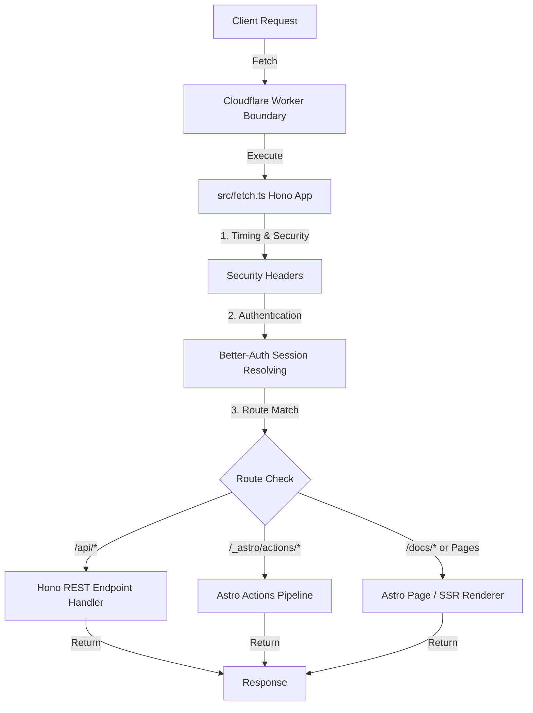

# RFC-0005: Advanced Routing and Pipeline Composition with Hono and Astro 7

- **Status**: **Implemented**
- **Author(s)**: Antigravity / @idant
- **Created**: 2026-06-22
- **Last Updated**: 2026-06-22
- **Discussion/PR**: [Link to PR/Issue]

---

## 1. Summary

This RFC proposes the adoption of Astro 7's new `src/fetch.ts` entry point in conjunction with Hono to orchestrate our application request lifecycle. By routing all server-side requests through Hono, we can resolve the architectural issue where Astro Actions execute prior to standard Astro middleware. Furthermore, this provides a unified, highly optimized, and type-safe router for custom API routes and third-party webhook integrations.

---

## 2. Motivation

Our current request lifecycle relies on standard `astro:middleware` sequenced in `packages/rimelight.com/src/middleware/index.ts`. However, this model introduces several technical limitations:

- **Actions Execute Before Middleware**: In standard Astro, requests targeted at Astro Actions (`/_astro/actions/...`) bypass standard `onRequest` middleware hooks before execution. This requires developers to duplicate authentication checks inside each individual Action handler rather than relying on a global middleware gatekeeper.
- **Rigid Pipeline Composition**: We cannot easily control the exact entry and exit phases of Astro's rendering pipeline (such as injecting headers, wrapping page rendering with timing tracers, or running redirects before parsing locale actions).
- **API Routing Boilerplate**: Writing custom REST APIs or webhook endpoints in Astro requires creating nested directories of `.ts` files returning custom `Response` objects. Managing CORS, rate-limiting, and validation schemas across these endpoints is verbose and lacks unified composition.

By leveraging Astro 7's `src/fetch.ts` combined with Hono, we gain absolute control over the request lifecycle at the very boundary of the Cloudflare Workers runtime.

---

## 3. Detailed Design

### 3.1. Proposed API / Usage

Under this proposal, we introduce a single `src/fetch.ts` in our application packages (e.g. `packages/rimelight.com/src/fetch.ts`) exporting a Hono instance.

```typescript
// packages/rimelight.com/src/fetch.ts
import { Hono } from "hono"
import { actions, middleware, pages, i18n } from "astro/hono"
import { authMiddleware } from "@/middleware/auth"
import { securityMiddleware } from "@/middleware/security"
import { timingMiddleware } from "@/middleware/timing"

const app = new Hono()

// 1. Global Server Utilities
app.use(timingMiddleware())
app.use(securityMiddleware())

// 2. Localization & Routing
app.use(i18n())

// 3. Security Boundary: Ensure Auth executes BEFORE Actions & Pages
app.use("/_astro/actions/*", authMiddleware())
app.use("/internal/*", authMiddleware())

// 4. Astro Lifecycle Execution
app.use(actions())
app.use(middleware())

// 5. Native Hono API Sub-routing (Optional/Clean API definition)
app.get("/api/v1/health", (c) => c.json({ status: "ok" }))

// 6. Page Rendering Fallback
app.use(pages())

export default app
```

### 3.2. Architecture & File Structure

With `src/fetch.ts` in place, the request pipeline shifts to a transparent, sequential model:



### 3.3. Key Components

1. **`astro/hono` Handlers**: Under the hood, the Astro 7 compiler converts static and SSR elements into middleware functions (`actions()`, `middleware()`, and `pages()`) compatible with Hono.
2. **Auth Integration**: The session verification (via `better-auth`) is shifted to run inside Hono middleware, setting standard context variables that downstream Astro endpoints can read.

---

## 4. Drawbacks & Trade-offs

- **Learning Curve**: Developers must familiarize themselves with the `hono` context (`c.req`, `c.json`) alongside standard Astro tools.
- **Migration Overhead**: Current middleware (using `defineMiddleware` from `astro:middleware`) must be refactored or adapted to function as Hono-compatible middleware.

---

## 5. Alternatives Considered

- **Keeping Standard Middleware**: We could keep checking auth inside every Action file. However, this is highly error-prone and developer forgetfulness could result in unprotected state mutation endpoints.
- **Vanilla fetch():** We could use the raw `src/fetch.ts` with manual URL parsing (`state.url.pathname.startsWith()`). This avoids bringing in `hono` but leads to writing a custom router from scratch.

---

## 6. Adoption & Migration Strategy

We can migrate progressively:

1. **Phase 1**: Add Hono and `src/fetch.ts` to `packages/rimelight.com`. Run standard middleware inside `app.use(middleware())` to preserve current behavior.
2. **Phase 2**: Relocate auth logic from `packages/rimelight.com/src/middleware/auth.ts` into a Hono middleware wrapper, placing it _above_ `app.use(actions())`.
3. **Phase 3**: Migrate API routes from `src/pages/api/*` to inline `app.get('/api/...')` routes inside the Hono app for improved readability.

---

## 7. Cross-Cutting Concerns

### 7.1. Performance & Bundle Size

- **Build Impact**: Hono is extremely lightweight (~20kB minified). It compiles down directly with our Cloudflare Worker bundle, adding zero client-side payload.
- **Runtime Performance**: Hono's RegExpRouter is one of the fastest routers available in JS/TS, maintaining execution latency under 1ms.

### 7.2. Security & Privacy

- **Enhanced Security**: Moving the auth boundary to execute prior to Astro Actions completely mitigates CSRF and unauthorized execution threats on state-modifying actions.

---

## 8. Verification & Testing Plan

### 8.1. Automated Tests

Run validation checks in the workspace to verify formatting and linting rules are upheld:

```bash
vp check
vp test
```

### 8.2. Manual Verification

1. Create a branch and build `rimelight.com` locally.
2. Trigger an action with authentication active, then verify that unauthorized curl requests to `/_astro/actions/` are blocked instantly at the server root.

---

## 9. Unresolved Questions

- **Static Assets**: How are static asset requests (`/_astro/assets/...`) bypassed? We need to ensure that the Hono router does not attempt dynamic routing logic for statically generated image or style assets.
