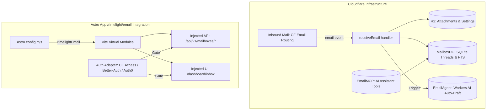

# RFC-0005: Modular Agentic Email & Inbox Astro Integration for Cloudflare

- **Status**: **Draft**
- **Author(s)**: Idan T. / Antigravity
- **Created**: 2026-08-25
- **Last Updated**: 2026-08-25
- **Discussion/PR**: N/A

---

## 1. Summary

This RFC proposes packaging the agentic inbox and email system (currently residing in `personal.idantity.me` and `rimelight-dot-com-agentic-inbox`) into a standalone, reusable package: **`@rimelight/email`** (or `@rimelight/inbox`).

The package will function as an **Astro Integration** combined with a Cloudflare Email/Durable Object server library. It allows any Astro application deployed on Cloudflare Workers/Pages to instantly gain a full-featured, auth-gated webmail client, Hono REST API, MCP tool endpoints, Workers AI auto-reply agent, and inbound email processing via Cloudflare Email Routing.

---

## 2. Motivation

Building and hosting email servers is notoriously complex. However, Cloudflare's serverless primitives (Email Routing, Durable Objects with SQLite storage, Workers AI, and R2) allow running a complete, high-performance personal or organizational email server on edge infrastructure with zero server maintenance.

Currently, this implementation is tightly bound to `personal.idantity.me` and a standalone React Router repository (`rimelight-dot-com-agentic-inbox`). By extracting this into a reusable Astro integration:

1. **Any Astro site on Cloudflare (`idantity.me`, `rimelight.com`, etc.)** can turn on a private webmail dashboard at `/inbox` or `/dashboard/inbox` with a single configuration block in `astro.config.mjs`.
2. **Pluggable Authentication**: Like Rimelight CMS (RFC-0004), access to mailboxes and email APIs can be gated via **Cloudflare Access (Zero Trust)**, **Better-Auth**, or **Auth0**.
3. **Turnkey AI & MCP Integration**: Any AI agent running via Model Context Protocol (MCP) or sidecar tools can query, search, and compose drafts through standard endpoints.

---

## 3. Detailed Design

### 3.1. Package Architecture

`@rimelight/email` will be structured into three primary export points:

```
@rimelight/email
├── / (Astro Integration: route injection, virtual modules)
├── /do (Durable Object classes: MailboxDO, EmailAgent, EmailMCP)
├── /server (Cloudflare Email Routing handler: receiveEmail, sendEmail)
└── /ui (Interactive UI islands: MailboxSplitView, ThreadView, Composer)
```



---

### 3.2. Integration Configuration (`astro.config.mjs`)

```typescript
// astro.config.mjs
import { defineConfig } from "astro/config"
import { rimelightEmail, cfAccessAuth } from "@rimelight/email"

export default defineConfig({
  integrations: [
    rimelightEmail({
      // Route where the webmail dashboard is served
      routePrefix: "/dashboard/inbox",

      // Optional layout to wrap the inbox UI (e.g. your app's dashboard shell)
      parentLayout: "./src/layouts/DashboardLayout.astro",

      // Authentication Adapter (reusing the RFC-0004 pattern)
      auth: cfAccessAuth({
        aud: process.env.CF_ACCESS_AUD,
        teamDomain: "idantity.cloudflareaccess.com",
        defaultRole: "admin"
      }),

      // Configured domains & mailboxes
      domains: ["idantity.me"],
      allowedMailboxes: ["daniel@idantity.me", "hello@idantity.me"],

      // Cloudflare environment binding names
      bindings: {
        bucket: "BLOB",
        mailbox: "MAILBOX",
        emailAgent: "EMAIL_AGENT",
        emailMcp: "EMAIL_MCP",
        sendEmail: "EMAIL",
        ai: "AI"
      }
    })
  ]
})
```

---

### 3.3. Injected Routes & Endpoints

When `rimelightEmail()` is registered, it automatically injects:

1. **Webmail UI Pages**:
   - `[routePrefix]`: Full-viewport split mailbox view with folder navigation, threaded conversation view, search bar, and WYSIWYG email composer.

2. **REST API Routes (`[routePrefix]/api/v1/*`)**:
   - `GET /mailboxes`: List mailboxes accessible to the session.
   - `GET/POST /mailboxes/:id/emails`: Fetch paginated emails, search, and send outbound messages.
   - `GET /mailboxes/:id/threads/:threadId`: Fetch all emails in a conversation thread.
   - `POST /mailboxes/:id/drafts`: Save or discard drafts.
   - `POST /mailboxes/:id/emails/:id/reply`: Handle structured threading replies.
   - `GET /mailboxes/:id/emails/:emailId/attachments/:attId`: Secure streaming attachment download from R2.

3. **AI / Model Context Protocol (MCP) Endpoints**:
   - `[routePrefix]/mcp/*`: Exposes MCP JSON-RPC tools (`search_emails`, `read_thread`, `create_draft`, `list_folders`) for local coding assistants and background agents.

---

### 3.4. Cloudflare Worker Entry & Durable Objects Export

In the host app's `wrangler.jsonc`:

```jsonc
{
  "name": "my-astro-app",
  "main": "@astrojs/cloudflare/entrypoints/server",
  "durable_objects": {
    "bindings": [
      { "name": "MAILBOX", "class_name": "MailboxDO" },
      { "name": "EMAIL_AGENT", "class_name": "EmailAgent" },
      { "name": "EMAIL_MCP", "class_name": "EmailMCP" }
    ]
  },
  "migrations": [{ "tag": "v1", "new_sqlite_classes": ["MailboxDO", "EmailAgent", "EmailMCP"] }],
  "r2_buckets": [{ "binding": "BLOB", "bucket_name": "my-app-storage" }],
  "ai": { "binding": "AI" },
  "send_email": [{ "name": "EMAIL", "remote": true }]
}
```

The consumer application can export the Durable Object classes directly from the package in their custom worker entry or entrypoint wrapper:

```typescript
// src/worker.ts (or server entry)
export { MailboxDO, EmailAgent, EmailMCP } from "@rimelight/email/do"
import { receiveEmail } from "@rimelight/email/server"

export default {
  // Handle incoming SMTP messages from Cloudflare Email Routing
  async email(message, env, ctx) {
    await receiveEmail(message, env, ctx)
  },

  // Fallback to Astro SSR handler
  fetch(request, env, ctx) {
    return astroHandler.fetch(request, env, ctx)
  }
}
```

---

### 3.5. Auth & Access Control

Access control mirrors the design in **RFC-0004**:

- **Single-User / Portfolio (`idantity.me`)**: Using `cfAccessAuth`, incoming HTTP requests verify the `Cf-Access-Jwt-Assertion` header. If valid, the user is granted access to all authorized mailboxes without maintaining any user database tables.
- **Multi-User / Organization (`rimelight.com`)**: Using `betterAuthAdapter` or `auth0Auth`, mailboxes are scoped to specific authenticated user IDs or organizational roles (`editor`, `support`, `admin`).

---

## 4. Drawbacks & Trade-offs

- **Cloudflare Primitives Dependency**: This integration is designed specifically for Cloudflare Workers (Email Routing, Durable Objects with SQLite, R2, and Workers AI). It cannot run on pure Node.js/Vercel SSR without alternative storage/queue adapters.
- **DO Migration Tracking**: Any changes to the SQLite schema within `MailboxDO` must be managed via versioned migration tags in `wrangler.jsonc`.

---

## 5. Alternatives Considered

1. **Third-Party SaaS (Google Workspace / Fastmail / Resend Inbox)**:
   - _Rejected_: High per-seat cost, lack of self-hosted data ownership, and inability to run native edge AI auto-reply workers and MCP protocols directly against the inbox database.
2. **Stand-alone Worker Subdomain (e.g. `mail.idantity.me`)**:
   - _Alternative_: Keeping it as a separate worker is valid, but creating an Astro Integration enables unified routing, shared auth sessions, and embedding directly into an existing admin dashboard.

---

## 6. Adoption & Migration Strategy

1. **Phase 1 (`packages/email` in Rimelight monorepo)**:
   - Extract `MailboxDO`, `EmailAgent`, `EmailMCP`, and `PostalMime` parser logic into `@rimelight/email`.
   - Build the `rimelightEmail()` Astro integration with route injection and auth adapter hooks.
2. **Phase 2 (`personal.idantity.me`)**:
   - Replace local `src/workers/inbox` code with the new `@rimelight/email` package.
3. **Phase 3 (Any new / existing Astro site)**:
   - Enable email routing and drop in `rimelightEmail()` with `cfAccessAuth`.

---

## 7. Verification & Testing Plan

### 7.1. Automated Tests

- Unit tests for MIME parsing, attachment extraction to R2, and threading headers calculation.
- Mock Durable Object SQLite tests for email pagination, full-text search, and folder mutations.

### 7.2. Manual Verification

- Send a live test email through Cloudflare Email Routing to verify reception, attachment storage in R2, and auto-draft trigger.
- Access the webmail dashboard at `/dashboard/inbox` under Cloudflare Access to test composing, replying, and searching.
