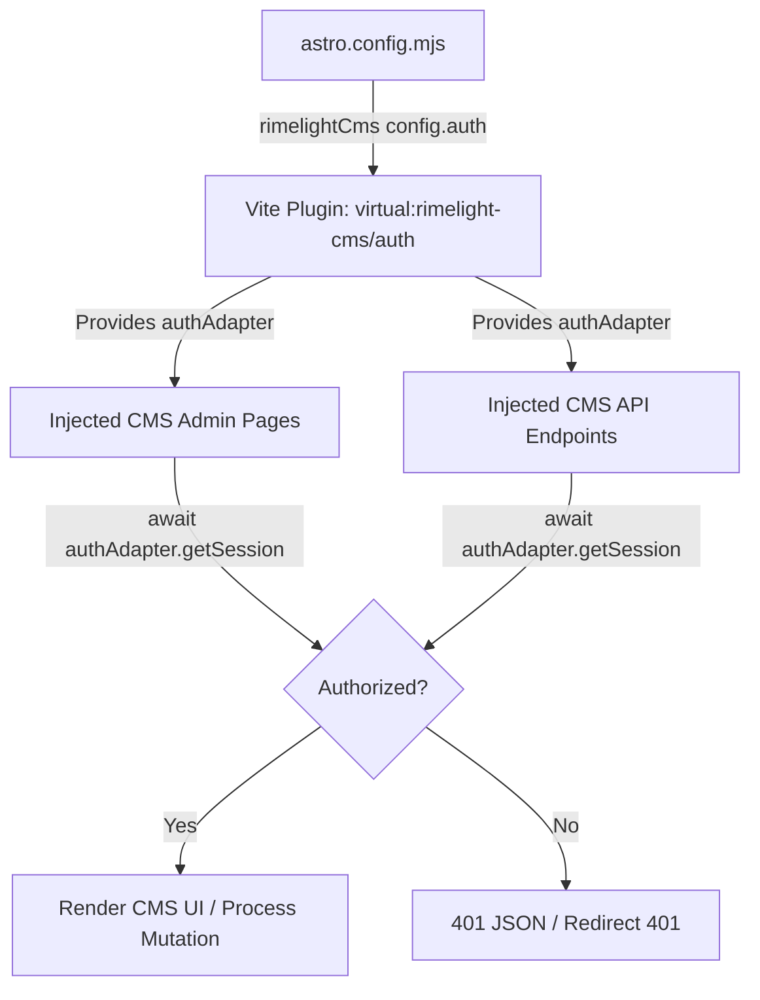

# RFC-0004: Pluggable Authentication Adapters & Decoupled User Schemas for Rimelight CMS

- **Status**: **Draft**
- **Author(s)**: Idan T. / Antigravity
- **Created**: 2026-08-25
- **Last Updated**: 2026-08-25
- **Discussion/PR**: N/A

---

## 1. Summary

This RFC proposes introducing a **Pluggable Authentication Adapter Architecture** for the `@rimelight/cms` Astro Integration, allowing consumer applications to power the CMS admin dashboard and protected API endpoints using any authentication mechanism (e.g. **Cloudflare Access**, **Auth0 / OIDC**, **Better-Auth**, or **Custom/Static Tokens**) without coupling the CMS to a specific user database or identity library.

Additionally, this document clarifies the boundary and relational strategies between CMS core content schemas (such as `bylines` and versioning audit trails) and application-specific user/employee database schemas.

---

## 2. Motivation

Currently, `@rimelight/cms` internally operates on a decoupled generic contract:

```typescript
export interface UserSessionContext {
  userId: string
  roles: string[]
  permissions: string[]
}
```

However, in practical implementations (such as `starter.rimelight.com`), the CMS API routes and page guards directly import and invoke `@rimelight/auth` (Better-Auth).

This tight coupling causes friction across different projects in the monorepo:

1. **Lightweight / Single-User Sites (`idantity.me`)**: Sites that only need to protect the CMS admin UI behind **Cloudflare Access (Zero Trust)** are currently forced to set up Better-Auth database tables (`users`, `sessions`, `accounts`, `verifications`), email notification handlers, and auth endpoints that they do not need.
2. **Enterprise / Multi-Tenant Sites (`rimelight.com`)**: Sites that may eventually migrate from Better-Auth to enterprise identity providers like **Auth0**, **Clerk**, or corporate **OIDC/SAML** providers should be able to do so without touching any CMS internal code.
3. **Database Schema Pollution**: Applications often maintain rich employee, customer, or member tables with proprietary fields. The CMS must never mandate or conflict with these domain schemas.

---

## 3. Detailed Design

### 3.1. The Auth Adapter Interface

We define a standardized adapter contract in `@rimelight/cms`:

```typescript
// packages/cms/src/auth/adapter.ts
export interface UserSessionContext {
  userId: string
  roles: string[]
  permissions: string[]
  email?: string
  name?: string
  metadata?: Record<string, any>
}

export interface CmsAuthAdapter {
  /**
   * Resolves the authenticated session from an incoming HTTP Request.
   * Returns `null` if unauthenticated or invalid.
   */
  getSession(request: Request): Promise<UserSessionContext | null>

  /**
   * Optional hook to handle unauthorized redirects for UI routes.
   * Defaults to redirecting to loginUrl or returning a 401.
   */
  handleUnauthorized?: (request: Request) => Response | Promise<Response>
}
```

---

### 3.2. Astro Integration Configuration (`rimelightCms`)

The `rimelightCms` integration in `packages/cms/src/integration.ts` is updated to accept an `auth` configuration field:

```typescript
// astro.config.mjs
import { defineConfig } from "astro/config"
import { rimelightCms, cfAccessAuth, betterAuthAdapter, auth0Auth } from "@rimelight/cms"

// Example 1: idantity.me (Cloudflare Access - Zero DB Auth)
export default defineConfig({
  integrations: [
    rimelightCms({
      routePrefix: "/[locale]/cms",
      db: "./src/db/index.ts",
      storage: { provider: "r2", binding: "BLOB" },
      auth: cfAccessAuth({
        aud: process.env.CF_ACCESS_AUD,
        teamDomain: "idantity.cloudflareaccess.com",
        defaultRole: "admin"
      })
    })
  ]
})
```

```typescript
// Example 2: rimelight.com (Auth0 / OIDC)
export default defineConfig({
  integrations: [
    rimelightCms({
      routePrefix: "/[locale]/cms",
      db: "./src/db/index.ts",
      auth: auth0Auth({
        domain: process.env.AUTH0_DOMAIN,
        audience: process.env.AUTH0_AUDIENCE,
        rolesClaim: "https://rimelight.com/roles"
      })
    })
  ]
})
```

```typescript
// Example 3: starter.rimelight.com (Better-Auth)
import { auth } from "./src/auth/auth"

export default defineConfig({
  integrations: [
    rimelightCms({
      routePrefix: "/[locale]/cms",
      db: "./src/db/index.ts",
      auth: betterAuthAdapter(auth)
    })
  ]
})
```

---

### 3.3. Virtual Module Architecture

The integration leverages Vite virtual modules to compile and inject the selected adapter at build time:



#### Vite Virtual Resolution:

```typescript
// packages/cms/src/integration.ts
updateConfig({
  vite: {
    plugins: [
      {
        name: "vite-plugin-rimelight-cms-virtuals",
        resolveId(id) {
          if (id === "virtual:rimelight-cms/auth") return "\0virtual:rimelight-cms/auth"
        },
        load(id) {
          if (id === "\0virtual:rimelight-cms/auth") {
            // Emits the configured adapter export
            return resolvedAuthAdapterCode
          }
        }
      }
    ]
  }
})
```

---

### 3.4. Pre-built Adapters

#### 1. Cloudflare Access Adapter (`cfAccessAuth`)

Reads Zero Trust headers (`Cf-Access-Jwt-Assertion` and `Cf-Access-Authenticated-User-Email`):

```typescript
export function cfAccessAuth(config: {
  aud?: string
  teamDomain?: string
  defaultRole?: string
}): CmsAuthAdapter {
  return {
    async getSession(req: Request) {
      const email = req.headers.get("cf-access-authenticated-user-email")
      const jwt = req.headers.get("cf-access-jwt-assertion")
      if (!email && !jwt) return null

      // In production, verify JWT against https://<teamDomain>.cloudflareaccess.com/cdn-cgi/access/certs
      return {
        userId: email || "cf-access-user",
        email: email || undefined,
        roles: [config.defaultRole || "admin"],
        permissions: ["*"]
      }
    }
  }
}
```

#### 2. Better-Auth Adapter (`betterAuthAdapter`)

Bridges the existing `@rimelight/auth` / Better-Auth instance:

```typescript
export function betterAuthAdapter(authInstance: any): CmsAuthAdapter {
  return {
    async getSession(req: Request) {
      const session = await authInstance.api.getSession({ headers: req.headers })
      if (!session || !session.user) return null

      return {
        userId: session.user.id,
        email: session.user.email,
        name: session.user.name,
        roles: session.user.role ? [session.user.role] : ["user"],
        permissions: session.user.permissions || []
      }
    }
  }
}
```

#### 3. Auth0 / Generic JWT Adapter (`auth0Auth`)

Verifies Bearer tokens or session cookies against an OIDC JWKS endpoint.

---

### 3.5. Database Schema Decoupling & Byline Relations

#### Loose Identifier Strategy

CMS tables maintain **zero foreign key constraints** to application `users` tables:

- `pages.authorIds`: `jsonb("author_ids").$type<string[]>()`
- `page_versions.createdBy`: `text("created_by")`
- `page_version_approvals.userId`: `text("user_id")`
- `bylines.userId`: `text("user_id")`

#### Relating Bylines to App Users / Employees

For applications like `rimelight.com` that require linking CMS content authors to their corporate employee / user records:

1. **Option A: App-Level Relational Queries (Drizzle `relations`)**
   The application defines the relation in its own schema without modifying `@rimelight/cms`:

   ```typescript
   // src/db/schema/relations.ts in rimelight.com
   import { relations } from "drizzle-orm"
   import { bylines } from "@rimelight/cms"
   import { users } from "./users"

   export const bylinesRelations = relations(bylines, ({ one }) => ({
     user: one(users, {
       fields: [bylines.userId],
       references: [users.id]
     })
   }))
   ```

2. **Option B: Query Joins**

   ```typescript
   const posts = await db
     .select({ page: pages, author: bylines, employee: users })
     .from(pages)
     .leftJoin(bylines, eq(pages.slug, bylines.slug))
     .leftJoin(users, eq(bylines.userId, users.id))
   ```

3. **Option C: Independent Guest Bylines**
   Guest authors, external contributors, or synthetic brand accounts can exist in `bylines` with `userId: null`, requiring no user account creation.

---

## 4. Drawbacks & Trade-offs

- **JWT Verification Overhead on Edge**: When using external OIDC/Auth0 or CF Access JWT verification in edge workers, JWKS keys should be cached in memory or KV to prevent sub-request latency on every CMS request.
- **Relational Integrity**: Because there are no SQL foreign keys between `pages.authorIds` / `bylines.userId` and `users.id`, deleting a user does not automatically cascade to CMS content. However, this is standard practice in CMS architectures to prevent historical published posts from corrupting upon user deletion.

---

## 5. Alternatives Considered

1. **Hardcoding `@rimelight/auth` into the CMS**:
   - _Rejected_: Forces single-user sites (`idantity.me`) and static portfolios to maintain unnecessary database tables and auth endpoints.
2. **HTTP Middleware-Only Protection (Reverse Proxy)**:
   - _Rejected_: Leaving CMS routes completely unauthenticated and relying exclusively on edge proxies makes local development, testing, and granular role-based permissions (Editor vs. Admin vs. Approver) impossible.

---

## 6. Adoption & Migration Strategy

1. **Phase 1 (`@rimelight/cms`)**:
   - Implement `CmsAuthAdapter` interface and default adapters (`cfAccessAuth`, `betterAuthAdapter`, `auth0Auth`, `devMockAuth`).
   - Add `auth` property to `RimelightCmsOptions` in `packages/cms/src/integration.ts`.
   - Update injected CMS pages and `/api/cms/*` endpoints to resolve session via `virtual:rimelight-cms/auth`.

2. **Phase 2 (`idantity.me`)**:
   - Enable `rimelightCms` with `cfAccessAuth`.
   - Delete unused Better-Auth tables and configurations if no longer required.

3. **Phase 3 (`starter.rimelight.com` & `rimelight.com`)**:
   - Wrap existing Better-Auth instance in `betterAuthAdapter(auth)`.
   - When migrating `rimelight.com` to Auth0, swap the adapter in `astro.config.mjs` with zero CMS code changes.

---

## 7. Cross-Cutting Concerns

- **Performance**: Auth resolution occurs only on CMS routes (`/cms/*` and `/api/cms/*`). Public site page rendering (`PageRenderer.astro`) remains completely static or ISR without auth runtime overhead.
- **Security**: The adapter pattern centralizes authentication validation into a single point of enforcement for all injected CMS routes, preventing orphaned unauthenticated API endpoints.

---

## 8. Verification & Testing Plan

### 8.1. Automated Tests

- Unit tests for each adapter (`cfAccessAuth`, `betterAuthAdapter`, `auth0Auth`) validating token parsing, header extraction, and rejection of invalid signatures.
- Guard validation tests checking role-based permissions (`admin`, `editor`, `approver`) across mock sessions.

### 8.2. Manual Verification

- Verify `idantity.me` loads CMS dashboard with mock/live Cloudflare Access headers.
- Verify `starter.rimelight.com` operates seamlessly with Better-Auth sessions.
