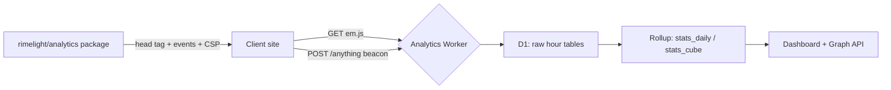

# RFC: `@rimelight/analytics` — Astro Native vs. Vite-Agnostic

- **Status**: Draft
- **Author(s)**: Rimelight Engineering
- **Created**: 2026-09-22
- **Last Updated**: 2026-09-22
- **Discussion/PR**: [Link to PR/Issue]
- **Related RFCs**:
  - [RFC: `@rimelight/ecommerce` — Self-Contained Workers Store vs. Headless Medusa Storefront](rimelight_ecommerce_package_options.md)

---

## 1. Summary

Rimelight has no analytics package, and every client site we ship currently runs ad-hoc tracking or nothing at all. We own the infrastructure and the privacy stance for the rest of a site's runtime (D1, Drizzle, Hono, `@rimelight/security`, `@rimelight/auth`), so a first-party analytics story fits the stack.

The candidate engine is **Edgemetry** — a privacy-first, self-hosted, Cloudflare-native analytics tool (one Worker, one D1 database, no cookies, ~2.1 KB tracker). It is MIT-licensed and runs on exactly the stack our apps already use (Cloudflare Workers, D1, Hono, Wrangler). We have assessed its internals and the fit is strong.

This RFC does **not** decide whether to run one shared Edgemetry instance or one per client — that is a separate deployment question. It decides the **shape of the `@rimelight/analytics` package**. Two options are presented in full:

- **Option A — Astro Native**: a traditional Astro integration using `astro:config:setup`, head injection and `injectRoute`.
- **Option B — Vite-Agnostic**: a framework-agnostic TypeScript core bundled with a consolidated Vite plugin and a **Unified Head contract** (`{ html, tags }`), with Astro as one consumer among several.

**Recommendation: Option B**, because it follows the precedent already set by the (accepted) `@rimelight/seo` decoupling: `@rimelight/auth`, `@rimelight/i18n`, and `@rimelight/ui` are registered as Vite plugins in `packages/config`, security ships a pure Vite plugin core with a thin Astro adapter, and head-injecting packages share one contract with zero cross-dependencies.

---

## 2. Motivation

### Pain Points

- **No analytics for client sites.** idantity.me, queerkit.com, marcelocfilho.com et al. either ship no tracking or would fall back to a third-party SaaS (Google Analytics, Plausible Cloud) with recurring bills, consent banners, and third-party requests in the browser.
- **The monorepo already lost Astro lock-in.** The SEO RFC that this RFC supersedes was accepted and shipped: `@rimelight/seo` is now a generic Vite plugin (`packages/seo/plugin.ts`, `virtual:rimelight/seo`) with `./plugin` subpath exports, `astro` dropped as a dependency. Shipping a _new_ package as Astro-only would reverse a deliberate, recent architectural decision.
- **Framework lock-in is real, not theoretical.** A `ComponentShowcase`-style multi-framework story, SolidStart/Hono/plain-Vite consumers, and edge runtimes (Cloudflare Workers standalone) cannot use an Astro integration. An analytics snippet is a head + script concern, not an Astro concern.
- **CSP compatibility is a first-class need.** `@rimelight/security` ships CSP + SRI. A tracker is a cross-origin `<script src>` plus a beacon `connect-src`. Whatever shape the package takes, it must be able to teach the security policy which origins to allow — and that handshake belongs between two _frameworks-agnostic_ pieces, not inside an Astro fat layer.

### Goals

- A `@rimelight/analytics` package that any Rimelight site can adopt with one line.
- Deliver the tracker snippet, custom events surface, and CSP/SRI coordination in a framework-agnostic form.
- Keep the **server half** (Edgemetry Worker, D1 rollups, graph API, dashboard) out of the package — it lives on a deployment, not in the monorepo, and the package is a consumer of its public API.
- Astro remains a first-class consumer via standard Vite plugin loading.

### Non-Goals

- Wiring a D1 database or Drizzle schema into the package. Edgemetry owns its storage; the package does not touch it.
- Reimplementing the dashboard, graph API, rollups, or visitor hashing in this RFC.
- Deciding shared-vs-per-client instance topology (see section 7.3).
- Supporting self-hosted Edgemetry _replacement_; the package assumes an instance exists at some hostname.

---

## 3. Detailed Design

### 3.1. Common Ground: What Both Options Share

Both options wrap the same Edgemetry surface. The tracker is fetched as:

```html
<script defer src="https://stats.example.com/em.js" data-domain="example.com"></script>
```

and events fire via `window.edgemetry('signup')`. The package therefore always provides:

| Concern          | Form                                                                          |
| ---------------- | ----------------------------------------------------------------------------- |
| Script injection | The `<script>` tag with `src`, `defer`, `data-domain`, optional `nonce`       |
| Options          | Script URL, `data-domain`, event surface on/off, `data-local` policy          |
| Events helper    | `analytics.event(name)` → delegates to `window.edgemetry`                     |
| CSP additions    | `scriptSrc: [scriptUrl]`, `connectSrc: [beaconOrigin]`                        |
| Dev mode         | Serve the tracker locally or proxy to the instance in dev (`configureServer`) |

The **server half is identical in both options** and does not ship in the package:



### 3.2. Option A — Astro Native Integration

A traditional Astro integration registered via `integrations.push(...)`.

```typescript
// astro.config.ts
import { rimelightAnalytics } from "@rimelight/analytics";

export default defineConfig({
  integrations: [
    rimelightAnalytics({
      scriptUrl: "https://stats.example.com/em.js",
      domain: "example.com",
      events: true
    })
  ]
});
```

Implementation shape:

- `astro:config:setup` hook → `updateConfig()` to register a `@astrojs/cloudflare`-compatible middleware or inject the snippet into page HTML via `astro:page:head`.
- `injectRoute` could mount an `AnalyticsDashboard.astro` wrapper in a future self-host-everywhere iteration.
- `transformIndexHtml` may be used for dev/preview parity.
- Direct access to `Astro.locals` enables injecting the tracker URL and per-page domain configuration at render time.

**Why someone would choose it:** trivially ergonomic for the exact apps we ship today (all Astro), full access to Astro lifecycle hooks, and the shortest path to mounting a dashboard inside `/admin/analytics`.

### 3.3. Option B — Vite-Agnostic (Recommended)

A framework-agnostic core plus a consolidated Vite plugin, following the shipped `@rimelight/seo`/`@rimelight/security` pattern.

```typescript
// vite.config.ts (any Vite app)
import { rimelightAnalytics } from "@rimelight/analytics/plugin";

export default defineConfig({
  plugins: [
    rimelightAnalytics({
      scriptUrl: "https://stats.example.com/em.js",
      domain: "example.com",
      events: true
    })
  ]
});
```

With a head generator usable in any SSR context:

```typescript
import { defineAnalyticsConfig, generateAnalyticsHead } from "@rimelight/analytics/head";

const config = defineAnalyticsConfig({
  scriptUrl: "https://stats.example.com/em.js",
  domain: "example.com"
});

const head = generateAnalyticsHead(config); // => { html, tags }
```

Astro consumes it as a plain Vite plugin, consistent with auth/i18n/ui:

```typescript
// astro.config.ts
import { rimelightAnalytics } from "@rimelight/analytics/plugin"

export default defineConfig({
  vite: {
    plugins: [rimelightAnalytics({ ... })]
  }
})
```

#### 3.3.1. Subpath Exports

Mirror `@rimelight/seo`:

```
"exports": {
  ".":             "./dist/index.mjs",
  "./plugin":      "./dist/plugin.mjs",
  "./head":        "./dist/head.mjs",
  "./events":      "./dist/events.mjs",
  "./csp":         "./dist/csp.mjs",
  "./tracker":     "./dist/tracker.mjs"
}
```

- `./plugin` — `rimelightAnalytics(options)`: `transformIndexHtml` for HTML consumers, `virtual:rimelight/analytics` for SSR loaders, `configureServer` middleware to serve/proxy the tracker in dev.
- `./head` — `defineAnalyticsConfig()` + `generateAnalyticsHead(): HeadResult`, producing a `script` `HeadTag` (`{ src, defer, "data-domain", nonce? }`) that conforms to the **Unified Head contract** shared by `@rimelight/seo`, `@rimelight/security`, `@rimelight/ui`.
- `./events` — the dependency-free client helper (`analytics.event(name)`, SPA hook, `data-local` opt-in, `em-ignore` honor).
- `./csp` — `cspAdditions(): { scriptSrc: string[], connectSrc: string[] }`, shaped to spread directly into `@rimelight/security`'s `SecurityOptions`. Zero cross-package dependencies.
- `./tracker` — the raw tracker script as a string export (what a self-hosted instance serves), enabling dev-server serving without a network dependency.

#### 3.3.2. Unified Head Contract Conformance

To stay consistent with the accepted Head contract, `generateAnalyticsHead` returns:

```typescript
interface HeadResult {
  html: string; // sanitized, ready for <Fragment set:html={...} />
  tags: (HeadTag | AnalyticsTag)[]; // typed descriptors
}
```

The `script` tag produced must carry `nonce` support so a Content Security Policy with a per-request nonce (as Edgemetry's own dashboard uses, and `@rimelight/security` expects) works without `'unsafe-inline'`.

#### 3.3.3. CSP/SRI Coordination

`cspAdditions()` returns the exact origins a site must allow:

```typescript
cspAdditions({ scriptUrl: "https://stats.example.com/em.js" });
// => { scriptSrc: ["https://stats.example.com"], connectSrc: ["https://stats.example.com"] }
```

The keys are named after `@rimelight/security`'s `SecurityOptions` fields, so no composer is needed — the result spreads straight into the site's security options:

```typescript
import { cspAdditions } from "@rimelight/analytics/csp";

const securityOptions = {
  domain: "example.com",
  ...cspAdditions({ scriptUrl: "https://stats.example.com/em.js" })
};
```

A site enabling both gets a correct, single policy with no extra layer. This supersedes the earlier plan to route the merge through `@rimelight/config`: that layer (`rimelightSolidConfig`, the `@rimelight/config/solid` subpath) has since been deleted, since it derived a CSP that `@rimelight/security` already derives from `domain` alone. `SecurityOptions` is now the single surface for CSP configuration.

#### 3.3.4. Dev Mode

`configureServer` middleware: serve the bundled tracker (`./tracker`) at `/_analytics/em.js` in dev so local traffic works with the stack's default `localhost`-ignore, or proxy to the instance. The `data-local="true"` opt-in is honored so development traffic never pollutes real stats until a developer opts in.

### 3.4. Key Components (Option B)

| File                                | Responsibility                                                     |
| ----------------------------------- | ------------------------------------------------------------------ |
| `packages/analytics/src/index.ts`   | Public barrel, types                                               |
| `packages/analytics/src/plugin.ts`  | `rimelightAnalytics()` Vite plugin, virtual module, dev middleware |
| `packages/analytics/src/head.ts`    | `defineAnalyticsConfig` / `generateAnalyticsHead`, HeadTag union   |
| `packages/analytics/src/events.ts`  | Client helper, framework-free                                      |
| `packages/analytics/src/csp.ts`     | `cspAdditions()`                                                   |
| `packages/analytics/src/tracker.ts` | The bundled tracker script string                                  |
| `packages/analytics/test/*`         | Vitest: head output, CSP additions, events, virtual module         |

---

## 4. Drawbacks & Trade-offs

### Option A — Astro Native

- Reintroduces the Astro lock-in the monorepo just removed from `@rimelight/seo`. `astro` becomes a peer/dev dependency, tying release and typecheck cycles to Astro versions.
- Useless outside Astro: SolidStart, Hono edge routes, and non-Astro Vite consumers get nothing.
- Duplicates the Head injection pattern (`astro:page:head`) that the new `{ html, tags }` contract replaces everywhere else.
- The only unique perk — `injectRoute` for a dashboard — is moot in the shared-instance model (section 1), where the dashboard stays on the analytics deployment.
- **Effort**: small (a few days), but a footprint the ecosystem will grow out of.

### Option B — Vite-Agnostic

- Slightly more ceremony for an all-Astro shop: sites must be wired through `vite.plugins` rather than a dedicated `integrations` entry. Mitigation: the Vite-plugin pattern is already the norm for auth/i18n/ui/seo, so the pattern is familiar and one-line.
- The unified head contract means layouts render `<Fragment set:html={head.html} />` (or the platform equivalent) rather than relying on magic head injection. SSG-only sites must render the head at build time, which needs either `transformIndexHtml` (handled by the plugin for HTML output) or an explicit layout call.
- Marginal: the dev-mode proxy and virtual module are new machinery for a three-functions package.
- **Effort**: slightly larger (a packaged plugin + head + events + csp), still measured in days.

---

## 5. Alternatives Considered

### A. Astro Integration Wrapping the Vite Plugin (Hybrid)

Ship the Vite plugin as the core _and_ a 20-line Astro adapter (`integration.ts`), exactly like `@rimelight/security`. This is effectively **Option B with a compat surface**, not a third option. Adopted by default — see section 6.

### B. No Package — Ship a Snippet in Each Site

Copy the `<script>` tag into every client site manually. **Rejected**: repeats the CSP handshake per site, no shared events helper, no dev parity, no versioning, drift between sites.

### C. Analytics Engine Shell — Package Reimplements the Server

Put the whole Edgemetry Worker (D1 schema, rollup, dashboard, graph API) in the monorepo as `@rimelight/analytics-server`. **Rejected for this RFC**: it re-lights the D1-budget accounting and Edgemetry's hand-rolled schema versioning, and it is orthogonal to the package-shape question this RFC decides. May be proposed separately if we decide to self-host per-site.

### D. Third-Party CDN Script (Plausible/GA) Wrapped by the Package

**Rejected**: reintroduces third-party requests, recurring cost, and consent-banner exposure — exactly what Edgemetry avoids.

### E. Single `analytics()` Utility, No Plugin, No Virtual Module

Export only pure functions (`generateAnalyticsHead`, `cspAdditions`) and call them from layouts/components. **Viable fallback** if the plugin surface feels too heavy, but loses `transformIndexHtml` auto-injection for plain HTML apps and dev-server serving.

---

## 6. Adoption & Migration Strategy

Non-breaking; no existing project is forced to change.

| Phase | Scope                                                                                        | Effort   |
| ----- | -------------------------------------------------------------------------------------------- | -------- |
| **1** | Fork Edgemetry's tracker; scaffold `packages/analytics` (plugin, head, events, csp, tracker) | 1–2 days |
| **2** | Wire alongside auth/i18n/ui so the starter spreads `cspAdditions()` into `security()`        | 0.5 day  |
| **3** | Pilot on `starter.rimelight.com` and one client site against a shared dev instance           | 1 day    |
| **4** | Add the Vitest suite (head output, CSP additions, virtual module) and ship                   | Ongoing  |

Astro sites adopt via `vite.plugins`. A future optional `./integration` subpath (the `@rimelight/security` pattern) gives a dedicated `integrations` entry without changing the core. The server half is deployed separately and needs no migration.

---

## 7. Cross-Cutting Concerns

### 7.1. Performance & Bundle Size

- Tracker path: the script is ~2.1 KB from the analytics origin; the package adds a few KB of code at build time only.
- `virtual:rimelight/analytics` is build-time resolved; no runtime import graph bloat for consumers.
- No change to page SSR output beyond the injected tag; CSP additions are compile-time strings.

### 7.2. Accessibility (a11y)

- The tracker itself is invisible; the injected element is a deferred `<script>`, no focus or aria impact.
- Any future in-app analytics UI (dashboard iframe) must not ship with the package — it is out of scope.

### 7.3. Security & Privacy

- **CSP**: the package's main security duty is exact `scriptSrc`/`connectSrc` additions; wrong origins silently break tracking, so the plugin must emit the additions it _will_ inject — one source of truth.
- **Privacy posture**: no cookies, no fingerprinting, IP only in-memory for daily-salted hashing. This is a _feature_ for Rimelight client work (no consent banner, no third-party processor disclosure).
- **Instance topology note**: a single shared instance means one high-traffic client consumes the shared D1 free-tier quota (~20k visits/day free, then $5/mo per Worker). This is a deployment decision, tracked separately, flagged here because it affects how many occurrences of `cspAdditions` a composer should expect per site.
- **Rate limiting**: Edgemetry's `/login` has no throttle at the Worker; an operator-deployed edge rate limit is required. Again a deployment concern, but it should appear in the package README checklist.

---

## 8. Verification & Testing Plan

### 8.1. Automated Tests

- **Head output**: `generateAnalyticsHead` returns valid `{ html, tags }`; the `script` tag carries `src`, `defer`, `data-domain`, and `nonce` passthrough.
- **CSP additions**: `cspAdditions()` returns the exact origins for a given URL; merging with `@rimelight/security` composes to a valid policy string.
- **Virtual module**: `virtual:rimelight/analytics` resolves and exposes options in both client and server contexts.
- **Events helper**: fires `window.edgemetry`, honors `data-local` and `em-ignore`, dedupes SPA routes.

```bash
vp check
vp test
```

### 8.2. Manual Verification

- Cleanup a starter site with analytics enabled; confirm the tag is present, CSP allows it, and a beacon hits the dev instance.
- Open the site with `?vite-plugin-analytics` dev server; confirm tracker is served locally when `data-local` is absent, and ignored for `localhost` unless opted in.
- Toggle events on/off and confirm `window.edgemetry` existence state.

---

## 9. Unresolved Questions

1. **Which instance topology?** One shared analytics deployment for all clients (shared quota, per-site dedup makes cross-site correlation impossible anyway) vs. per-client instances. This changes how `cspAdditions` is sourced (one `scriptUrl` vs. a map per domain).
2. **Who owns the analytics hostname?** A rimelight-owned domain (e.g., `stats.rimelight.com`) centralizes the CSP config and the edge rate-limit chore. Confirm with platform ops before implementation.
3. **Should `./integration` (Astro adapter) ship in v1?** It is a cheap win for all-Astro sites; decide during Phase 1.
4. **Events API before the engine is stabilized?** `window.edgemetry` is Edgemetry's surface; alias `analytics.event(name)` and keep it identical so swapping engines later is a one-line change.
5. **Nonce propagation:** With `@rimelight/security` SRI-hashing local chunks, does the injected tracker need an SRI hash in addition to a CSP allowance, or is the explicit origin allow sufficient for first-party tracker code? Confirm against the security package's virtual config.
