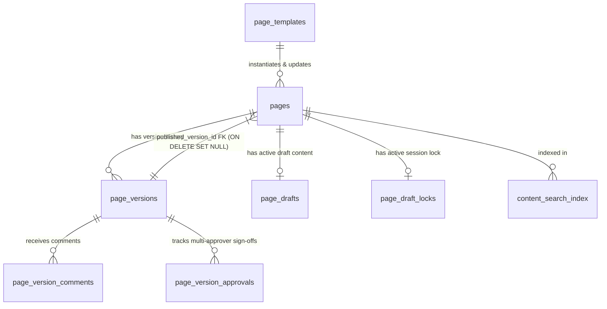
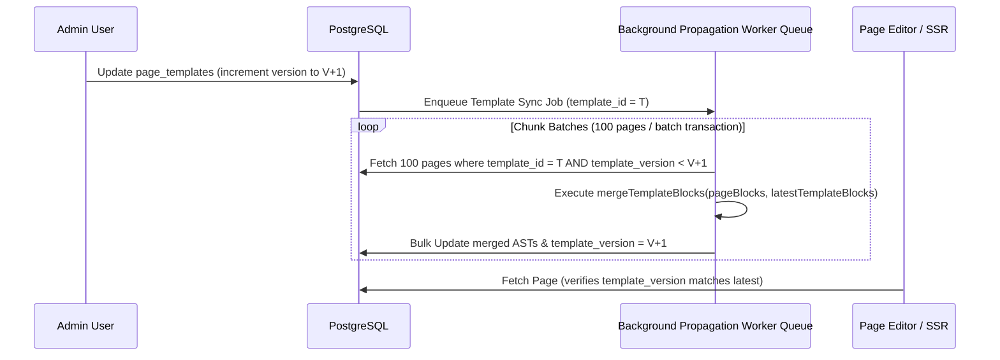

# RFC: @rimelight/CMS — Core Content & Wiki Architecture

- **Status**: **Proposed (Revised)**
- **Author**: Antigravity (Coding Assistant)
- **Created**: 2026-08-02
- **Last Updated**: 2026-08-02
- **Target Package**: `@rimelight/cms`
- **Discussion/PR**: Rimelight Monorepo Architecture Refactor

---

## 1. Executive Summary

This RFC defines the unified architecture for **`@rimelight/CMS`**, an enterprise-grade content management, page property, block rendering, and wiki system designed for the Rimelight ecosystem (`rimelight.com` and `starter.rimelight.com`).

`@rimelight/CMS` replaces legacy file-based collections and fragmented databases with a robust **PostgreSQL database infrastructure** (utilizing Drizzle ORM `pg-core`), natively integrated with `better-auth` for role-based access control (RBAC), **isolated draft state storage**, **role-locked page templates**, **asynchronous live template update propagation**, **pure server-side reader block stripping**, and **editor read-only block authorization with server-enforced parent deletion protection**.

### Key Architectural Pillars

1. **PostgreSQL Foundation & Safe Migration Pipeline**: High-performance relational database schema with JSONB support, strict foreign keys, version auditing, composite version indexes, isolated draft tables (`page_drafts`, `page_draft_locks`), multi-approver tracking (`page_version_approvals`), and locale-aware PostgreSQL full-text search (`tsvector` + `pg_trgm`). Includes a non-destructive, chunk-batched data migration pipeline.
2. **Framework-Astro SSR Reader (Zero-JS Payload for Readers)**: Pure Astro (`.astro`) server-side components utilizing `@rimelight/ui` design system components. Unauthorized blocks are **completely stripped on the server side** prior to HTML rendering—ensuring sensitive data is never present in the DOM or network responses.
3. **Framework-Free & CSP-Compliant Client Editor with Side-by-Side Live Preview**: Standalone interactive editor built with vanilla TypeScript/JavaScript Custom Elements, Vanilla CSS, and `sortablejs`. Features a split-pane layout with a draggable resize handle. Operates a lightweight, pure vanilla HTML `contenteditable` selection and event controller (zero third-party rich-text frameworks).
4. **Complete Editor State & Collaboration Suite (Section 3.3)**: Native local state Undo/Redo (`Ctrl+Z` / `Cmd+Z`), real-time Autosave status indicators (`Saved`, `Unsaved changes`, `Saving...`), dedicated `page_drafts` persistence, and `better-auth` draft session lock management (`page_draft_locks` with automated TTL heartbeat expiration) to prevent concurrent overwrite collisions.
5. **`better-auth` Integration & Dual Server/Client Block Authorization**: Dual-mode security model:
   - **Reader Mode**: Blocks failing auth are **completely omitted** from server-rendered HTML.
   - **Editor Mode**: Blocks failing auth are **visible as locked/read-only nodes** to authors.
   - **Server-Enforced Deletion & Mutation Guard**: Server API endpoints (`POST`/`PUT /api/cms/pages/*`) run tree diff validation (`validator.ts`) to prevent authors from deleting parent containers containing restricted or templated child blocks, or altering locked `templatedProps`.
6. **Immutable `isTemplated` Blocks & Property Locking**: Templated blocks (`isTemplated: true`) can **never be deleted, reordered, or removed** from instantiated pages. Additional blocks may be inserted before or after them. Property-level locks (`templatedProps`) enforce un-editable content for designated block properties.
7. **Asynchronous Live Template Update Propagation Engine**: Updating a template in `page_templates` fires an automated chunked background worker job paired with structural anchor positional fitting to merge new/updated template blocks into instantiated pages without blocking HTTP requests.
8. **PR-Style Versioning & Multi-Approval Review Workflow**: Permanent version retention in PostgreSQL with inline version comment threads (`page_version_comments`), multi-approver rule validation (`page_version_approvals`), and multi-tier CDN cache invalidation (supporting multi-tenant hostnames, Cloudflare Enterprise `Cache-Tag`, and Standard URL purging).

---

## 2. Motivation & Objectives

### Current Pain Points & Status Quo Limitations

1. **Database Fragmentation & Data Loss Risks**: Existing setups mix SQLite/D1 and legacy schemas. Upgrading requires preserving production page records in `rimelight.com` without locking serverless database transactions during migrations.
2. **Unrestricted Page Templates**: sensitive templates (such as Legal Policies, Official Announcements, or System Docs) must be restricted so only authorized roles can instantiate them.
3. **Template Drift on Live Pages**: When an official template is updated, existing pages instantiated from that template remain on old structures unless an automated propagation/merge mechanism updates them.
4. **Security Vulnerabilities in Block Filtering**: In-place object mutation during block filtering can pollute in-memory caches, exposing sensitive blocks across user sessions. Direct raw API requests could bypass client-side deletion locks.
5. **Editor Live Preview Friction**: Authors need immediate visual feedback via a side-by-side split editor with a draggable resize handle, local undo/redo history, and autosave indicators.
6. **Bypassing Block Locks via Parent Deletion**: Without parent deletion guards, a user lacking permissions to edit a child block could delete the parent section block, forcibly destroying unauthorized content.

---

## 3. Package Blueprint & Ecosystem Integration

### 3.1 Monorepo Coexistence & Non-Destructive Core Integration

`@rimelight/cms` exists as `packages/cms` in the pnpm workspace.

> [!IMPORTANT]
> **Preservation of Ecosystem Packages**:
>
> - **`@rimelight/i18n`**: Remains a standalone package. `@rimelight/cms` imports `@rimelight/i18n` helpers to localize database-stored strings (`Localized<T>`).
> - **Site Auth & Permissions**: Existing project auth statements in `rimelight.com` and `starter.rimelight.com` remain untouched. `@rimelight/cms` exports `cmsStatements` and `cmsAc` to merge into each site's `better-auth` configuration.

### 3.2 Workspace File Layout

```
packages/cms/
├── package.json
├── tsconfig.json
├── README.md
├── src/
│   ├── index.ts                   # Main package entrypoint
│   ├── schema/                    # Drizzle PostgreSQL Tables
│   │   ├── index.ts
│   │   ├── pages.ts
│   │   ├── page_drafts.ts         # Work-in-progress draft content
│   │   ├── page_draft_locks.ts    # Draft editing locks & TTL heartbeats
│   │   ├── page_versions.ts       # Published version audit history
│   │   ├── page_version_comments.ts
│   │   ├── page_version_approvals.ts # Multi-approver threshold tracking
│   │   ├── page_templates.ts
│   │   └── search.ts
│   ├── core/                      # Types & Block Engine
│   │   ├── types/
│   │   │   ├── blocks.ts          # Block & UUID AST definitions
│   │   │   ├── pages.ts
│   │   │   ├── templates.ts
│   │   │   ├── versioning.ts
│   │   │   └── inline.ts
│   │   ├── registry.ts            # Block & Page Type Registries
│   │   ├── validator.ts           # Client & Server AST Payload Validators
│   │   └── template-sync.ts       # Asynchronous Template Propagation Worker Engine
│   ├── astro/                     # Pure Astro SSR Renderers (Zero JS)
│   │   ├── PageRenderer.astro
│   │   ├── BlockRenderer.astro
│   │   └── blocks/                # Individual Astro Block Renderers
│   ├── client/                    # Vanilla JS/CSS Editor & Web Components
│   │   ├── styles/
│   │   │   └── cms-editor.css     # External CSS & Splitpane CSS
│   │   ├── components/            # Custom Elements
│   │   │   ├── rimelight-editor-layout.ts
│   │   │   ├── rimelight-editor.ts
│   │   │   ├── rimelight-preview.ts
│   │   │   ├── rimelight-block.ts
│   │   │   └── rimelight-contenteditable.ts # Pure Vanilla Rich-Text Controller
│   │   ├── state/
│   │   │   ├── history.ts         # Undo / Redo (Ctrl+Z) Stack
│   │   │   ├── autosave.ts        # Autosave Controller & Status Indicator
│   │   │   └── lock-manager.ts    # Draft Lock Controller
│   │   └── utils/
│   │       ├── splitpane.ts
│   │       └── sortable.ts
│   ├── auth/                      # better-auth Guards & Statements
│   │   ├── permissions.ts
│   │   ├── filter-blocks.ts       # Immutable SSR & Editor Block Authorization
│   │   ├── editor-guards.ts       # Client & Server Deletion/Mutation Validation
│   │   └── filter-templates.ts
│   ├── cache/                     # Multi-Tier CDN Invalidation Adapter
│   │   └── purge.ts
│   └── search/                    # Locale-Aware PostgreSQL Search
│       ├── query.ts
│       └── sync.ts
```

### 3.3 Editor State Management & Collaboration Suite

The client editor (`<rimelight-editor>`) implements three core operational services:

#### 3.3.1 Local State Undo / Redo Stack (`Ctrl+Z` / `Cmd+Z`)

- **Immutable State Snapshots**: Every block addition, structural reorder, text edit, or property change pushes an immutable snapshot of the page block tree (`Block[]`) onto an internal `HistoryStack`.
- **Transaction Batching**: Continuous typing within a single block is batched using a 500ms debounce buffer so single keystrokes do not flood the undo history.
- **Keyboard Shortcut Handlers**: `Ctrl+Z` (Undo) and `Ctrl+Y` / `Cmd+Shift+Z` (Redo) restore tree snapshots instantly and notify `<rimelight-preview>` to re-render.

#### 3.3.2 Real-Time Autosave Controller & Status Bar

- **Debounced Autosave**: Changes trigger an automated background POST request to `/api/cms/pages/:id/draft` after 2000ms of inactivity, persisting work-in-progress to `page_drafts`.
- **Visual Status Indicator**: The editor top bar displays real-time state badges:
  - `[● Saved]`: All local changes persisted to `page_drafts`.
  - `[▲ Unsaved Changes]`: Local modifications waiting for debounce timer.
  - `[↻ Saving...]`: Background API call in flight.
  - `[✖ Save Failed - Retrying...]`: Network retry active with exponential backoff.

#### 3.3.3 Draft Session Locking (`better-auth` Concurrent Editing Guard)

- **Active User Lock (`page_draft_locks`)**: Opening a page draft acquires an active session lock persisted in PostgreSQL (`page_draft_locks`) with a 5-minute Time-To-Live (TTL).
- **Heartbeat & Collision Warning**: The client sends a heartbeat POST request to `/api/cms/pages/:id/lock/heartbeat` every 30 seconds to refresh `expires_at`. If another author attempts to edit the same page draft, the editor displays a read-only lock banner: _"User @alex is currently editing this draft (Lock acquired 2m ago)"_, preventing concurrent overwrite collisions. Stale locks expire automatically after 5 minutes of inactivity.

---

## 4. Database Architecture & PostgreSQL Schema

The database relies on PostgreSQL (`pg-core` via Drizzle ORM). It leverages JSONB for localized dynamic attributes and nested block ASTs, while utilizing dedicated relational tables for versioning, review comments, multi-approver tracking, draft persistence, active edit locking, templates, and full-text search.



### 4.1. Drizzle Schema Definitions

```typescript
// packages/cms/src/schema/page_templates.ts
import { integer, jsonb, pgTable, text, timestamp, uuid } from "drizzle-orm/pg-core"
import type { Block, Localized, PageType } from "../core/types/pages"

export interface TemplateApprovalRules {
  minApprovals?: number
  allowSelfApproval?: boolean
  requiredRolesForApproval?: string[]
}

export const pageTemplates = pgTable("page_templates", {
  id: uuid("id").defaultRandom().notNull().primaryKey(),
  slug: text("slug").notNull().unique(),
  title: jsonb("title").$type<Localized<string>>().notNull(),
  description: jsonb("description").$type<Localized<string>>(),
  pageType: text("page_type").$type<PageType>().notNull(),
  version: integer("version").default(1).notNull(), // Incremented on template structural updates
  allowedRoles: jsonb("allowed_roles").$type<string[]>().default([]).notNull(),
  requiredPermission: text("required_permission"),
  approvalRules: jsonb("approval_rules")
    .$type<TemplateApprovalRules>()
    .default({ allowSelfApproval: true, minApprovals: 1 })
    .notNull(),
  defaultProperties: jsonb("default_properties").default({}).notNull(),
  initialBlocks: jsonb("initial_blocks").$type<Block[]>().default([]).notNull(),
  createdAt: timestamp("created_at", { withTimezone: true }).defaultNow().notNull(),
  updatedAt: timestamp("updated_at", { withTimezone: true }).$onUpdate(() => new Date())
})
```

```typescript
// packages/cms/src/schema/pages.ts
import { sql } from "drizzle-orm"
import { integer, jsonb, pgTable, text, timestamp, uniqueIndex, uuid } from "drizzle-orm/pg-core"
import type { Block, Localized, PageType, RegisterPageTypes } from "../core/types/pages"
import { pageVersions } from "./page_versions"
import { pageTemplates } from "./page_templates"

export const pages = pgTable(
  "pages",
  {
    id: uuid("id").defaultRandom().notNull().primaryKey(),
    slug: text("slug").notNull(),
    type: text("type").$type<PageType>().notNull(),
    templateId: uuid("template_id").references(() => pageTemplates.id, { onDelete: "set null" }),
    templateVersion: integer("template_version").default(1).notNull(),
    title: jsonb("title").$type<Localized<string>>().notNull(),
    description: jsonb("description").$type<Localized<string>>(),
    tags: jsonb("tags").$type<Localized<string>[]>().default([]).notNull(),
    authorIds: jsonb("author_ids").$type<string[]>().default([]),
    /** Denormalized read-cache of the active published version content (NULL if unpublished draft) */
    content: jsonb("content")
      .$type<{
        blocks: Block[]
        properties: RegisterPageTypes[PageType]
      }>()
      .notNull(),
    publishedVersionId: uuid("published_version_id").references(() => pageVersions.id, {
      onDelete: "set null"
    }),
    postedAt: timestamp("posted_at", { withTimezone: true }),
    createdAt: timestamp("created_at", { withTimezone: true }).defaultNow().notNull(),
    updatedAt: timestamp("updated_at", { withTimezone: true }).$onUpdate(() => new Date()),
    deletedAt: timestamp("deleted_at", { withTimezone: true })
  },
  (table) => [
    uniqueIndex("pages_slug_active_unique_idx")
      .on(table.slug)
      .where(sql`deleted_at IS NULL`)
  ]
)
```

```typescript
// packages/cms/src/schema/page_drafts.ts
import { jsonb, pgTable, text, timestamp, uuid } from "drizzle-orm/pg-core"
import { pages } from "./pages"
import type { Block, PageType, RegisterPageTypes } from "../core/types/pages"

export const pageDrafts = pgTable("page_drafts", {
  pageId: uuid("page_id")
    .notNull()
    .primaryKey()
    .references(() => pages.id, { onDelete: "cascade" }),
  content: jsonb("content")
    .$type<{
      blocks: Block[]
      properties: RegisterPageTypes[PageType]
    }>()
    .notNull(),
  updatedBy: text("updated_by").notNull(),
  updatedAt: timestamp("updated_at", { withTimezone: true }).defaultNow().notNull()
})
```

```typescript
// packages/cms/src/schema/page_draft_locks.ts
import { pgTable, text, timestamp, uuid } from "drizzle-orm/pg-core"
import { pages } from "./pages"

export const pageDraftLocks = pgTable("page_draft_locks", {
  pageId: uuid("page_id")
    .notNull()
    .primaryKey()
    .references(() => pages.id, { onDelete: "cascade" }),
  lockedByUserId: text("locked_by_user_id").notNull(),
  lockedByUserName: text("locked_by_user_name").notNull(),
  acquiredAt: timestamp("acquired_at", { withTimezone: true }).defaultNow().notNull(),
  expiresAt: timestamp("expires_at", { withTimezone: true }).notNull() // TTL expiration (5 minutes)
})
```

```typescript
// packages/cms/src/schema/page_versions.ts
import { integer, jsonb, pgTable, text, timestamp, uniqueIndex, uuid } from "drizzle-orm/pg-core"
import { pages } from "./pages"
import type { Block, Localized, PageType, RegisterPageTypes } from "../core/types/pages"

export type PageVersionStatus = "pending" | "approved" | "rejected" | "published"

export const pageVersions = pgTable(
  "page_versions",
  {
    id: uuid("id").defaultRandom().notNull().primaryKey(),
    pageId: uuid("page_id")
      .notNull()
      .references(() => pages.id, { onDelete: "cascade" }),
    versionNumber: integer("version_number").notNull(),
    status: text("status").$type<PageVersionStatus>().default("pending").notNull(),
    slug: text("slug").notNull(),
    type: text("type").$type<PageType>().notNull(),
    title: jsonb("title").$type<Localized<string>>().notNull(),
    description: jsonb("description").$type<Localized<string>>(),
    tags: jsonb("tags").$type<Localized<string>[]>().default([]).notNull(),
    authorIds: jsonb("author_ids").$type<string[]>().default([]),
    content: jsonb("content")
      .$type<{
        blocks: Block[]
        properties: RegisterPageTypes[PageType]
      }>()
      .notNull(),
    createdBy: text("created_by").notNull(),
    approvedBy: jsonb("approved_by").$type<string[]>().default([]).notNull(),
    approvedAt: timestamp("approved_at", { withTimezone: true }),
    changeSummary: text("change_summary"),
    createdAt: timestamp("created_at", { withTimezone: true }).defaultNow().notNull()
  },
  (table) => [
    /** Composite unique index preventing duplicate version numbers per page */
    uniqueIndex("page_versions_page_id_version_idx").on(table.pageId, table.versionNumber)
  ]
)
```

```typescript
// packages/cms/src/schema/page_version_approvals.ts
import { pgTable, text, timestamp, uuid } from "drizzle-orm/pg-core"
import { pageVersions } from "./page_versions"

export const pageVersionApprovals = pgTable("page_version_approvals", {
  id: uuid("id").defaultRandom().notNull().primaryKey(),
  versionId: uuid("version_id")
    .notNull()
    .references(() => pageVersions.id, { onDelete: "cascade" }),
  userId: text("user_id").notNull(),
  userRole: text("user_role").notNull(),
  approvedAt: timestamp("approved_at", { withTimezone: true }).defaultNow().notNull()
})
```

```typescript
// packages/cms/src/schema/search.ts
import { sql } from "drizzle-orm"
import { index, pgTable, text, uuid } from "drizzle-orm/pg-core"
import { pages } from "./pages"

export const contentSearchIndex = pgTable(
  "content_search_index",
  {
    id: uuid("id").defaultRandom().notNull().primaryKey(),
    pageId: uuid("page_id")
      .notNull()
      .references(() => pages.id, { onDelete: "cascade" }),
    locale: text("locale").notNull(),
    titleText: text("title_text").notNull(),
    contentText: text("content_text").notNull(),
    searchVector: sql`tsvector`
  },
  (table) => [index("search_vector_gin_idx").using("gin", table.searchVector)]
)
```

#### PostgreSQL Text Search Dictionary & AST Text Extractor

To populate `content_search_index`, block AST text is recursively extracted using `extractPlainTextFromBlocks(blocks, locale)`. Dynamic locale codes are mapped to PostgreSQL search configuration dictionaries:

| CMS Locale | PostgreSQL Text Search Config | Fallback Dictionary |
| :--------- | :---------------------------- | :------------------ |
| `en`       | `english`                     | `simple`            |
| `es`       | `spanish`                     | `simple`            |
| `de`       | `german`                      | `simple`            |
| `fr`       | `french`                      | `simple`            |
| _other_    | `simple`                      | `simple`            |

An automated background worker syncs `content_search_index` whenever a page version is published.

---

## 5. Core Data Models & AST Specifications

### 5.1. Block AST Engine, UUID Identifiers, `isTemplated`, & Property Locks

Every block extends `BaseBlock`. All block `id` fields **MUST be valid UUID v4 strings** generated upon instantiation:

```typescript
// packages/cms/src/core/types/blocks.ts
export type BlockType =
  | "SectionBlock"
  | "ParagraphBlock"
  | "CalloutBlock"
  | "ImageBlock"
  | "ScriptBlock"
  | "SceneBlock"
  | "DialogueBlock"
  | "CodeBlock"

export interface BaseBlock {
  /** Unique UUID v4 identifier */
  id: string
  type: BlockType

  /**
   * Structural Template Lock:
   * If true, this block is a permanent template anchor and can NEVER be deleted, reordered, or removed from instantiated pages.
   * Matched during template propagation using block `type` + `isTemplated: true` tag and structural index.
   */
  isTemplated?: boolean

  /**
   * Property Content Lock:
   * Controls whether block prop content can be edited.
   * - boolean true: ALL properties of this block are locked from editing.
   * - string[]: Specific property keys locked from editing (e.g. ["title", "disclaimer"]).
   */
  templatedProps?: boolean | string[]

  allowedRoles?: string[] // e.g. ["admin", "member"]. If undefined or empty [], public to all readers.
  requiredPermission?: string // e.g. "view_classified_notes"
  props: Record<string, any>
  children?: BaseBlock[] // Recursive nested blocks for container nodes
}
```

### 5.2. Node-Based Rich Text AST (Vanilla ContentEditable Controller)

Rich text inside blocks uses a structured inline node AST (`InlineNode[]`). In the client editor, `<rimelight-contenteditable>` handles native browser `beforeinput`, `selectionchange`, and `paste` events using pure vanilla TypeScript:

```typescript
// packages/cms/src/core/types/inline.ts
export type InlineNodeType = "text" | "page_mention" | "user_mention" | "link" | "emoji"

export interface TextInlineNode {
  type: "text"
  text: string
  marks?: Array<"bold" | "italic" | "underline" | "strikethrough" | "code">
}

export interface PageMentionNode {
  type: "page_mention"
  pageId: string
  pageSlug: string
  displayTitle?: string
}

export interface LinkInlineNode {
  type: "link"
  url: string
  children: TextInlineNode[]
  openInNewTab?: boolean
}

export type InlineNode = TextInlineNode | PageMentionNode | LinkInlineNode
```

> [!NOTE]
> **Editor Implementation Strategy**: Vanilla `contenteditable` is retained as the lightweight default. If browser composition (CJK IME) or complex selection state issues arise during testing, the architecture allows swapping the underlying controller for a headless engine (such as Lexical or Slate) without altering the `InlineNode[]` AST schema.

---

## 6. Auth, RBAC & Dual-Mode Block Security

### 6.1. Reader vs Editor Block Authorization Matrix

| Context              | Authorization Status | Behavior                                                                                                      |
| :------------------- | :------------------- | :------------------------------------------------------------------------------------------------------------ |
| **Astro SSR Reader** | **Failed Auth**      | **COMPLETELY STRIPPED**. Zero DOM nodes or network payload generated.                                         |
| **Astro SSR Reader** | **Passed Auth**      | Rendered as clean semantic HTML via `@rimelight/ui`.                                                          |
| **Client Editor**    | **Failed Auth**      | **VISIBLE AS LOCKED**. Displays as read-only card (`[🔒 Restricted Block]`). Editing & deletion disabled.     |
| **Server API Route** | **Failed Auth**      | **REJECTED WITH 403**. API payload diffing (`validator.ts`) enforces tree invariants on `POST/PUT` endpoints. |

### 6.2. Immutable SSR Block Filter (Reader Security)

```typescript
// packages/cms/src/auth/filter-blocks.ts
import type { BaseBlock } from "../core/types/blocks"

export interface UserSessionContext {
  userId: string
  roles: string[]
  permissions: string[]
}

/** Pure immutable function for Astro SSR Reader. Returns new array; never mutates input AST */
export function filterBlocksForReader(
  blocks: BaseBlock[],
  session: UserSessionContext
): BaseBlock[] {
  const filtered: BaseBlock[] = []

  for (const block of blocks) {
    if (block.allowedRoles?.length && !block.allowedRoles.some((r) => session.roles.includes(r))) {
      continue // Omit completely from reader payload
    }
    if (block.requiredPermission && !session.permissions.includes(block.requiredPermission)) {
      continue // Omit completely from reader payload
    }

    const filteredChildren = block.children?.length
      ? filterBlocksForReader(block.children, session)
      : block.children

    filtered.push({
      ...block,
      children: filteredChildren
    })
  }

  return filtered
}
```

### 6.3. Server-Enforced AST Tree Diffing & Deletion Protection Guard

In addition to client-side UI guards, server API endpoints (`POST`/`PUT /api/cms/pages/*`) run `validateServerBlockPayload` against the existing page tree stored in PostgreSQL to prevent direct API request bypasses:

```typescript
// packages/cms/src/auth/editor-guards.ts
import type { BaseBlock } from "../core/types/blocks"
import type { UserSessionContext } from "./filter-blocks"

/** Checks if a user has full edit rights over a specific block */
export function canUserEditBlock(block: BaseBlock, session: UserSessionContext): boolean {
  if (block.allowedRoles?.length && !block.allowedRoles.some((r) => session.roles.includes(r))) {
    return false
  }
  if (block.requiredPermission && !session.permissions.includes(block.requiredPermission)) {
    return false
  }
  return true
}

/** Recursively checks if a block or ANY of its descendants are locked/un-editable */
export function hasLockedDescendants(block: BaseBlock, session: UserSessionContext): boolean {
  if (!canUserEditBlock(block, session)) return true
  if (block.isTemplated) return true // Templated blocks can never be deleted

  if (block.children?.length) {
    return block.children.some((child) => hasLockedDescendants(child, session))
  }

  return false
}

/** Server-Side Guard: Validates that an incoming edited block tree obeys templated & authorization invariants */
export function validateServerBlockPayload(
  existingTree: BaseBlock[],
  incomingTree: BaseBlock[],
  session: UserSessionContext
): { valid: boolean; reason?: string } {
  // 1. Ensure all existing templated blocks (isTemplated: true) remain present in incoming tree
  const existingTemplated = extractTemplatedBlocks(existingTree)
  const incomingTemplated = extractTemplatedBlocks(incomingTree)

  if (existingTemplated.length !== incomingTemplated.length) {
    return { valid: false, reason: "Forbidden: One or more templated blocks were removed." }
  }

  // 2. Ensure locked properties (templatedProps) were not modified
  for (const existingBlock of existingTemplated) {
    const incomingBlock = incomingTemplated.find(
      (b) => b.type === existingBlock.type && b.id === existingBlock.id
    )
    if (!incomingBlock) {
      return {
        valid: false,
        reason: `Forbidden: Templated block ${existingBlock.type} missing in payload.`
      }
    }

    if (existingBlock.templatedProps === true) {
      if (JSON.stringify(existingBlock.props) !== JSON.stringify(incomingBlock.props)) {
        return {
          valid: false,
          reason: `Forbidden: Cannot modify locked properties on ${existingBlock.type}.`
        }
      }
    }
  }

  return { valid: true }
}

function extractTemplatedBlocks(blocks: BaseBlock[]): BaseBlock[] {
  let result: BaseBlock[] = []
  for (const b of blocks) {
    if (b.isTemplated) result.push(b)
    if (b.children?.length) result = result.concat(extractTemplatedBlocks(b.children))
  }
  return result
}
```

---

## 7. Template System & Live Update Propagation Engine

### 7.1. Templated Block & Property Rules

1. **Structural Lock (`isTemplated: true`)**:
   - Blocks marked `isTemplated: true` are permanent anchors matched by block `type` + `isTemplated: true`.
   - Authors can insert custom blocks above, between, or below templated blocks, but cannot delete or reorder templated anchors.
2. **Property Lock (`templatedProps`)**:
   - If `templatedProps: true`, all property fields on the block are locked from editing.
   - If `templatedProps: ["disclaimer"]`, only the `disclaimer` property field is locked from editing.

### 7.2. Automated Asynchronous Template Propagation Sync

When a `page_template` version is incremented from `V` to `V+1`, template updates are merged into instantiated pages using structural anchor positional alignment in a background worker queue:



#### Structural Positional Alignment Algorithm (`mergeTemplateBlocks`)

```typescript
// packages/cms/src/core/template-sync.ts
import type { BaseBlock } from "./types/blocks"

/**
 * Merges updated template blocks into an existing page block tree.
 * Matches templated blocks by block `type` + `isTemplated: true` tag and structural index.
 * Fits updated template anchors while preserving user-inserted blocks around them.
 */
export function mergeTemplateBlocks(
  existingPageBlocks: BaseBlock[],
  newTemplateBlocks: BaseBlock[]
): BaseBlock[] {
  const merged: BaseBlock[] = []

  // Extract templated anchors from template
  const newTemplatedAnchors = newTemplateBlocks.filter((b) => b.isTemplated)

  let existingIndex = 0

  for (const templateAnchor of newTemplatedAnchors) {
    // Collect user-inserted custom blocks preceding this template anchor
    while (
      existingIndex < existingPageBlocks.length &&
      !existingPageBlocks[existingIndex].isTemplated
    ) {
      merged.push(existingPageBlocks[existingIndex])
      existingIndex++
    }

    // Match existing template anchor by block type
    const existingAnchor = existingPageBlocks[existingIndex]

    if (existingAnchor && existingAnchor.type === templateAnchor.type) {
      // Preserve existing block ID, update props/locks if templatedProps enforces update
      merged.push({
        ...templateAnchor,
        id: existingAnchor.id, // Preserve page block UUID
        props: mergeBlockProps(
          existingAnchor.props,
          templateAnchor.props,
          existingAnchor.templatedProps
        )
      })
      existingIndex++
    } else {
      // New template anchor inserted in template update: add fresh block with new UUID
      merged.push({
        ...templateAnchor,
        id: crypto.randomUUID()
      })
    }
  }

  // Append any remaining custom user blocks at the end of the document
  while (existingIndex < existingPageBlocks.length) {
    merged.push(existingPageBlocks[existingIndex])
    existingIndex++
  }

  return merged
}

function mergeBlockProps(
  existingProps: any,
  templateProps: any,
  templatedProps?: boolean | string[]
) {
  if (templatedProps === true) return templateProps
  if (Array.isArray(templatedProps)) {
    const updated = { ...existingProps }
    for (const key of templatedProps) {
      updated[key] = templateProps[key]
    }
    return updated
  }
  return existingProps
}
```

---

## 8. Data Migration Strategy (Safe Chunked Execution)

The migration script (`scripts/migrate-legacy-pages-to-cms-v2.ts`) splits DDL statements from data updates, executing data transformations in chunked batches outside long-lived locks:

```typescript
// scripts/migrate-legacy-pages-to-cms-v2.ts
import { db } from "../packages/rimelight.com/src/db"
import { sql } from "drizzle-orm"

export async function migrateLegacyPagesToCMSv2() {
  console.log("[Migration] Applying DDL schema updates...")

  // 1. Schema DDL statements
  await db.execute(sql`
    ALTER TABLE pages ADD COLUMN IF NOT EXISTS template_id UUID;
    ALTER TABLE pages ADD COLUMN IF NOT EXISTS template_version INTEGER DEFAULT 1 NOT NULL;
    ALTER TABLE page_versions ADD COLUMN IF NOT EXISTS version_number INTEGER DEFAULT 1 NOT NULL;
    
    CREATE UNIQUE INDEX IF NOT EXISTS page_versions_page_id_version_idx 
    ON page_versions (page_id, version_number);
  `)

  console.log("[Migration] Transforming legacy page content in batches...")

  // 2. Chunked batch data migration
  const BATCH_SIZE = 100
  let offset = 0
  let hasMore = true

  while (hasMore) {
    const batch = await db.execute(sql`
      SELECT id, content FROM pages ORDER BY id LIMIT ${BATCH_SIZE} OFFSET ${offset};
    `)

    if (batch.rows.length === 0) {
      hasMore = false
      break
    }

    for (const page of batch.rows as any[]) {
      const transformed = transformLegacyContent(page.content)
      await db.execute(sql`
        UPDATE pages SET content = ${JSON.stringify(transformed)}::jsonb WHERE id = ${page.id}::uuid;
      `)
    }

    offset += BATCH_SIZE
    console.log(`[Migration] Migrated ${offset} records...`)
  }

  console.log("[Migration] Migration completed successfully.")
}

function transformLegacyContent(raw: any) {
  if (typeof raw === "object" && raw !== null && "blocks" in raw) return raw
  let textContent = ""
  try {
    textContent = typeof raw === "string" ? raw : JSON.stringify(raw ?? "")
  } catch {
    textContent = ""
  }
  return {
    blocks: [
      {
        id: crypto.randomUUID(),
        type: "ParagraphBlock",
        props: { text: { en: textContent } }
      }
    ],
    properties: {}
  }
}
```

---

## 9. Multi-Tier Edge Cache Invalidation Strategy

To accommodate multi-tenancy (`rimelight.com`, `starter.rimelight.com`), dynamic route prefixes, and Cloudflare tiers (Enterprise vs Standard):

```typescript
// packages/cms/src/cache/purge.ts
export interface CachePurgeOptions {
  slug: string
  locales: string[]
  domain?: string // e.g. "rimelight.com" or "starter.rimelight.com"
  basePath?: string // e.g. "" or "/wiki" or "/docs"
  isEnterpriseCloudflare?: boolean
}

export async function invalidatePageCache(options: CachePurgeOptions) {
  const { slug, locales, domain = "rimelight.com", basePath = "", isEnterpriseCloudflare } = options
  const zoneId = process.env.CLOUDFLARE_ZONE_ID
  const apiToken = process.env.CLOUDFLARE_API_TOKEN

  if (!zoneId || !apiToken) return

  const cleanPath = basePath ? `/${basePath.replace(/^\/+|\/+$/g, "")}` : ""

  const body = isEnterpriseCloudflare
    ? { tags: [`page-${domain}-${slug}`] }
    : { files: locales.map((lang) => `https://${domain}/${lang}${cleanPath}/${slug}`) }

  await fetch(`https://api.cloudflare.com/client/v4/zones/${zoneId}/purge_cache`, {
    method: "POST",
    headers: {
      "Authorization": `Bearer ${apiToken}`,
      "Content-Type": "application/json"
    },
    body: JSON.stringify(body)
  })
}
```

---

## 10. Verification & Automated Testing Plan

```bash
# Type check and run Vitest suite via Vite+
vp check
vp test
```

### Test Specifications:

- `test/auth-reader-filter.test.ts`: Verify `filterBlocksForReader` completely omits unauthorized blocks from SSR HTML without mutating memory objects.
- `test/auth-editor-guards.test.ts`: Verify `validateBlockDeletion` blocks deleting parent containers with unauthorized child blocks in client UI.
- `test/auth-server-validation.test.ts`: Verify `validateServerBlockPayload` rejects `POST`/`PUT` requests attempting to delete `isTemplated` blocks or mutate locked `templatedProps`.
- `test/draft-lock-ttl.test.ts`: Verify `page_draft_locks` TTL expiration (5 minutes) and 30-second client heartbeat refresh mechanics.
- `test/multi-approval.test.ts`: Verify `page_version_approvals` threshold checks require `minApprovals` count before transition to `published` status.
- `test/templated-blocks.test.ts`: Verify `isTemplated: true` blocks and `templatedProps` reject deletion, reordering, and prop mutation.
- `test/template-propagation.test.ts`: Verify `mergeTemplateBlocks` fits structural template updates into existing page block trees using positional alignment while preserving user-inserted blocks.
- `test/template-sync-worker.test.ts`: Verify asynchronous background chunked worker processes template update batches without request timeouts.
- `test/editor-history.test.ts`: Verify Undo/Redo (`Ctrl+Z`) stack correctly rolls back AST states.
