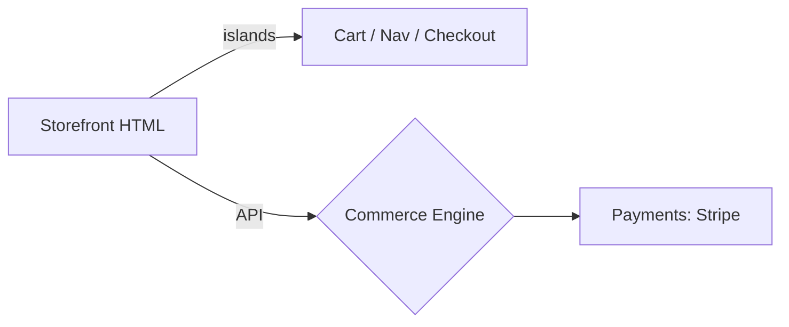

# RFC: `@rimelight/ecommerce` — Self-Contained Workers Store vs. Headless Medusa Storefront

- **Status**: Draft
- **Author(s)**: Rimelight Engineering
- **Created**: 2026-09-22
- **Last Updated**: 2026-09-22
- **Discussion/PR**: [Link to PR/Issue]
- **Related RFCs**:
  - [RFC: `@rimelight/analytics` — Astro Native vs. Vite-Agnostic](rimelight_analytics_package_options.md)
  - [RFC-0007: Database-Backed Dynamic Content Types & E-Commerce Collections Architecture](dynamic_content_types_and_ecommerce_collections.md)

---

## 1. Summary

Rimelight has no commerce story. Client sites currently ship marketing/content only, and every storefront project would otherwise fall to a rented SaaS (Shopify) or a separate backend service we don't operate. This RFC selects the foundation for `@rimelight/ecommerce` from two open-source candidates we evaluated end to end:

- **minshop** — a self-contained store: one Astro SSR Worker, D1 + R2, in-app admin, four payment rails, ports-and-adapters seams, and an agent/MCP purchase path. Runs inside Cloudflare's free tier.
- **Astro Medusa Storefront (astro-medusa-storefront)** — a headless storefront: Astro 6 SSG + React islands in front of a **Medusa v2** backend that must be hosted separately (a Node service, not Workers).

Both are MIT, both are Astro + Cloudflare + Tailwind, so either port carries familiar tooling. The decisive differences are **where the commerce engine runs** and **who owns the integration surface**.

**Recommendation: build the Rimelight store on the minshop shape** — the commerce engine lives in the same Worker as the site (D1 catalog/orders, R2 media, in-process checkout), stays inside the free tier, and is structured so the monorepo can decompose it into packages (`@rimelight/commerce` core + admin + storefront components) rather than vendoring a second running service. The Medusa route is kept as the documented alternative for a client who already runs a headless backend or explicitly wants Medusa's hosted admin.

---

## 2. Motivation

### Pain Points

- **No storefront capability in the monorepo.** `starter.rimelight.com` has auth, CMS, SEO, security, i18n — nothing that sells a product. Client asks for merch stores (queerkit.com, idantity.me are natural candidates) currently have no answer.
- **The existing stack is the cheapest store runtime already.** Rimelight apps run Astro on `@astrojs/cloudflare` with D1 via Drizzle and Hono API routes. A store that reuses that runtime adds near-zero infrastructure; a store that needs a backend VPS (Medusa) adds ops we explicitly avoid.
- **Two prior RFCs set the pattern.** RFC-0007 already spec'd e-commerce primitives (price, SKU, inventory, digital fulfillment, variants) on dynamic CMS collections and explicitly left open whether commerce is a module or the CMS. And the `@rimelight/analytics` RFC established the package shape (framework-agnostic core, self-contained Cloudflare servers kept out-of-repo). This RFC must stay consistent with both.
- **Agent commerce is a Rimelight-shaped direction.** Both analytics (Edgemetry) and minshop expose machine-readable APIs and MCP surfaces. An "agent reads the catalog and pays a Lightning invoice with no human in the loop" story is coherent with where the ecosystem is going; a storefront with no API excludes it.

### Goals

- A Rimelight site can become a store without leaving the monorepo stack: D1 catalog/orders, R2 media, Stripe-first payments, in-process checkout.
- Reuse existing packages (`@rimelight/auth` for admin permissions, `@rimelight/ui`, `@rimelight/security` CSP, `@rimelight/i18n` for the `/[locale]` routing the Medusa storefront's `/:country/` pattern approximates).
- Stay on the Cloudflare free tier for a small store, with the Stripe/Lightning/email/vector bindings as the only paid seams.
- Keep agent access (JSON API + optional MCP) as a first-class surface, not an afterthought.

### Non-Goals

- Renting a hosted commerce platform (Shopify-style) — rejected, see section 5.
- Operating a Medusa backend for every client by default — see Options A vs B.
- Deciding payment-rail specifics (Stripe vs Lightning mix) beyond what the candidates already establish; that is a per-store Admin setting.
- Re-litigating RFC-0007's dynamic content-type engine; this RFC decides only where commerce lives, not the CMS schema work.

---

## 3. Detailed Design

### 3.1. Common Ground: What Both Candidates Share

Both are Astro storefronts on Cloudflare Workers with Tailwind CSS v4, so the shared baseline is thin:



| Concern       | Astro Medusa Storefront                          | minshop                                                             |
| ------------- | ------------------------------------------------ | ------------------------------------------------------------------- |
| Rendering     | Astro 6, **SSG with React islands** (Nanostores) | Astro, **SSR, near-zero client JS**, progressive-enhancement forms  |
| Data store    | External Medusa v2 (Node service + database)     | **D1 in the same Worker**                                           |
| Media         | External (S3 bucket, custom domain)              | **R2 via `StorageProvider` port**, served through the Worker        |
| Cart          | Client-side localStorage (Nanostores)            | **HttpOnly cookie cart**, drawer enhanced over no-JS forms          |
| Admin         | Medusa's separate admin service                  | **Built-in `/admin`** in the same app                               |
| Payments      | Stripe only                                      | Stripe + Lightning (phoenixd/LNbits) + OpenNode + demo              |
| Agent API     | None                                             | **JSON catalog/checkout API + MCP server** (buyer + operator tiers) |
| Free-tier fit | Storefront yes, **backend no**                   | **Yes, whole store**                                                |

### 3.2. Option A — Headless Medusa v2 Storefront (astro-medusa-storefront)

Adopt the starter's architecture: the Astro app statically generates product/store pages, renders React islands for cart and checkout, and talks to a separately hosted **Medusa v2** instance for catalog, pricing, regions, cart, and orders.

```text
client ──▶ Cloudflare Worker (frontend: SSG + islands) ──▶ Medusa v2 backend (VPS/Railway/Fly) ──▶ Stripe
                                                          ▲ admin (Medusa dashboard)
```

- **Strengths.** Medusa v2 is a genuinely deep commerce engine — regions (the whole `/:country/` routing story), tax, discounts, fulfillment, multi-currency, hosted admin, OSS. The storefront itself is static-first and fast; webhooks-to-redeploy keeps static pages roughly in sync. If a client already runs Medusa, this is the storefront they'd use.
- **Costs.** Running the backend is real ops: a long-running Node service, its own database, its own deployment — on a VPS or container host, outside Cloudflare's free tier, exactly the recurring-bill/host-the-VM situation Rimelight's other choices avoid. Inventory served statically needs the client-side stock-refresh workaround. Cart state drops into `localStorage` (per-origin, fragile). No built-in agent/MCP surface. As a "package," it can only ever be a starter template — there is no D1/Drizzle seam for the monorepo to own.
- **Verdict.** A great storefront for a store whose backend is already headless. Not a foundation for a Rimelight-owned, free-tier, in-house commerce capability.

### 3.3. Option B — Self-Contained Workers Store (minshop)

Adopt the minshop architecture: one Astro SSR Worker owns catalog, orders, media, admin, and checkout, with D1 as the database and R2 for storage.

```text
client ──▶ Worker (storefront SSR /admin R2 /api /api/webhook) ──▶ D1 (products, orders, settings)
                            │
                            ├── Stripe checkout / webhook
                            ├── Lightning node (phoenixd/LNbits) via /pay
                            ├── MCP server (buyer/operator tiers) ──▶ same checkout
                            └── Email (Resend / Cloudflare Email)
```

The engineering decisions worth carrying over, evaluated against the monorepo:

1. **Ports-and-adapters seams.** `PaymentProvider` and `StorageProvider` interfaces keep vendor code at the edges (`src/features/payments`, `src/features/storage`). This maps 1:1 onto the monorepo's package philosophy — each seam becomes a small framework-agnostic module.
2. **HTML-first.** Server-rendered pages, near-zero client JS, cart/checkout/search working with JS disabled. Consistent with the analytics RFC's "HTML first, JS as enhancement" posture.
3. **Search on D1.** SQLite FTS5 (bm25, prefix, typo-correction) with optional Workers AI + Vectorize behind a `SearchProvider` seam.
4. **Write-only key vault.** Provider keys encrypted in D1 under a `SECRETS_KEK` Worker secret, never echoed; the Worker needs exactly two secrets (`SECRETS_KEK`, `AUTH_SECRET`).
5. **Admin auth & rate limits.** PBKDF2 wizard password or Cloudflare Access, plus native edge rate limits on anonymous login/checkout/search POSTs — features this RFC has already flagged as required for the analytics deployment too.
6. **Inventory via reservations.** Held inventory on checkout, released on expiry/failure, settled on payment — the correct primitive for edge checkout.
7. **Agent commerce.** Public `GET /api/products`, `POST /api/checkout`, order-status polling, and a sibling MCP Worker — an agent can browse and pay with no human. This is the "agent-payable store" direction.
8. **R2 media with ownership rules.** A media library that owns files and only deletes what nothing references; private `FILES` bucket for digital deliverables.
9. **Equivalence-tested refactors.** A 70-file Vitest suite renders `.astro` through `AstroContainer` with rendering baselines — the same standard the monorepo should hold storefront changes to.

- **Costs.** It is a complete application, not a package — absorbing it means either vendoring it as a clonable product (like the `npm create minshop@latest` scaffold) or decomposing it into `@rimelight/commerce` packages. Single currency and store time zone per store (build-time `store.config.ts`). Lightning path skips tax/promo (both Stripe-Checkout features). In-app admin duplicates capabilities `@rimelight/auth`/`@rimelight/ui` already provide for the same stack.
- **Verdict.** The correct foundation: same runtime as the monorepo, free-tier storage + serving, every seam package-shaped, and the only candidate that carries an agent surface.

### 3.4. Comparison

| Dimension                            | A — Medusa headless                 | B — minshop-shaped              |
| ------------------------------------ | ----------------------------------- | ------------------------------- |
| Commerce engine lifespan             | Separate service (Node)             | In-Worker, D1                   |
| Free tier for the whole store        | No (backend billed/hosted)          | Yes                             |
| Ops burden                           | Two systems (frontend + backend)    | One deploy                      |
| Admin                                | Medusa dashboard (external)         | Built-in `/admin`               |
| Currency / region                    | Multi-region per backend capability | One per store (runtime config)  |
| Inventory integrity                  | Client-refresh workaround on SSG    | D1 reservations                 |
| Agent/MCP purchase path              | None                                | Built in                        |
| Monorepo integration                 | Starter template only               | Decomposable into packages      |
| Edit existing store runtime settings | Backend admin + redeploy            | Admin → Settings, zero redeploy |

### 3.5. Recommended Packaging Path (Rimelight-Native Composition)

Neither candidate is a package; the monorepo's analogue to "adopt minshop's shape" is to **build the commerce capability out of packages over a D1 schema** (this is Option B decomposed, and it answers RFC-0007 Q4 with "a dedicated package set that composes with the CMS, not commerce inside the CMS"):

```
packages/commerce/
  core/        # Drizzle schema: products, variants, inventory, orders, reservations
               # Hono router: /api/checkout, /api/catalog, /api/webhook/*
               # PaymentProvider + StorageProvider + EmailProvider seams
  admin/       # product/order/media/settings UI on @rimelight/ui + @rimelight/auth perms
  storefront/  # @rimelight/ui product cards, cart drawer, /pay page (SSR-first)
  mcp/         # sibling Worker exposing buyer/operator tools (minshop's two-tier model)
```

```typescript
// astro.config.ts — a store becomes a composition, not a fork
import { rimelightCommerce } from "@rimelight/commerce/core";
export default defineConfig({
  vite: {
    plugins: [rimelightCommerce({ stripe: true, lightning: process.env.LND_URL })],
  },
});
```

The first implementation milestone can be a **vendored minshop clone** (its own repo or a `starter.store.rimelight.com`-style app) that proves the flow with real traffic before the decomposition into Drizzle-backed packages pays off — the same "run the working self-contained thing first, decompose later" logic the analytics RFC used to keep Edgemetry's server out of the monorepo.

---

## 4. Drawbacks & Trade-offs

### Option A — Medusa headless

- **Recurring backend cost and ops**; hostile to the "one Worker on the free tier" story this ecosystem is built around.
- **Two systems to keep versioned** (storefront + Medusa) and a second admin for operators.
- **SSG catalog semantics**: publish happens via webhook-triggered redeploy, inventory can be stale between builds, cart lives in `localStorage`. These are the reasons minshop chose SSR + cookies.
- **No commerce primitives for the monorepo to own** — no D1 schema, no Hono routes, no package seams. Effort spent here doesn't compound.
- **Effort**: low for the storefront, but the backend provisioning is an external dependency we'd still own.

### Option B — minshop-shaped

- **It is a big codebase** (~70 test files, full admin, media library, shipping, MCP) — absorbing or even just vendoring it is the largest integration in this RFC series to date.
- **Built-in admin friction**: the wizard-password gate is strong, but a second auth model next to `@rimelight/auth` must be reconciled (the decompiled packages should use `@rimelight/auth` permissions instead).
- **Single currency / time zone per store** is a real limitation for multi-region clients; the Medusa route's `/:country/` would beat it there.
- **Lightning limitations**: tax and promo codes are Stripe-only on that rail; no automatic Lightning refunds.
- **Effort**: medium for a vendored deployment; high for full package decomposition.

### Option C (packaging path)

- **Abstracts before it earns the abstraction** if started immediately — mirror the candidate, don't pre-decouple it.
- Duplicate-admin risk with `@rimelight/cms` if RFC-0007 ships dynamic content types first (mitigation: commerce owns orders/checkout; catalog can delegate to CMS collections via a documented adapter).

---

## 5. Alternatives Considered

### A. Shopify / rented SaaS

Powerful, but recurring fees, merchant control, and the "we host it ourselves" positioning this RFC series preserves. **Rejected for the default**; remains an option per-client.

### B. Adopt the Medusa storefront only for clients who already run Medusa

Not a Rimelight capability, just a starter template. **Deferred**: document it, don't build it into the default.

### C. Commerce entirely inside `@rimelight/cms` (RFC-0007's alternative)

Tempting — catalog-as-content is elegant and RFC-0007 already defines price/SKU/inventory fields. It fails on **checkout**. Orders, reservations, carts, webhooks, PCI-relevant flows, and Lightning needs a transaction layer and Hono routes the CMS collection engine shouldn't own. **Resolution**: catalog _content_ may live in dynamic CMS collections; _commerce_ lives in `@rimelight/commerce`. This RFC answers RFC-0007 Q4.

### D. Rent only payments (Stripe Payment Links) and skip a store

Fine for a one-product "buy" button; not a store. Not enough for a merch storefront.

### E. No store at all

Loses client revenue work; inconsistent with the agent-commerce direction established in this RFC series.

---

## 6. Adoption & Migration Strategy

| Phase | Scope                                                                                                                                                | Effort   |
| ----- | ---------------------------------------------------------------------------------------------------------------------------------------------------- | -------- |
| **1** | Vendored minshop-shaped store as `apps/store.rimelight.com`-style template / cloned repo; deploy one pilot client store on the free tier             | 1–2 days |
| **2** | Extract `@rimelight/commerce/core`: Drizzle schema + Hono checkout/catalog/webhooks + payment/storage/email seams; reuse `@rimelight/auth` for admin | weeks    |
| **3** | `@rimelight/commerce/storefront` components (product cards, cart drawer, `/pay`) on `@rimelight/ui`, SSR-first; agent JSON API + MCP worker          | weeks    |
| **4** | Replace built-in admin screens with `@rimelight/ui`-based ones; wire CSP via `@rimelight/security`; ship to the remaining client sites               | ongoing  |

Non-breaking; no existing site is required to adopt it. Pilot store uses the vendored app path, so a store ships before any package exists (mirrors how Edgemetry ships as a deployment before the analytics package). The Medusa storefront remains a supported alternative for headless-backend clients and is not deleted from consideration.

---

## 7. Cross-Cutting Concerns

### 7.1. Performance & Bundle Size

- minshop-shaped SSR ships near-zero client JS (HTML-first); the Medusa storefront ships React islands + Nanostores. Recommendation favors the smaller payload.
- D1 FTS5 search is free-tier friendly; the optional vector path adds Workers AI + Vectorize spend only when enabled.
- R2 zero-egress serving beats a CDN-hosted S3 bucket on the Worker-free-tier math (`/images/...` from R2 with immutable 1-year caching).

### 7.2. Accessibility (a11y)

- HTML-first means cart, search, and checkout function without JS — a strict superset of a11y versus island-only flows. Carry minshop's no-JS fallbacks into the packages.
- The `@rimelight/ui` components used in storefront/admin already carry the ecosystem's focus/aria conventions.

### 7.3. Security & Privacy

- **PCI surface**: Stripe Checkout redirect keeps card data out of the Worker entirely; Lightning is self-custody/self-hosted by the operator — matching the "merchant runs the node" model.
- **Keys are write-only**: `SECRETS_KEK`-encrypted vault in D1, two Worker secrets total; never redisplayed.
- **Auth**: wizard-password gate (PBKDF2) must be raised before a public deploy, or `/admin` fronted with Cloudflare Access; edge rate limits on anonymous login/checkout/search POSTs (minshop's declared bindings) replicate the analytics RFC's mandate that `/login`-class paths get throttled.
- **CSP**: a store adds Stripe checkouts + webhooks + (optionally) an MCP worker — all surfaces that `@rimelight/security` must whitelist; reuse the `cspAdditions()` pattern introduced by the analytics RFC.
- **Digital downloads**: private R2 `FILES` bucket, token-protected URLs, snapshot-at-checkout entitlements — never the public image bucket.
- **Privacy**: card data never touches the Worker; per-customer data is order-scoped by verified email (passwordless accounts avoid hashing/reset liability).

---

## 8. Verification & Testing Plan

### 8.1. Automated Tests

Vendored app: carry minshop's suite forward — pure-function tests (slugify, cart count, reservation aggregation, order numbering, FTS sanitizer), a clean-room D1 gate suite (reservation concurrency/release/settlement), and an end-to-end demo checkout run against an isolated production Worker build.

Package decomposition:

- `@rimelight/commerce/core`: Drizzle migrations additive-only; Hono route contract tests; payment adapter test doubles (Stripe webhook verify, Lightning re-poll).
- Equivalence tests for storefront components: render `.astro` through `AstroContainer` and diff against rendering baselines (the minshop standard).
- MCP: buyer-tier can only reach public URLs; operator tools absent without a token; bounded session tiers.

```bash
vp check
vp test
```

### 8.2. Manual Verification

- Deploy the pilot store, complete Admin setup, run a Stripe test checkout (`4242 4242 ...`), watch order settle in `/admin`, verify a Drain Lightning `/pay` flow with a fake-node key.
- Disable JS and complete a purchase through the no-JS fallbacks.
- Drive `POST /api/checkout` from a script (or an MCP client) and confirm the agent path produces the same order a browser would.
- Confirm Stripe-sensitive paths are `no-store` and public catalog pages cache correctly.

---

## 9. Unresolved Questions

1. **Vendor-the-app vs. decompose-first.** Do we ship the minshop-shaped clone as the pilot and let real traffic drive the package extraction (recommended), or decompose to packages before the first store?
2. **Single currency is a hard cap.** Is one currency per store acceptable for the pilot clients, or does the first store need multi-region pricing (which pushes toward Option A's backend model)? Where does the `akira`/`/[locale]` i18n pattern intersect `/:country/`?
3. **Admin auth model.** Rebase the built-in admin on `@rimelight/auth` permissions immediately, or keep the wizard-password gate for the vendored phase and rebase in the package phase?
4. **MCP exposure.** Ship the MCP server per-store (a second Worker), or centralize an operator-tier MCP once, consistent with how the analytics deployment stays out-of-repo?
5. **Agent rails before human rails?** minshop's lightning checkouts allow an agent to pay with a wallet end-to-end. Do we invest in a Lightning rail (phoenixd) in the pilot, or stay Stripe-first and treat Lightning as an opt-in higher-tier feature?
6. **Relationship to RFC-0007.** If the CMS dynamic-collections engine lands first, which part of the catalog is CMS content and which part is `@rimelight/commerce`-owned? A documented adapter is proposed, but the boundary needs explicit sign-off before both teams move.
