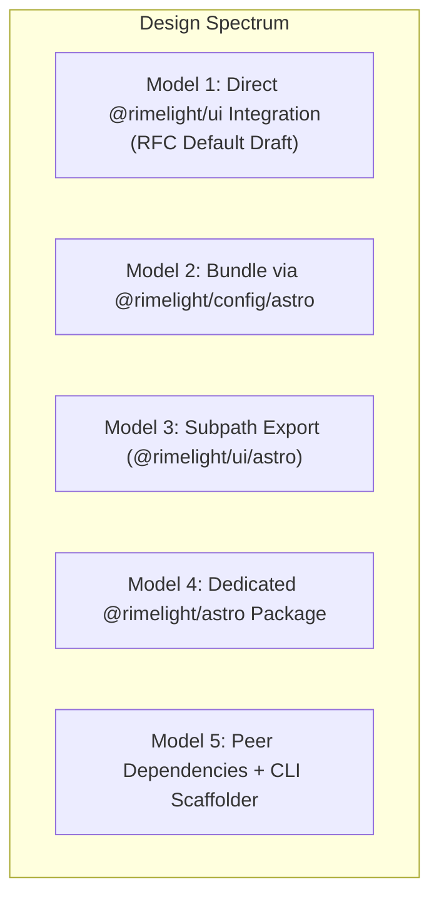

# RFC-0005: `@rimelight/ui` as an Astro Integration & Solid Renderer Abstraction

- **Status**: **Draft**
- **Author(s)**: Rimelight Architecture Team
- **Created**: 2026-09-19
- **Last Updated**: 2026-09-19
- **Discussion/PR**: [Link to PR/Issue]

---

## 1. Summary

This proposal transforms `@rimelight/ui` from a loose collection of Vite plugins and Astro components into a first-class **Astro Integration**. By declaring `@astrojs/solid-js`, `solid-js`, `@unocss/vite`, and `unocss` as direct `dependencies` of `@rimelight/ui` and registering the Solid.js renderer automatically during Astro's config lifecycle, consuming packages and applications will no longer need to manually install or manage `@astrojs/solid-js`, `solid-js`, or `unocss` in their own `package.json` files.

At the same time, this design preserves Astro's strict island tree-shaking guarantees: routes and pages that do not use interactive client islands ship **0 bytes** of Solid.js runtime to the browser.

---

## 2. Motivation

### Current Pain Points

1. **Redundant Boilerplate Across Apps**: Every consuming app (`rimelight.com`, `starter.rimelight.com`, `idantity.me`, `queerkit.com`, `marcelocfilho.com`, `personal.idantity.me`, `thrift.idantity.me`, `octavianmironescu.com`) has had to manually declare:
   - `@astrojs/solid-js`
   - `solid-js`
   - `unocss`
2. **Leaky Abstraction**: While developers configure high-level options like `rimelightAstroConfig({ ui: true, solid: true })`, the underlying architecture required consumer repositories to manage low-level engine peer dependencies.
3. **Version Drift**: Upgrading Solid or UnoCSS across the monorepo required updating 8+ independent `package.json` files and running synchronization scripts, risking version mismatches.

### Goals

- **Zero-Config Consumer Setup**: Installing `@rimelight/ui` (or enabling `ui: true` in `@rimelight/config/astro`) brings in all necessary runtime and styling dependencies automatically.
- **Out-of-the-Box Island Hydration**: Components like `<RLAToaster client:load />`, `<RLAShortcuts client:load />`, and custom `.tsx` Solid components work without explicit renderer configuration.
- **Zero Bundle Bloat**: Keep browser bundles strictly pay-for-what-you-use. If a route renders static HTML, 0 KB of Solid is shipped.

### Non-Goals

- Forcing client-side JavaScript on static pages.
- Deprecating pure `.astro` static components.

---

## 3. Detailed Design

### 3.1. Proposed API & Developer Experience

#### Consuming Application `package.json` (Before vs After)

```diff
  "dependencies": {
    "@rimelight/config": "workspace:*",
    "@rimelight/ui": "workspace:*",
-   "@astrojs/solid-js": "7.0.2",
-   "solid-js": "1.9.15",
-   "unocss": "66.10.5"
  }
```

#### Consuming Application `astro.config.ts`

```typescript
import { defineConfig } from "astro/config"
import { rimelightAstroConfig } from "@rimelight/config/astro"

export default defineConfig(
  rimelightAstroConfig({
    domain: "example.com",
    ui: true // Automatically mounts UnoCSS + Solid island renderer
  })
)
```

#### Using Components in `.astro` Layouts & Pages

```astro
---
import RLAToaster from "@rimelight/ui/components/toaster/RLAToaster.astro"
import RLAShortcuts from "@rimelight/ui/components/shortcuts/RLAShortcuts.astro"
import CustomCounter from "../components/CustomCounter.tsx" // Solid component
---

<!-- Hydrates via automatically registered @astrojs/solid-js -->
<RLAToaster client:idle />
<RLAShortcuts client:idle />
<CustomCounter client:visible />
```

---

### 3.2. Architecture & Integration Lifecycle

```mermaid
flowchart TD
    AppConfig[Consumer astro.config.ts] -->|rimelightAstroConfig| ConfigPkg[@rimelight/config]
    ConfigPkg -->|Loads| UIIntegration[@rimelight/ui Integration]

    subgraph "@rimelight/ui Integration"
        UIIntegration -->|Registers| SolidRenderer[Solid.js Astro Renderer]
        UIIntegration -->|Attaches| UnoPlugin[UnoCSS Vite Plugin]
        UIIntegration -->|Injects| Presets[Wind4 + Typography + Icons Presets]
    end

    subgraph "Compilation & Island Hydration"
        SolidRenderer -->|Compiles| TSXFiles[Solid .tsx Islands]
        SolidRenderer -->|Injects Client Runtime Only When| ClientDirectives[client:* Directives Present]
        UnoPlugin -->|Extracts Utility Classes| StaticCSS[Generated Atomic CSS]
    end

    ClientDirectives -->|Bundled to Browser| ClientBundle[Client JS Bundle]
    TSXFiles -->|SSR Rendered| HTMLStream[Static HTML Output]
```

---

### 3.3. `@rimelight/ui` Integration Definition

In `packages/ui/src/integration.ts`:

```typescript
import type { AstroIntegration } from "astro"
import solid from "@astrojs/solid-js"
import UnoCSS from "@unocss/vite"
import { rimelightUiPreset } from "./preset.js"
import type { UIConfig } from "./types.js"

export function rimelightUi(config: UIConfig = {}): AstroIntegration {
  const { unocss = {}, solid: solidOptions, ...cfg } = config

  return {
    name: "@rimelight/ui",
    hooks: {
      "astro:config:setup": ({ updateConfig, addRenderer }) => {
        const solidIntegration = solid(
          typeof solidOptions === "object"
            ? solidOptions
            : { include: ["**/solid/**", "**/*.tsx", "**/*.jsx"] }
        )

        updateConfig({
          vite: {
            plugins: [
              UnoCSS({
                ...unocss,
                presets: [rimelightUiPreset(cfg), ...(unocss.presets || [])],
                content: {
                  ...unocss.content,
                  pipeline: unocss.content?.pipeline !== false && {
                    ...unocss.content?.pipeline,
                    include: [
                      /\.(astro|html|js|jsx|json|md|mdx|ts|tsx)$/,
                      ...[unocss.content?.pipeline?.include]
                    ]
                  }
                }
              })
            ]
          }
        })

        // Delegate renderer registration to @astrojs/solid-js
        if (solidIntegration.hooks["astro:config:setup"]) {
          solidIntegration.hooks["astro:config:setup"]({
            addRenderer,
            updateConfig
            // Pass standard Astro setup context
          } as any)
        }
      }
    }
  }
}

export default rimelightUi
```

---

## 4. Tree-Shaking & Performance Guarantees

A key requirement is ensuring that making Solid and UnoCSS direct dependencies does **not** bloat applications that do not use interactive client islands.

| Scenario                                                | Server Bundle (`dist/server`)          | Client Bundle (`dist/client`)                           |
| :------------------------------------------------------ | :------------------------------------- | :------------------------------------------------------ |
| **Static `.astro` pages only**                          | Pure HTML string templates             | **0 bytes** JS                                          |
| **Solid component with SSR only (no `client:*`)**       | Solid SSR renderer (~2 KB) executed    | **0 bytes** JS                                          |
| **Solid component with `<Component client:visible />`** | Solid SSR renderer executed            | Hydration chunk loaded **only when element is visible** |
| **Disabled Solid (`solid: false`)**                     | Gated integration; 0 Solid code loaded | **0 bytes** JS                                          |

---

## 5. Drawbacks & Trade-offs

1. **Astro Framework Coupling Risk**:
   `@rimelight/ui` was previously refactored from an Astro-specific integration into a **framework-agnostic Vite plugin** (`virtual:rimelight/ui`) with multi-framework component exports (`RLA*`, `RLS*`). Bundling Astro-specific rendering integrations (`@astrojs/solid-js`) directly into `@rimelight/ui` re-couples the UI package to Astro, making it less ergonomic for non-Astro Vite apps (e.g. Solid SPA, Svelte, or Vite SSR).
2. **Direct Dependency Size in `node_modules`**:
   `node_modules/@rimelight/ui` will contain `solid-js` and `@astrojs/solid-js`. In modern package managers (pnpm), content-addressable storage shares these bytes across all workspace apps with 0 disk penalty.
3. **Pinned Framework Version**:
   All consuming apps inherit the Solid.js and UnoCSS versions specified by `@rimelight/ui`. In the Rimelight ecosystem, this is a deliberate benefit ensuring consistency across all web products.

---

## 6. Architectural Models & Alternatives Considered

The central design dilemma is finding the right boundary for the **Astro $\leftrightarrow$ Solid $\leftrightarrow$ UI runtime glue** without violating package responsibilities:



### Model 1: Direct `@rimelight/ui` Integration (Current RFC Proposal)

- **Design**: `@rimelight/ui` root exports both the Vite plugin and the Astro integration with `@astrojs/solid-js` as a direct dependency.
- **Pros**: Simplest consumer DX — installing `@rimelight/ui` just works.
- **Cons**: Re-couples the UI package to Astro, undoing the prior refactor toward generic Vite agnosticism.

### Model 2: Bundle via `@rimelight/config/astro`

- **Design**: Move `@astrojs/solid-js` and Solid runtime orchestration into `@rimelight/config/astro`, leaving `@rimelight/ui` 100% agnostic.
- **Pros**: Leaves `@rimelight/ui` completely generic.
- **Cons**: **Scope pollution for config package**. `@rimelight/config` is intended for lightweight configuration presets (TSConfig, Drizzle configs, Vite presets). Tying heavy UI rendering engines and framework runtimes to `@rimelight/config` violates its single-responsibility principle.

### Model 3: Subpath Export (`@rimelight/ui/astro`)

- **Design**: Root `@rimelight/ui` remains a 100% generic Vite plugin with zero Astro dependencies. A dedicated subpath export `@rimelight/ui/astro` provides the Astro integration for Astro consumers:
  ```typescript
  // astro.config.ts
  import { defineConfig } from "astro/config"
  import { rimelightUi } from "@rimelight/ui/astro"

  export default defineConfig({
    integrations: [rimelightUi()]
  })
  ```
- **Pros**: Non-Astro consumers import `@rimelight/ui` with 0 Astro baggage; Astro consumers import `@rimelight/ui/astro` and get zero-config Solid/UnoCSS registration.
- **Cons**: Astro apps still import from the UI package rather than a dedicated meta-framework integration.

### Model 4: Dedicated Integration Package (`@rimelight/astro`)

- **Design**: Establish clear boundary separation across three tiers:
  1. `@rimelight/ui`: UI components & UnoCSS preset (pure Vite plugin).
  2. `@rimelight/config`: Tooling presets (TSConfig, Drizzle, Vite-plus).
  3. `@rimelight/astro`: First-class Astro integration suite bundling Cloudflare SSR, Solid renderer, SEO, CMS, and UI integration.
- **Pros**: Cleanest separation of concerns in the monorepo; each package has a single, unambiguous purpose.
- **Cons**: Adds one new package to maintain in the workspace.

### Model 5: Peer Dependencies + CLI Scaffolding (`pnpm rimelight init`)

- **Design**: Keep peer dependencies explicit, but eliminate manual copy-paste friction via a setup command in `@rimelight/cli`.
- **Pros**: Absolute transparency, zero abstraction layer over Astro/Solid.
- **Cons**: Downstream apps still have multi-line `package.json` dependency lists and potential version drift if not upgraded via CLI.

---

## 7. Adoption & Migration Strategy

1. **Finalize Architecture Model**: Align team on Model 3 (subpath export `@rimelight/ui/astro`) vs Model 4 (dedicated `@rimelight/astro` package).
2. **Update Selected Integration Layer**:
   - Provide zero-config Solid island registration and UnoCSS pipeline setup.
3. **Clean Consumer `package.json` Files**:
   - Remove redundant `@astrojs/solid-js` and `solid-js` entries from downstream applications (`rimelight.com`, `idantity.me`, `queerkit.com`, etc.).

---

## 8. Verification & Testing Plan

1. **Automated Tests**:
   - Verify `@rimelight/ui` unit and integration tests with `vp test`.
   - Test that components render correctly in both SSR and hydration contexts.
2. **Bundle Verification**:
   - Inspect `dist/client` across built apps to confirm zero client JS is emitted for static pages.
   - Test client interactivity for `<RLAToaster client:idle />` and `<RLAShortcuts client:idle />`.

---

## 9. Unresolved Questions

1. **Subpath export (`@rimelight/ui/astro`) vs dedicated package (`@rimelight/astro`)**: Which architectural boundary best fits the long-term roadmap?
2. **Framework Agnosticism Priority**: Should `@rimelight/ui` remain strictly generic at its root entrypoint to preserve flexibility for Solid/Svelte-only standalone apps?
3. **JSX Pragma Support**: Should the integration support optional custom JSX pragma configuration for consumers writing Solid `.tsx` alongside other frameworks, or should standard `solid-js` pragma remain the universal default? (Recommendation: Keep Solid as default).
