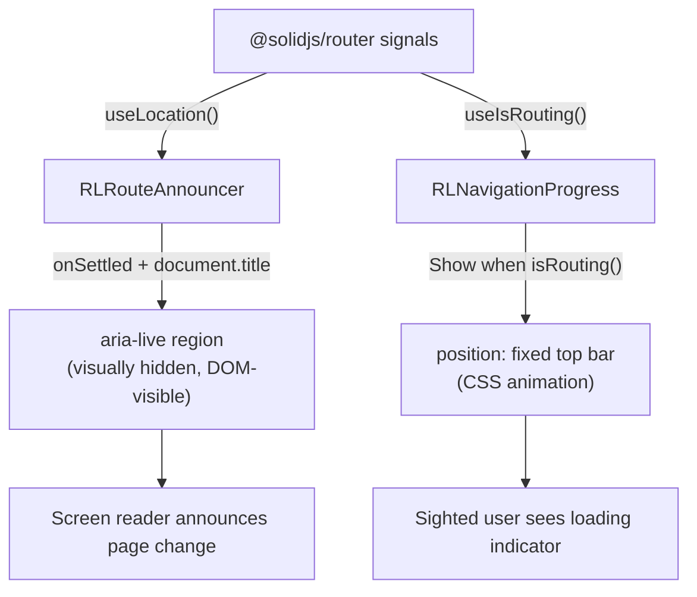

# RFC: Route Announcer & Navigation Progress in `@rimelight/ui`

- **Status**: **Draft**
- **Author(s)**: Rimelight Team
- **Created**: 2026-10-01
- **Last Updated**: 2026-10-01
- **Discussion/PR**: [Pending]

---

## 1. Summary

This RFC proposes adding two new components to `@rimelight/ui`:

- **`RLRouteAnnouncer`** — a visually hidden `aria-live` region that announces page title changes to screen readers on every client-side navigation, closing an accessibility gap that neither `@solidjs/router` nor `filesystem-routing` address by default.
- **`RLNavigationProgress`** — a Nuxt-style top loading bar driven by `useIsRouting()` that provides visual feedback during async route transitions (lazy chunks, server data fetches, etc.).

Both components are placed once in the app shell (e.g., `AppLayout.tsx`) alongside existing shell-level components like `RLScrollToTop` and `RLToaster`, and require no configuration beyond mounting them.

---

## 2. Motivation

### The Accessibility Gap

When a user navigates between routes in a client-side SPA, the browser does not perform a full page reload. Screen readers (VoiceOver, NVDA, JAWS) rely on the browser's load event or focus management to announce context changes — neither of which fires on a SPA transition. Without an `aria-live` announcer, a screen reader user clicking a link receives no feedback that the page has changed at all.

Nuxt and SvelteKit both ship a route announcer by default for this reason. Solid Router currently does not.

Both `rimelight.com` and `starter.rimelight.com` already have a `skip-to-content` link in `AppLayout.tsx`, showing awareness of accessibility concerns — the route announcer is the logical next step.

### The Loading Feedback Gap

`useIsRouting()` from `@solidjs/router` flips `true` the moment a navigation triggers any async work (a lazy route chunk, a `"use server"` function, a data loader). Currently neither app surfaces this state visually. Users on slower connections or navigating to heavy routes see no indication that anything is happening, which creates a perception of the UI being unresponsive.

### Why `@rimelight/ui`

Both components are headless UI primitives with no application-specific logic — the same category as `RLScrollToTop` and `RLToaster`. There is no justification for a separate package; placing them in `@rimelight/ui` means both apps (and any future apps) get them for free via their existing `@rimelight/ui` dependency.

### Goals

- Close the SPA accessibility gap for screen reader users across all Rimelight apps.
- Provide visual navigation feedback consistent with what users expect from modern web apps.
- Zero configuration: drop the components into `AppLayout.tsx` and they work.
- Match the existing component conventions in `@rimelight/ui` (`RL` prefix, theme file, type file, `onSettled` for DOM effects).

### Non-Goals

- Wrapping or replacing `filesystem-routing` or `@solidjs/router`.
- Providing a customizable animation system (basic CSS is sufficient).
- Supporting non-Solid renderers (out of scope until the Astro integration RFC is resolved).

---

## 3. Detailed Design

### 3.1. Proposed API / Usage

Both components are drop-in additions to `AppLayout.tsx`, placed alongside existing shell-level components:

```tsx
import { RLRouteAnnouncer, RLNavigationProgress } from "@rimelight/ui";

// Inside AppLayout's return:
<RLScrollToTop showProgress={true} />
<RLShortcuts />
<RLLayoutGrid />
<RLToaster />
<RLRouteAnnouncer />
<RLNavigationProgress />
```

No props are required. Optional props for escape hatches:

```tsx
// RLRouteAnnouncer
<RLRouteAnnouncer
  // Custom prefix when document.title is empty. Defaults to "Navigated to"
  prefix="Now on"
/>

// RLNavigationProgress
<RLNavigationProgress
  // Override the progress bar color token. Defaults to "primary"
  color="secondary"
  // Height in px. Defaults to 3
  height={3}
/>
```

### 3.2. Architecture & File Structure

New files added under `packages/ui/src/components/`:

```
packages/ui/src/components/
├── route-announcer/
│   ├── RLRouteAnnouncer.tsx       # Component
│   ├── route-announcer.ts         # Props type + doc comments
│   └── route-announcer.theme.ts   # (empty / minimal — no visual output)
└── navigation-progress/
    ├── RLNavigationProgress.tsx   # Component
    ├── navigation-progress.ts     # Props type + doc comments
    └── navigation-progress.theme.ts
```

Both are added to `packages/ui/src/components/index.ts` following the existing barrel export pattern.



### 3.3. Key Components

#### `RLRouteAnnouncer`

```tsx
import { useLocation } from "@solidjs/router";
import { createSignal, onSettled, type Component } from "solid-js";
import type { RouteAnnouncerProps } from "./route-announcer";

const RLRouteAnnouncer: Component<RouteAnnouncerProps> = (props) => {
  const location = useLocation();
  const [announcement, setAnnouncement] = createSignal("");

  onSettled(() => {
    // Re-runs on every pathname change via Solid's reactive ownership
    const path = location.pathname;
    const prefix = props.prefix ?? "Navigated to";
    const title = document.title || `${prefix} ${path}`;
    setAnnouncement(title);
  });

  return (
    <div aria-live="polite" aria-atomic="true" role="status" class="sr-only">
      {announcement()}
    </div>
  );
};
```

Key decisions:

- **`onSettled` instead of `createEffect`** — `onSettled` (Solid 2.0) fires after the DOM has settled, which means `document.title` has already been updated by `@solidjs/meta`'s `<Title>` before we read it. This eliminates the `setTimeout(100)` hack from the conversation that prompted this RFC.
- **`class="sr-only"` via UnoCSS** — the `sr-only` utility is standard in UnoCSS's `@unocss/preset-wind` and compiles to an external stylesheet served from `'self'`. JSX `style={{}}` props are a CSP violation at runtime because `@rimelight/security` sets `style-src 'self'` with no `'unsafe-inline'`.
- **`aria-atomic="true"`** — ensures the full title is announced as a unit, not character-by-character on update.

#### `RLNavigationProgress`

```tsx
import { useIsRouting } from "@solidjs/router";
import { Show, type Component } from "solid-js";
import { navigationProgressTheme } from "./navigation-progress.theme";
import type { NavigationProgressProps } from "./navigation-progress";

const RLNavigationProgress: Component<NavigationProgressProps> = (props) => {
  const isRouting = useIsRouting();

  const classes = () =>
    navigationProgressTheme({
      color: props.color ?? "primary",
      height: props.height ?? 3,
    });

  return (
    <Show when={isRouting()}>
      <div
        role="progressbar"
        aria-label="Page loading"
        aria-valuemin={0}
        aria-valuemax={100}
        class={classes().bar}
        style={{ height: `${props.height ?? 3}px` }}
      />
    </Show>
  );
};
```

Key decisions:

- **`role="progressbar"`** — the bar is an indeterminate progress indicator; this is the correct ARIA role (with no `aria-valuenow` for indeterminate state).
- **`Show` instead of CSS visibility** — the element is unmounted when not routing, not just hidden. This avoids a permanently present DOM node whose CSS animation runs perpetually in the background.
- **CSS animation lives in the theme file** — consistent with every other animated component in `@rimelight/ui`.
- **Color driven by CSS custom properties** (`--rl-{color}-500`) — matches the existing token system used in `RLScrollToTop` and other components.

---

## 4. Drawbacks & Trade-offs

- **`useLocation()` and `useIsRouting()` must be called inside a Router context.** Both components must be placed inside `<Router>` (which is already the case in both apps' `AppLayout.tsx`, since layouts render inside routes).
- **`document.title` timing.** `onSettled` is the correct hook here, but if a route does not set a `<Title>` at all, the announcer will read the previous page's title until the component unmounts. This is an edge case and the same behavior as Nuxt's announcer.
- **Indeterminate bar UX.** `useIsRouting()` gives a boolean, not a percentage. The bar animates as an indeterminate indicator. This is acceptable and consistent with how Nuxt, GitHub, and YouTube handle navigation progress.

---

## 5. Alternatives Considered

1. **`createEffect` + `setTimeout(100)`** (as proposed in the originating conversation)
   - Rejected: `onSettled` is the idiomatic Solid 2.0 approach and does not rely on an arbitrary timeout that may fail on slow devices or race with title updates.

2. **`MutationObserver` on `<title>`**
   - Would work, but adds imperative DOM code when the reactive `onSettled` approach is cleaner and framework-idiomatic.

3. **A separate `@rimelight/shell` package**
   - Rejected: the components are ~30 lines each and fit naturally into `@rimelight/ui`'s existing structure. A new package adds dependency management overhead with no real benefit at the current scale of 2 apps.

4. **Wrapping `filesystem-routing` in a custom package**
   - Discussed separately and deferred. Not related to these components.

---

## 6. Adoption & Migration Strategy

Non-breaking addition. No existing code changes.

**Rollout steps:**

1. Implement and publish `@rimelight/ui` with both components.
2. Add to `AppLayout.tsx` in `rimelight.com`.
3. Add to `AppLayout.tsx` in `starter.rimelight.com`.

The `AppLayout.tsx` diff for each app is two import lines and two JSX elements.

---

## 7. Cross-Cutting Concerns

### 7.1. Performance & Bundle Size

Both components are tiny (~20 lines of JSX each). They will be included in the `@rimelight/ui` components barrel and tree-shaken in any app that does not import them. Since both apps will use them, they'll be present in the bundle — but the total addition is negligible (< 1 KB gzipped).

`RLNavigationProgress` uses `Show`, so when not routing, the bar DOM node does not exist and its CSS animation does not run.

### 7.2. Accessibility (a11y)

This RFC is primarily an accessibility improvement:

- `RLRouteAnnouncer` directly addresses WCAG 2.1 Success Criterion 4.1.3 (Status Messages) for SPA navigation.
- `aria-live="polite"` is the correct politeness level — it waits for current speech to finish before announcing.
- `aria-atomic="true"` ensures the announcement is read as a complete string.
- `RLNavigationProgress` includes `role="progressbar"` and `aria-label="Page loading"` so the loading state is also communicated to assistive technology, not just visually.

### 7.3. Security & Privacy

No network requests, no data storage, no external dependencies. No security implications.

---

## 8. Verification & Testing Plan

### 8.1. Automated Tests

Unit tests in `packages/ui/test/`:

- `RLRouteAnnouncer`: mock `useLocation` signal, assert `aria-live` region text updates when pathname changes.
- `RLNavigationProgress`: mock `useIsRouting`, assert bar mounts/unmounts correctly.

```bash
vp test
vp check
```

### 8.2. Manual Verification

1. Run `rimelight.com` in dev mode.
2. Navigate between routes using keyboard only.
3. Enable VoiceOver (macOS) or NVDA (Windows) and navigate via links — verify each page title is announced.
4. Navigate to a route with a slow data loader — verify the top bar appears and disappears.
5. Confirm the announcer `div` is not visible in any viewport size.

---

## 9. Unresolved Questions

- Should `RLRouteAnnouncer` be included in `AppLayout.tsx` directly, or should it be composed into a higher-level `RLAppShell` component in the future (pending the broader app shell duplication discussion)?
- Should `RLNavigationProgress` support a `position` prop (top vs. bottom) or is top-only sufficient?
- Do we want to expose a `onNavigationStart` / `onNavigationEnd` callback prop on `RLNavigationProgress` for apps that want to hook into the routing lifecycle for analytics or other side effects?
