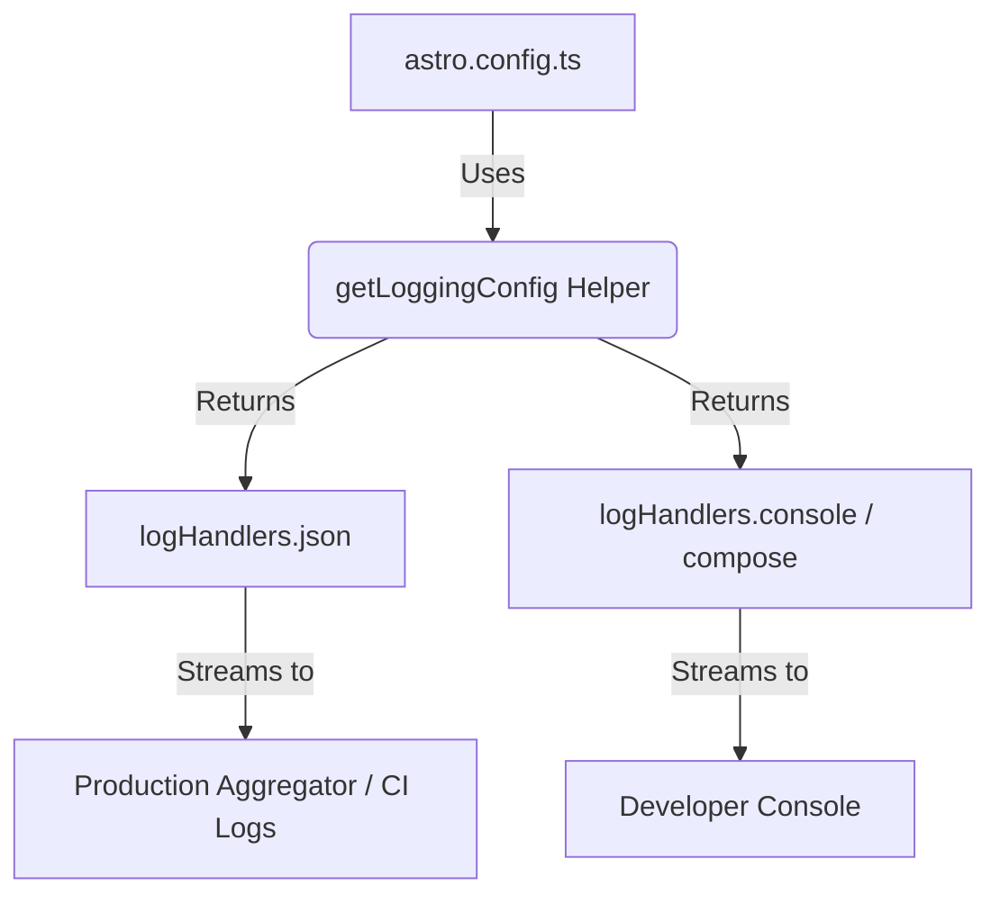

# RFC: Structured JSON Logging for Astro Applications

- **Status**: **Draft**
- **Author(s)**: Antigravity (Coding Assistant)
- **Created**: 2026-06-22
- **Last Updated**: 2026-06-22
- **Discussion/PR**: _Pending_

---

## 1. Summary

This RFC proposes the implementation and standardization of structured JSON logging across Rimelight’s Astro-based projects ([`rimelight.com`](file:///c:/Users/idant/WebstormProjects/rimelight/packages/rimelight.com) and [`starter.rimelight.com`](file:///c:/Users/idant/WebstormProjects/rimelight/packages/starter.rimelight.com)), leveraging Astro 7's newly introduced `logHandlers` API.

Under this proposal, we will configure Astro's logger pipeline to output structured JSON logs in non-interactive/production environments (CI/CD, staging, and Cloudflare/production builds) and when running under agentic systems, while keeping the default, human-readable terminal styling during local developer sessions.

---

## 2. Motivation

Currently, Rimelight runs dynamic Astro SSR applications deployed to cloud/serverless environments (like Cloudflare Pages).
While Astro’s default terminal logs are highly stylized and readable for human developers:

1. **Machine Parsing in Production**: These logs use colors, ANSI escape sequences, and multi-line formatting. None of this is parseable by machine log aggregators (e.g. Kibana, CloudWatch, Datadog, Grafana Loki), leading to unstructured string blobs that make querying or setting up alerts on errors extremely tedious.
2. **AI/Agent Integration**: Raw logs with ANSI escape codes clutter log files and sometimes break output parsing for agent workflows that verify dev server runs or build scripts.
3. **Traceability**: In a multi-package monorepo workspace, combining logs from multiple concurrently running dev servers or builds can lead to scrambled output. Having structured logs allows log management systems to easily categorize logs by service.

Standardizing structured logging in Astro 7 gives us control to multiplex logs to the console and structured logging agents simultaneously.

---

## 3. Detailed Design

Astro 7 introduces a new `logger` option in `defineConfig` along with `logHandlers`. We will integrate structured logging configuration directly into our Astro configuration pipelines.

### 3.1. Proposed API / Usage

#### Local Config updates (e.g. [`packages/rimelight.com/astro.config.ts`](file:///c:/Users/idant/WebstormProjects/rimelight/packages/rimelight.com/astro.config.ts))

We will update the config to conditionally choose a logger setup depending on the environment:

```typescript
import { defineConfig, logHandlers } from "astro/config"

const isProduction = process.env.NODE_ENV === "production"
const isAgent = !!process.env.GEMINI_AGENT || !!process.env.CI

export default defineConfig({
  // ... other config settings

  logger:
    isProduction || isAgent
      ? logHandlers.json()
      : logHandlers.compose(
          logHandlers.console(),
          logHandlers.json() // keeps a structured stream if needed, or just logHandlers.console()
        )
})
```

Alternatively, if we have centralized configurations under `@rimelight/ui/config`, we can abstract this logic.

### 3.2. Architecture & File Structure

We will add a reusable helper in [`packages/ui/src/config/`](file:///c:/Users/idant/WebstormProjects/rimelight/packages/ui/src/config) to provide uniform logging behavior across all Astro applications.



### 3.3. Key Components

1. **Environment Detection**: Standardize environment detection (detecting `CI`, `production`, and Agent runtimes) to activate JSON logging automatically.
2. **Logger Integration**: Implement `logger` definitions in:
   - [`packages/rimelight.com/astro.config.ts`](file:///c:/Users/idant/WebstormProjects/rimelight/packages/rimelight.com/astro.config.ts)
   - [`packages/starter.rimelight.com/astro.config.ts`](file:///c:/Users/idant/WebstormProjects/rimelight/packages/starter.rimelight.com/astro.config.ts)

---

## 4. Drawbacks & Trade-offs

- **File Size & Dependency**: The `logHandlers` module is built directly into `astro/config`, meaning there is no additional dependency bloat.
- **Log Readability on CI**: When looking at raw GitHub Actions / CI logs, reading JSON lines can be slightly harder for humans than colorized output. However, searchability and grep capability on JSON logs far outweigh this cost.

---

## 5. Alternatives Considered

- **`astro dev --json` flag only**: Developers could manually supply the `--json` flag when running scripts. However, this is prone to human error and doesn't enforce structured logs in production SSR deployments. Setting it up programmatically in the config ensures it works everywhere reliably.
- **Winston / Pino wrapper**: Wrapping `console.log` statements in the project. This was rejected because it does not intercept internal Astro framework logs (routing, dev server startup, asset building), whereas the built-in `logHandlers` handles framework-level events out of the box.

---

## 6. Adoption & Migration Strategy

Since Astro 7 is already active in [`rimelight.com`](file:///c:/Users/idant/WebstormProjects/rimelight/packages/rimelight.com) and [`starter.rimelight.com`](file:///c:/Users/idant/WebstormProjects/rimelight/packages/starter.rimelight.com), there is no runtime migration required. We can adopt this immediately by updating the `astro.config.ts` files. It is fully backward compatible.

---

## 7. Cross-Cutting Concerns

### 7.1. Performance & Bundle Size

- **Build/Dev Performance**: Handlers run at build-time and in the SSR dev server/runtime. The overhead of JSON stringification is negligible compared to HTML rendering and Vite builds.
- **Client Bundle Size**: The logger configurations only run on the server side (Node.js/Cloudflare worker runtime) and during build stages; it has **zero** footprint on client-side JS bundle sizes.

### 7.2. Security & Privacy

- **IP / Credential Leaks**: Standardize structured logging formatting to ensure environment variables and request headers (like `Authorization` or cookies) are not logged accidentally in JSON payloads.

---

## 8. Verification & Testing Plan

### 8.1. Automated Tests

We can verify the compilation of the configurations using the standard command:

```bash
vp check
```

### 8.2. Manual Verification

1. Run local dev server with `astro dev --json` (or set env variables) and ensure it outputs JSON logs.
2. Confirm the standard `astro dev` still prints clean console logs for developer usage.

---

## 9. Unresolved Questions

- Should we build a custom log handler that scrubs sensitive headers (e.g. `Cookie`, `Authorization`) before they are printed out to JSON streams, or does Astro's internal logger already handle this?
