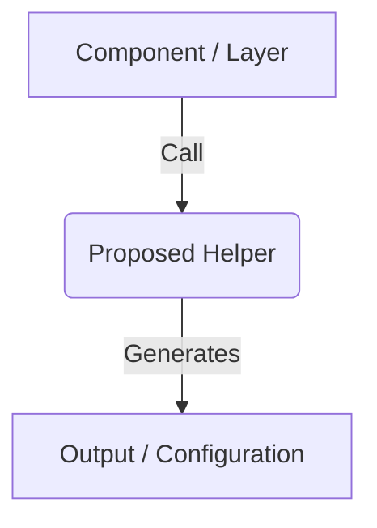

# RFC-0000: [Feature / Proposal Title]

- **Status**: **Draft** | **In Review** | **Accepted** | **Rejected** | **Postponed**
- **Author(s)**: [Name / GitHub Username]
- **Created**: YYYY-MM-DD
- **Last Updated**: YYYY-MM-DD
- **Discussion/PR**: [Link to PR/Issue]

---

## 1. Summary

A brief, high-level overview of the proposal (1-3 paragraphs). What are we changing, why, and what is the expected outcome? Keep it accessible to any engineer reading this document for the first time.

---

## 2. Motivation

Explain the context and the problem this proposal solves:

- What pain points are developers or users currently experiencing?
- Why is the status quo insufficient or unsustainable?
- What are the core goals and non-goals of this proposal?

---

## 3. Detailed Design

This is the technical heart of the RFC. Explain how the feature will work in detail, including code samples, architecture, and APIs.

### 3.1. Proposed API / Usage

Show concrete examples of how developers will interact with the new feature.

```typescript
// Insert code example showing the developer experience
```

### 3.2. Architecture & File Structure

List the files being added or modified, and describe the internal data flow. Use a Mermaid diagram if appropriate:



### 3.3. Key Components

Break down the implementation into logical pieces.

---

## 4. Drawbacks & Trade-offs

Be honest about the disadvantages of this proposal:

- What is the cost of implementing and maintaining this feature?
- Does it add complexity or increase bundle size?
- Are there any risks or potential regressions?

---

## 5. Alternatives Considered

Describe other approaches that could solve the same problem:

- What other designs or libraries were evaluated?
- Why were they rejected? (e.g., performance overhead, poor developer experience, lack of flexibility).

---

## 6. Adoption & Migration Strategy

How do we roll this out across the monorepo?

- Is this a breaking change?
- Will existing projects require manual refactoring, or can we automate the migration (e.g., using codemods)?
- What is the plan for backward compatibility?

---

## 7. Cross-Cutting Concerns

Assess how this proposal impacts core quality vectors in the Rimelight ecosystem.

### 7.1. Performance & Bundle Size

- How does this affect page load times, server-side rendering (SSR), or build performance?
- Does it impact the bundle size of the packages or templates?

### 7.2. Accessibility (a11y)

- If this proposal touches the user interface, does it conform to accessibility standards?
- Are semantic HTML, keyboard navigation, and aria attributes properly handled?

### 7.3. Security & Privacy

- Are there any security implications (e.g., data exposure, dependency vulnerabilities)?
- Does this affect compliance with privacy policies or browsers (e.g., Global Privacy Control)?

---

## 8. Verification & Testing Plan

How will we ensure the implementation is correct and stable?

### 8.1. Automated Tests

- What unit, integration, or end-to-end tests will be added or modified?
- Run check commands to verify:
  ```bash
  vp check
  vp test
  ```

### 8.2. Manual Verification

- Describe the steps to manually verify the behavior in a local sandbox or playground.

---

## 9. Unresolved Questions

List any design decisions, implementation details, or dependencies that are not yet finalized. These are topics we expect to discuss during the RFC review process.
