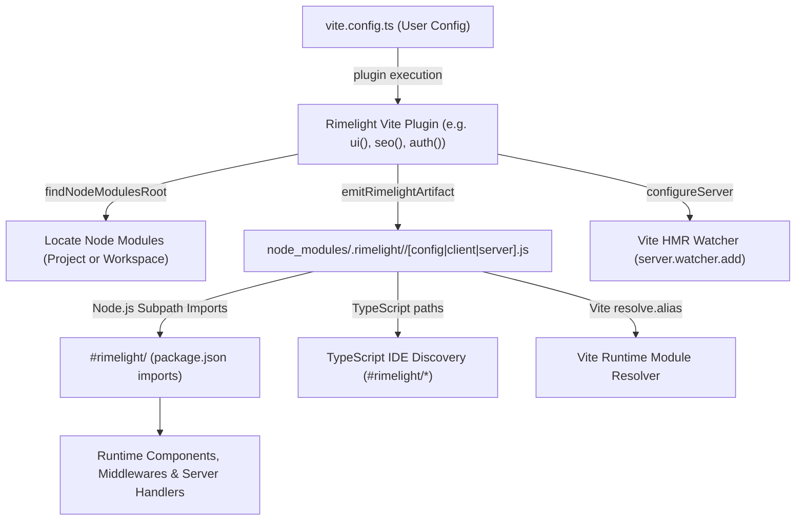

# RFC: Unified Generated Artifacts in `node_modules/.rimelight` via Subpath Imports

- **Status**: **Accepted (Enhanced)**
- **Author(s)**: Rimelight Core Team
- **Created**: 2026-10-08
- **Last Updated**: 2026-10-08
- **Discussion/PR**: N/A

---

## 1. Summary

This RFC proposes replacing all ad-hoc in-memory Vite virtual modules across Rimelight packages (`@rimelight/ui`, `@rimelight/seo`, `@rimelight/auth`, `@rimelight/security`, `@rimelight/i18n`, and `@rimelight/cms`) with a unified, disk-backed artifact generation pattern stored in `node_modules/.rimelight/` and consumed via standard **Node.js Subpath Imports** (`#rimelight/*`).

The refined design satisfies eight strict developer experience, resolution, and architecture constraints:

1. **Native Subpath Imports & Vite Aliasing**: Consuming apps and internal workspace packages resolve generated configuration through standard Node.js `#rimelight/*` subpath imports, backed by package-level `package.json` `"imports"`, TypeScript `paths`, and Vite `resolve.alias`.
2. **Environment & Dual-Build Isolation**: Client and SSR/Server configurations are cleanly separated (`#rimelight/<pkg>/client`, `#rimelight/<pkg>/server`, and unified `#rimelight/<pkg>`), eliminating race conditions and server-secret leaks in dual-build environments (e.g., Astro, Solid SSR, Vite SSR).
3. **Two-Tier Safe Serialization & Re-based Module References**: Distinguishes static serializable options (primitives, regexes, simple objects) from runtime module instances (functions, database adapters, auth providers, icon buffers), generating valid ES module code with POSIX-normalized, re-based `importSpecifier` references rather than brittle `JSON.stringify` closures.
4. **Monorepo & Multi-App Collision Safety**: Correctly traverses and resolves workspace root vs app-local `node_modules` without accidental empty directory creation, preventing concurrent builds across workspace apps from stomping on shared artifacts.
5. **HMR Watcher Integration & Byte-Checked Idempotency**: Explicitly registers generated directories with Vite's dev watcher (`server.watcher.add`, `server.watch.ignored`) while using byte-level comparison to prevent redundant writes and watcher feedback loops.
6. **Per-Test State Isolation & Framework Reactivity Model**: Provides clean runtime getter and test override helpers to support unit tests that dynamically toggle configuration states (e.g., `unstyled: true` vs `false`) without mutating immutable ES module exports, accounting for Solid.js and Astro lifecycle semantics.
7. **Packaging Integration (`vp pack` / tsdown)**: Standardizes `neverBundle: [/^#rimelight\//]` across package builds to ensure clean library packaging.
8. **Cold CI & Typecheck Preparation (`rimelight prepare`)**: Standardizes a lightweight `rimelight prepare` command (executed via `postinstall` or CI steps) to generate fallback type definitions and stubs before standalone `tsc --noEmit` runs.

---

## 2. Motivation

Virtual modules (e.g., `virtual:rimelight/ui`, `virtual:rimelight-security-config`, `virtual:rimelight/seo/server`) are currently used across Rimelight to pass build-time options from `vite.config.ts` into runtime modules. While functional, their pervasive use creates friction across development, typing, and testing:

1. **Degraded IDE Experience & Type Resolution**:
   - `Cmd/Ctrl + Click` (jump-to-definition) fails or lands on empty `declare module "virtual:..."` stubs in ambient `.d.ts` files.
   - Internal packages and consumers must maintain fragile ambient declarations that easily get out of sync.
2. **Heavy Vitest Mocking Overhead**:
   - Unit tests across packages (e.g. `packages/ui/test/*`) require manual `vi.mock("virtual:rimelight/ui", ...)` setup blocks before components can even be imported or tested.
3. **Unsafe Function Serialization & Instance Stripping**:
   - Packages resort to custom `.toString()` serialization (which breaks when functions close over module scope in `vite.config.ts`) or naive `JSON.stringify` (which silently strips functions, callbacks, and database adapter instances).
4. **Dual-Build & SSR Collisions**:
   - When Vite builds client and SSR bundles concurrently, in-memory virtual modules can leak server secrets to client bundles or collide during build phases.
5. **Fragmented In-Memory Identifiers**:
   - Different packages use inconsistent naming schemes (`virtual:rimelight/ui`, `virtual:rimelight-seo-config`, `virtual:sri-manifest`, `virtual:rimelight-auth-config`), hindering ecosystem maintainability.

### Goals

- Establish a single, uniform generation mechanism across all Rimelight packages using standard `#rimelight/*` subpath imports.
- Maintain dedicated client/server artifact boundaries to guarantee SSR safety and tree-shaking.
- Make configuration artifacts inspectable on disk for effortless debugging.
- Enable native IDE jump-to-definition and autocomplete without broken TypeScript path wildcards.
- Eliminate unit test mocking boilerplate for configuration modules.
- Ensure robust HMR and prevent watcher dead-zones in `node_modules`.
- Guarantee multi-app monorepo isolation during concurrent dev and build steps.
- Support runtime configuration overrides in tests without illegal ES module mutations.
- Provide seamless cold CI and standalone `tsc --noEmit` support via zero-cost prepare stubs (`rimelight prepare`).
- Standardize library packaging rules (`vp pack` / tsdown) for `#rimelight/*` externalization.
- Maintain 100% backward compatibility for consumer configuration in `vite.config.ts`.

### Non-Goals

- Introducing a standalone `rimelight.config.ts` file (configuration remains cleanly in Vite plugins).
- Forcing React/Solid context providers upon consumers.

---

## 3. Detailed Design

### 3.1. Architecture & Directory Layout

During Vite's `config` / `configResolved` lifecycle hooks, each Rimelight plugin normalizes its options and emits real JavaScript and TypeScript declaration files into `<app-root>/node_modules/.rimelight/<pkg>/`:

```
<project-root>/
├── node_modules/
│   └── .rimelight/                     <-- Automatically gitignored
│       ├── ui/
│       │   ├── config.js
│       │   └── config.d.ts
│       ├── auth/
│       │   ├── client.js
│       │   ├── client.d.ts
│       │   ├── server.js
│       │   └── server.d.ts
│       ├── seo/
│       │   ├── client.js
│       │   ├── client.d.ts
│       │   ├── server.js
│       │   └── server.d.ts
│       ├── security/
│       │   ├── config.js
│       │   ├── sri.json
│       │   └── config.d.ts
│       ├── i18n/
│       │   ├── config.js
│       │   └── config.d.ts
│       └── cms/
│           ├── client.js
│           ├── client.d.ts
│           ├── server.js
│           └── server.d.ts
├── package.json                        <-- Declares subpath imports (#rimelight/*)
├── vite.config.ts                      <-- Standard plugin options
└── src/
```

---

### 3.2. Data Flow & Execution Pipeline



---

### 3.3. Core Implementation

#### 1. Workspace Node Modules Discovery & Multi-App Isolation (`@rimelight/config`)

To support monorepos (pnpm/npm/yarn workspaces) while preventing multi-app collisions when multiple workspace apps build concurrently, `findNodeModulesRoot` inspects the directory hierarchy with project-level awareness:

- **Application Dev & Build**: When running inside an application (e.g. `apps/rimelight.com`), the generator targets the application's local `node_modules` if present, ensuring complete artifact isolation between separate apps in the monorepo.
- **Workspace Packages & Unit Tests**: When running package-level tests (e.g. `packages/ui/test/*`), it traverses upward to locate the workspace root `node_modules`.

```typescript
import fs from "node:fs";
import path from "node:path";

export interface RimelightArtifactFiles {
  [filename: string]: string;
}

/**
 * Finds the appropriate node_modules directory for artifact generation.
 * 1. Checks if a local node_modules exists in startDir (app-local isolation).
 * 2. Traverses upward to find the closest existing node_modules directory (monorepo root fallback).
 * 3. Falls back to creating a local node_modules directory if none exists.
 */
export function findNodeModulesRoot(startDir: string): string {
  const localCandidate = path.resolve(startDir, "node_modules");
  if (fs.existsSync(localCandidate) && fs.statSync(localCandidate).isDirectory()) {
    return localCandidate;
  }

  let current = path.resolve(startDir);
  while (true) {
    const candidate = path.join(current, "node_modules");
    if (fs.existsSync(candidate) && fs.statSync(candidate).isDirectory()) {
      return candidate;
    }
    const parent = path.dirname(current);
    if (parent === current) break;
    current = parent;
  }

  // If none exists (e.g. fresh directory or isolated sandbox), create local candidate
  fs.mkdirSync(localCandidate, { recursive: true });
  return localCandidate;
}

/**
 * Emits disk-backed artifacts only when content has changed to preserve filesystem mtime.
 */
export function emitRimelightArtifact(
  root: string,
  pkgName: string,
  files: RimelightArtifactFiles,
): { targetDir: string; changed: boolean } {
  const nodeModulesDir = findNodeModulesRoot(root);
  const targetDir = path.join(nodeModulesDir, ".rimelight", pkgName);
  fs.mkdirSync(targetDir, { recursive: true });

  let changed = false;
  for (const [filename, content] of Object.entries(files)) {
    const filePath = path.join(targetDir, filename);
    if (!fs.existsSync(filePath) || fs.readFileSync(filePath, "utf-8") !== content) {
      fs.writeFileSync(filePath, content, "utf-8");
      changed = true;
    }
  }

  return { targetDir, changed };
}
```

---

#### 2. Two-Tier Code Generation, Re-based Module References & POSIX Normalization

Configuration values are split into two categories:

1. **Serializable Data**: Static options, primitives, regexes, and plain objects formatted into clean ES module declarations.
2. **Runtime Module References (`importSpecifier`)**: Dynamic functions, custom database adapters, auth providers, or asset buffers that cannot be safely serialized across processes are imported via ES module references.

##### Relative Path Re-basing

Because generated files reside inside `node_modules/.rimelight/<pkg>/`, relative import specifiers (e.g., `./auth.adapter.ts` from the user's `vite.config.ts`) must be re-based relative to the generated artifact's directory and normalized to POSIX paths (`/`):

```typescript
export interface CodeGenExport {
  name: string;
  value?: unknown;
  importSpecifier?: { from: string; symbol?: string; isDefault?: boolean };
}

/**
 * Safely serializes data values including primitives, RegExps, Dates, Sets, Maps, Arrays, and plain Objects.
 * Throws actionable compile-time errors when detecting un-serializable functions or closures.
 */
export function serializeData(value: unknown, path = "config"): string {
  if (value === null) return "null";
  if (value === undefined) return "undefined";
  if (typeof value === "string") return JSON.stringify(value);
  if (typeof value === "number" || typeof value === "boolean") return String(value);
  if (typeof value === "bigint") return `${value.toString()}n`;

  if (typeof value === "function") {
    throw new Error(
      `[Rimelight Config Error] Cannot directly serialize function at "${path}". Functions closing over module scope cannot be written to disk. Use dynamic module references via "importSpecifier: { from: '...', symbol: '...' }" instead.`,
    );
  }

  if (typeof value === "symbol") {
    throw new Error(
      `[Rimelight Config Error] Symbols cannot be serialized into disk artifacts at "${path}".`,
    );
  }

  if (value instanceof RegExp) {
    return `new RegExp(${JSON.stringify(value.source)}, ${JSON.stringify(value.flags)})`;
  }

  if (value instanceof Date) {
    return `new Date(${JSON.stringify(value.toISOString())})`;
  }

  if (value instanceof Set) {
    return `new Set([${Array.from(value)
      .map((v, i) => serializeData(v, `${path}[${i}]`))
      .join(", ")}])`;
  }

  if (value instanceof Map) {
    const entries = Array.from(value.entries()).map(
      ([k, v]) =>
        `[${serializeData(k, `${path}.key`)}, ${serializeData(v, `${path}[${JSON.stringify(k)}]`)}]`,
    );
    return `new Map([${entries.join(", ")}])`;
  }

  if (Array.isArray(value)) {
    return `[${value.map((item, i) => serializeData(item, `${path}[${i}]`)).join(", ")}]`;
  }

  if (typeof value === "object") {
    const entries = Object.entries(value as Record<string, unknown>)
      .filter(([, v]) => v !== undefined)
      .map(([k, v]) => `${JSON.stringify(k)}: ${serializeData(v, `${path}.${k}`)}`);
    return `{\n  ${entries.join(",\n  ")}\n}`;
  }

  return JSON.stringify(value);
}

/**
 * Normalizes and re-bases import specifiers for output inside node_modules/.rimelight/<pkg>.
 */
export function resolveImportSpecifier(from: string, rootDir: string, targetDir: string): string {
  if (from.startsWith(".")) {
    const absolutePath = path.resolve(rootDir, from);
    let relativePath = path.relative(targetDir, absolutePath).replace(/\\/g, "/");
    if (!relativePath.startsWith(".")) {
      relativePath = `./${relativePath}`;
    }
    return relativePath;
  }
  // Package or bare specifier
  return from.replace(/\\/g, "/");
}

export function generateESModule(
  exports: CodeGenExport[],
  options?: { rootDir?: string; targetDir?: string },
): string {
  const imports: string[] = [];
  const declarations: string[] = [];
  const exportNames: string[] = [];

  const rootDir = options?.rootDir ?? process.cwd();
  const targetDir = options?.targetDir ?? rootDir;

  let importCounter = 0;
  for (const exp of exports) {
    if (exp.importSpecifier) {
      const alias = `_ref_${++importCounter}`;
      const { from, symbol, isDefault } = exp.importSpecifier;
      const rebasedFrom = resolveImportSpecifier(from, rootDir, targetDir);

      if (isDefault || !symbol) {
        imports.push(`import ${alias} from ${JSON.stringify(rebasedFrom)};`);
      } else {
        imports.push(`import { ${symbol} as ${alias} } from ${JSON.stringify(rebasedFrom)};`);
      }
      declarations.push(`export const ${exp.name} = ${alias};`);
      exportNames.push(exp.name);
    } else {
      declarations.push(`export const ${exp.name} = ${serializeData(exp.value, exp.name)};`);
      exportNames.push(exp.name);
    }
  }

  return [
    `// Auto-generated by Rimelight. Do not edit directly.`,
    ...imports,
    ``,
    ...declarations,
    `export default { ${exportNames.join(", ")} };`,
  ].join("\n");
}
```

---

#### 3. Standardized Subpath Imports Integration & HMR Watcher

Every package plugin implements the standard Subpath Import pattern, maps Vite aliases, and registers the artifact directory with the Vite dev server file watcher:

```typescript
import path from "node:path";
import type { Plugin } from "vite-plus";
import {
  emitRimelightArtifact,
  findNodeModulesRoot,
  generateESModule,
} from "@rimelight/config/generator";
import type { UIConfig } from "./types";

export function ui(options: UIConfig = {}): Plugin {
  let root = process.cwd();
  let generatedDir = "";

  return {
    name: "rimelight:ui",
    enforce: "pre",

    config(userConfig) {
      root = userConfig.root ? path.resolve(userConfig.root) : process.cwd();
      const nodeModules = findNodeModulesRoot(root);
      const configFilePath = path.join(nodeModules, ".rimelight/ui/config.js");
      const targetDir = path.join(nodeModules, ".rimelight/ui");

      // 1. Emit disk-backed artifact with path re-basing
      emitRimelightArtifact(root, "ui", {
        "config.js": generateESModule(
          [
            { name: "config", value: options },
            { name: "logos", value: options.logos ?? {} },
            { name: "unstyled", value: options.unstyled ?? false },
            { name: "icons", value: options.icons ?? {} },
          ],
          { rootDir: root, targetDir },
        ),
        "config.d.ts": [
          `import type { UIConfig, LogoRegistry, IconRegistry } from "@rimelight/ui";`,
          `export declare const config: UIConfig;`,
          `export declare const logos: LogoRegistry;`,
          `export declare const unstyled: boolean;`,
          `export declare const icons: IconRegistry;`,
          `declare const _default: { config: UIConfig; logos: LogoRegistry; unstyled: boolean; icons: IconRegistry };`,
          `export default _default;`,
        ].join("\n"),
      });

      generatedDir = targetDir;

      // 2. Register Vite Alias matching Node.js Subpath Imports and un-ignore .rimelight in watcher
      return {
        resolve: {
          alias: {
            "#rimelight/ui": configFilePath,
          },
        },
        server: {
          watch: {
            // Explicitly allow Vite's Chokidar instance to watch .rimelight inside node_modules
            ignored: ["!**/node_modules/.rimelight/**"],
          },
        },
      };
    },

    configureServer(server) {
      // 3. Ensure Vite HMR watcher monitors generated directory despite node_modules default ignore
      if (generatedDir) {
        server.watcher.add(generatedDir);

        // Explicitly trigger HMR module reload when generated artifact files change
        server.watcher.on("change", (file) => {
          if (file.includes(path.join(".rimelight", "ui"))) {
            const mod = server.moduleGraph.getModuleById(file);
            if (mod) {
              server.moduleGraph.invalidateModule(mod);
            }
            server.ws.send({ type: "full-reload" });
          }
        });
      }
    },
  };
}
```

---

#### 4. Standardized Package-by-Package Mapping & Client/Server Separation

| Package                   | Subpath Import                                       | Generated File                                                                       | Scope & Exported Shape                                                                       |
| :------------------------ | :--------------------------------------------------- | :----------------------------------------------------------------------------------- | :------------------------------------------------------------------------------------------- |
| **`@rimelight/ui`**       | `#rimelight/ui`                                      | `node_modules/.rimelight/ui/config.js`                                               | **Universal**: `{ config, logos, unstyled, icons }`                                          |
| **`@rimelight/auth`**     | `#rimelight/auth/client`<br>`#rimelight/auth/server` | `node_modules/.rimelight/auth/client.js`<br>`node_modules/.rimelight/auth/server.js` | **Client**: `{ authClient, routes }`<br>**Server**: `{ auth, authAdapter, sessionOptions }`  |
| **`@rimelight/seo`**      | `#rimelight/seo/client`<br>`#rimelight/seo/server`   | `node_modules/.rimelight/seo/client.js`<br>`node_modules/.rimelight/seo/server.js`   | **Client**: `{ siteConfig }`<br>**Server**: `{ site, db, corpusPages, masterIconBuffer }`    |
| **`@rimelight/security`** | `#rimelight/security`                                | `node_modules/.rimelight/security/config.js`                                         | **Universal**: `{ config, sriManifest }`                                                     |
| **`@rimelight/i18n`**     | `#rimelight/i18n`                                    | `node_modules/.rimelight/i18n/config.js`                                             | **Universal**: `{ locales, defaultLocale, translations }`                                    |
| **`@rimelight/cms`**      | `#rimelight/cms/client`<br>`#rimelight/cms/server`   | `node_modules/.rimelight/cms/client.js`<br>`node_modules/.rimelight/cms/server.js`   | **Client**: `{ routePrefix, previewEnabled }`<br>**Server**: `{ storage, db, auth, schema }` |

---

#### 5. Subpath Imports in `package.json` and TypeScript Resolution

##### Package-Local Resolution Scope & Package Boundaries

In Node.js module resolution, subpath imports (specifiers beginning with `#`) are **strictly package-local**: they resolve relative to the `package.json` belonging to the file issuing the import.

To ensure seamless resolution across both consuming applications, pre-packaged libraries, and internal workspace packages during tests:

1. **Workspace Packages (`packages/*/package.json`) and Consuming Apps (`apps/*/package.json`)**:
   Every package and application manifest declares `#rimelight/*` imports:

   ```json
   {
     "imports": {
       "#rimelight/*/client": "./node_modules/.rimelight/*/client.js",
       "#rimelight/*/server": "./node_modules/.rimelight/*/server.js",
       "#rimelight/*": "./node_modules/.rimelight/*/config.js"
     }
   }
   ```

2. **Cross-Package Boundary Resolution & Published Manifests**:
   - When consuming packages are published and bundled via `vp pack` / `tsdown`, `#rimelight/*` imports remain unbundled (`neverBundle`).
   - Published library manifests (e.g. `@rimelight/ui/package.json`) also declare `"imports": { "#rimelight/*": "./node_modules/.rimelight/*" }`.
   - In dev and build modes, the Rimelight Vite plugins inject physical `resolve.alias` paths into Vite's config. This provides guaranteed cross-boundary resolution across all nested monorepo packages, pnpm virtual stores, and standalone runtimes.

3. **TypeScript Discovery via `@rimelight/config/tsconfig/base.json`**:

   ```json
   {
     "compilerOptions": {
       "paths": {
         "#rimelight/*/client": ["./node_modules/.rimelight/*/client.d.ts"],
         "#rimelight/*/server": ["./node_modules/.rimelight/*/server.d.ts"],
         "#rimelight/*/config": ["./node_modules/.rimelight/*/config.d.ts"],
         "#rimelight/*": [
           "./node_modules/.rimelight/*/config.d.ts",
           "./node_modules/.rimelight/*/index.d.ts",
           "./node_modules/.rimelight/*"
         ]
       }
     }
   }
   ```

---

#### 6. Per-Test Configuration Isolation & Framework Reactivity Model

Because static ES module exports (`export const unstyled = false`) are immutable bindings, unit tests cannot mutate imported exports directly (e.g. `(await import("#rimelight/ui")).default.unstyled = true`).

To support dynamic test matrix scenarios (e.g. testing components under styled vs unstyled modes in `packages/ui/test/core.test.ts`), `@rimelight/ui` provides a test-context override utility:

```typescript
// packages/ui/src/config-runtime.ts
import generatedConfig from "#rimelight/ui";

let testOverrides: Partial<typeof generatedConfig> | null = null;

export function getUIConfig() {
  return testOverrides ? { ...generatedConfig, ...testOverrides } : generatedConfig;
}

export function setRimelightUITestConfig(overrides: Partial<typeof generatedConfig> | null) {
  testOverrides = overrides;
}
```

##### Framework Lifecycle & Reactivity Guidelines

Components and helpers read config via `getUIConfig()`, allowing tests to safely execute:

```typescript
import { setRimelightUITestConfig } from "@rimelight/ui";

afterEach(() => {
  setRimelightUITestConfig(null);
});

it("renders in unstyled mode", () => {
  setRimelightUITestConfig({ unstyled: true });
  // Render and assert component...
});
```

> **Important Architectural Rules for Component Reactivity**:
>
> 1. **No Top-Level Module-Scope Config Caching**: Internal components and middleware helpers MUST NOT evaluate config at top-level module scope (`const isUnstyled = getUIConfig().unstyled;`). Doing so freezes configuration at file import time.
> 2. **Solid.js Single-Execution Lifecycle**: Solid component bodies execute **only once upon creation**. In tests, `setRimelightUITestConfig` must be invoked _before_ mounting/instantiating the component. If dynamic reactivity during a single mounted instance's lifecycle is needed, components should access configuration via an accessor getter (`() => getUIConfig().unstyled`).
> 3. **Astro & Server Handlers**: In Astro components and SSR middleware handlers, `getUIConfig()` is evaluated per template execution/request, seamlessly supporting request-level dynamic overrides.

---

#### 7. Package Packaging Configuration (`vp pack` / tsdown)

All package build configurations (`packages/*/vite.config.ts`) must externalize `#rimelight/*` imports during packaging (`vp pack`):

```typescript
export default defineConfig({
  pack: {
    entry: ["src/plugin.ts", "src/index.ts"],
    deps: {
      neverBundle: [/^#rimelight\//],
    },
  },
});
```

When consuming apps bundle `@rimelight/*` packages, their application-level Vite bundler resolves `#rimelight/*` to the application's generated `node_modules/.rimelight/` artifacts.

---

#### 8. Cold CI, Standalone `tsc --noEmit` & Tooling Preparation (`rimelight prepare`)

To align with modern web framework workflows (`astro sync`, `nuxt prepare`, `svelte-kit sync`) and guarantee that clean CI checkouts and IDE instances can run `tsc --noEmit` before any Vite build or dev server start, `@rimelight/config` provides the `rimelight prepare` command:

```bash
# In consumer / workspace package.json:
"scripts": {
  "postinstall": "rimelight prepare",
  "prepare": "rimelight prepare"
}
```

`rimelight prepare` (aliased as `rimelight-init`):

1. Traverses the project/workspace to locate `node_modules`.
2. Creates minimal fallback `.d.ts` and default fallback `.js` files for all `#rimelight/*` subpaths if they do not yet exist.
3. Guarantees instant, zero-error type resolution on cold repository checkouts without requiring a prior `vite build` or `vite dev` run.

---

## 4. Drawbacks & Trade-offs

1. **Cold Clean Checkouts**:
   - Running `tsc --noEmit` prior to `postinstall` or `vite build` could cause missing module errors.
   - **Mitigation**: Standard `postinstall: "rimelight prepare"` stub generation plus packaged fallback schema types in `@rimelight/config`.
2. **Disk I/O Overhead**:
   - Small disk writes on plugin initialization.
   - **Mitigation**: Writing <6 lightweight files takes <2ms; the strict byte-comparison cache avoids redundant writes and prevents file-watcher HMR feedback loops.
3. **Dual Client/Server Artifacts**:
   - Requires generating separate `client.js` and `server.js` files for packages with server-only sensitive options (e.g. `@rimelight/auth`, `@rimelight/seo`, `@rimelight/cms`).
   - **Mitigation**: Clear separation prevents accidental bundle leaks of server secrets to the client.
4. **Vite Watcher node_modules Filter**:
   - Chokidar ignores `node_modules` by default.
   - **Mitigation**: Vite config `server.watch.ignored: ['!**/node_modules/.rimelight/**']` explicitly un-ignores `.rimelight`, combined with direct `server.moduleGraph` invalidation.

---

## 5. Alternatives Considered

1. **In-Memory Virtual Modules (Status Quo)**:
   - _Rejected_: Broken IDE jump-to-definition, heavy Vitest mocking boilerplate, and insecure closure serialization.
2. **Dedicated `rimelight.config.ts` File**:
   - _Rejected_: Introduces config fragmentation outside `vite.config.ts`.
3. **Global UI/Auth Context Providers (`<RimelightUIProvider>`)**:
   - _Rejected_: Adds JSX wrapper boilerplate and runtime overhead to static SSR pages.
4. **Root `.rimelight/` Directory**:
   - _Rejected_: Pollutes project root and forces consumers to maintain custom `.gitignore` rules.

---

## 6. Adoption & Migration Strategy

### Phase 1: Core Tooling (`@rimelight/config`)

- Implement `emitRimelightArtifact`, `generateESModule`, `serializeData` (with closure error diagnostics and Date/Set/Map support), `resolveImportSpecifier` (with relative re-basing and POSIX slash normalization), and robust `findNodeModulesRoot` in `@rimelight/config`.
- Implement `rimelight prepare` (and `rimelight-init` binary alias) and export explicit `#rimelight/*` paths in `@rimelight/config/tsconfig/base.json`.
- Add `neverBundle: [/^#rimelight\//]` to base pack configurations.

### Phase 2: Package Migration

- Audit configuration options across all packages (`@rimelight/auth`, `@rimelight/cms`, `@rimelight/seo`, `@rimelight/ui`) to ensure dynamic functions utilize `importSpecifier` references instead of inline closures.
- Migrate `@rimelight/ui` to `#rimelight/ui`, implement `setRimelightUITestConfig` and `getUIConfig()`, and remove test mocks across `packages/ui/test/*`.
- Ensure all components dynamically call `getUIConfig()` inside component setup/render functions rather than caching at module scope.
- Migrate `@rimelight/auth`, `@rimelight/seo`, `@rimelight/security`, `@rimelight/i18n`, and `@rimelight/cms` to `#rimelight/<pkg>/[client|server|config]`.
- Update `package.json` `"imports"` in all workspace packages (`packages/*/package.json`) and configure published manifests.

### Phase 3: Application Validation

- Add `"imports"` to consuming apps (`personal.idantity.me`, `idantity.me`, `rimelight.com`).
- Validate dev server HMR (including watcher un-ignore behavior), static production builds, and clean CI runs.

---

## 7. Verification & Testing Plan

### 7.1. Automated Verification

- Run test suites without any `vi.mock("virtual:...")` declarations:
  ```bash
  vp check
  vp test
  ```
- Unit test `emitRimelightArtifact` for timestamp idempotency, directory creation, and multi-app isolation.
- Unit test `serializeData` and `resolveImportSpecifier` ensuring:
  - Functions/symbols throw descriptive compile-time errors.
  - Date/Set/Map/RegExp serialize cleanly.
  - Relative specifiers from `vite.config.ts` correctly re-base relative to `node_modules/.rimelight/<pkg>` using POSIX forward slashes (`/`).
- Verify that `rimelight prepare` generates valid fallback typings on a clean workspace without `node_modules/.rimelight`.

### 7.2. IDE & Manual Verification

- Verify `Cmd/Ctrl + Click` jump-to-definition in WebStorm / VSCode on `#rimelight/ui`, `#rimelight/auth/client`, and `#rimelight/auth/server` navigates directly to the generated `.d.ts`.
- Verify tree-shaking in production builds (`vp build`), confirming client bundles contain zero server-only configuration.
- Verify HMR: modifying plugin options in `vite.config.ts` triggers file regeneration, invalidates Vite's module graph, and updates the browser seamlessly.
