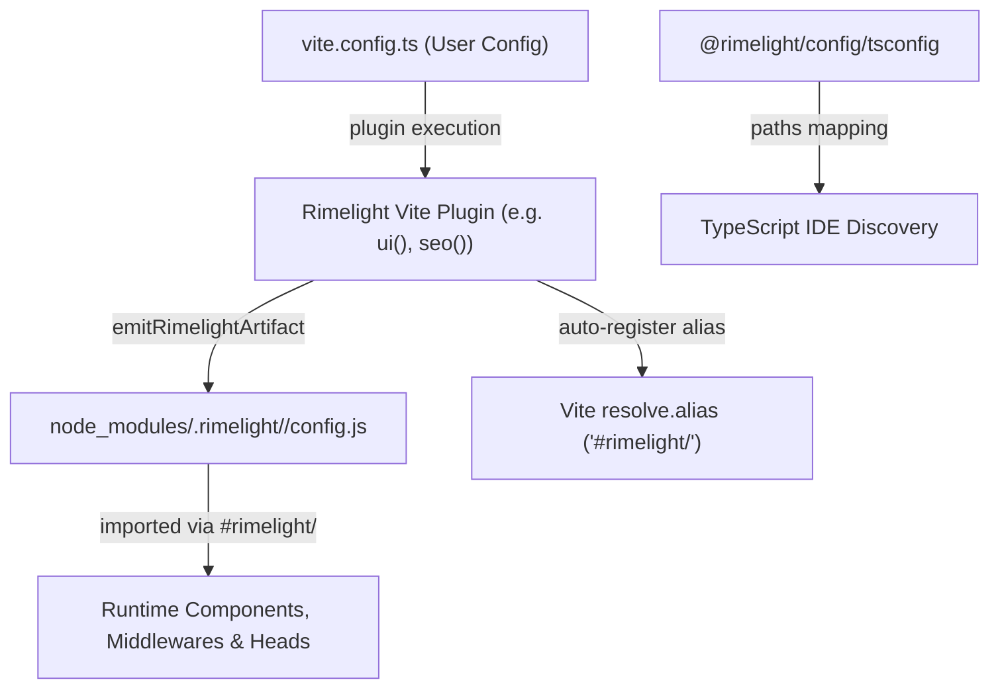

# RFC: Unified Generated Artifacts in `node_modules/.rimelight`

- **Status**: **Draft**
- **Author(s)**: Rimelight Core Team
- **Created**: 2026-10-08
- **Last Updated**: 2026-10-08
- **Discussion/PR**: N/A

---

## 1. Summary

This RFC proposes replacing all ad-hoc in-memory Vite virtual modules across Rimelight packages (`@rimelight/ui`, `@rimelight/seo`, `@rimelight/auth`, `@rimelight/security`, `@rimelight/i18n`, and `@rimelight/cms`) with a single, unified disk-backed artifact generation pattern stored in `node_modules/.rimelight/`.

The proposed design satisfies four strict developer experience constraints:

1. **Unified Pattern**: All packages follow the exact same file layout (`node_modules/.rimelight/<pkg>/config.js`) and alias convention (`#rimelight/<pkg>`).
2. **Zero Extra Config Files**: Consumer configuration stays 100% inside `vite.config.ts` plugin invocations (`ui({...})`, `seo({...})`, `auth({...})`). No root `rimelight.config.ts` is required.
3. **Automatic Gitignoring**: Artifacts are emitted strictly to `node_modules/.rimelight/`, eliminating any need for consumers to touch `.gitignore`.
4. **Zero Provider Wrappers**: Runtime modules and UI components directly import their configuration at module scope without requiring JSX wrapper components like `<RimelightUIProvider>`.

---

## 2. Motivation

Virtual modules (e.g. `virtual:rimelight/ui`, `virtual:rimelight-security-config`, `virtual:rimelight/seo/server`) are currently used across Rimelight to pass build-time options from `vite.config.ts` into runtime modules. While functional, their pervasive use creates friction across development, typing, and testing:

1. **Degraded IDE Experience & Type Resolution**:
   - `Cmd/Ctrl + Click` (jump-to-definition) fails or lands on empty `declare module "virtual:..."` stubs in ambient `.d.ts` files.
   - Consumers and internal packages must maintain fragile ambient declarations.
2. **Heavy Vitest Mocking Overhead**:
   - Unit tests across packages (e.g. `packages/ui/test/*`) require manual `vi.mock("virtual:rimelight/ui", ...)` setup blocks before components can even be imported or tested.
3. **Unsafe Function Serialization**:
   - Packages like `@rimelight/security` resort to custom `serializeConfig` implementations that turn functions into strings via `.toString()`. Any function that closes over module scope in `vite.config.ts` breaks silently at runtime.
4. **Fragmented In-Memory Identifiers**:
   - Different packages use different naming conventions (`virtual:rimelight/ui`, `virtual:rimelight-seo-config`, `virtual:sri-manifest`, `virtual:rimelight-auth-config`), making the ecosystem inconsistent to maintain.

### Goals

- Establish a single, uniform generation mechanism across all Rimelight packages.
- Make configuration artifacts inspectable on disk for easy debugging.
- Enable native IDE jump-to-definition and autocomplete.
- Remove unit test mocking requirements for configuration modules.
- Maintain 100% backward compatibility for consumer configuration in `vite.config.ts`.

### Non-Goals

- Introducing a standalone `rimelight.config.ts` file (configuration remains on Vite plugins).
- Forcing React/Solid context providers upon consumers.

---

## 3. Detailed Design

### 3.1. Architecture & Directory Layout

During Vite's `config` / `configResolved` lifecycle hooks, each Rimelight plugin normalizes its options and emits real JavaScript, JSON, and TypeScript definition files into `<root>/node_modules/.rimelight/<pkg>/`:

```
<project-root>/
├── node_modules/
│   └── .rimelight/                     <-- Automatically gitignored
│       ├── ui/
│       │   ├── config.js
│       │   └── config.d.ts
│       ├── auth/
│       │   ├── config.js
│       │   └── config.d.ts
│       ├── seo/
│       │   ├── config.js
│       │   └── config.d.ts
│       ├── security/
│       │   ├── config.js
│       │   ├── sri.json
│       │   └── config.d.ts
│       ├── i18n/
│       │   ├── config.js
│       │   └── config.d.ts
│       └── cms/
│           ├── config.js
│           └── config.d.ts
├── vite.config.ts                      <-- Standard plugin options
└── src/
```

### 3.2. Data Flow & Execution Pipeline



### 3.3. Core Implementation

#### 1. Shared Artifact Generator (`@rimelight/config` or `@rimelight/core`)

A zero-dependency helper writes files only when content has changed, preserving file modification timestamps and preventing accidental HMR reloads:

```typescript
import fs from "node:fs";
import path from "node:path";

export interface RimelightArtifactFiles {
  [filename: string]: string;
}

export function emitRimelightArtifact(
  root: string,
  pkgName: string,
  files: RimelightArtifactFiles,
): string {
  const targetDir = path.resolve(root, "node_modules/.rimelight", pkgName);
  fs.mkdirSync(targetDir, { recursive: true });

  for (const [filename, content] of Object.entries(files)) {
    const filePath = path.join(targetDir, filename);
    if (!fs.existsSync(filePath) || fs.readFileSync(filePath, "utf-8") !== content) {
      fs.writeFileSync(filePath, content, "utf-8");
    }
  }

  return targetDir;
}
```

#### 2. Standardized Plugin Integration Pattern

Every package plugin implements the exact same lifecycle pattern:

```typescript
import path from "node:path";
import type { Plugin } from "vite-plus";
import { emitRimelightArtifact } from "@rimelight/config/generator";

export function ui(options: UIConfig = {}): Plugin {
  let root = process.cwd();

  return {
    name: "rimelight:ui",
    enforce: "pre",

    config(userConfig) {
      root = userConfig.root ? path.resolve(userConfig.root) : process.cwd();
      const configFilePath = path.resolve(root, "node_modules/.rimelight/ui/config.js");

      // 1. Emit initial artifact
      emitRimelightArtifact(root, "ui", {
        "config.js": `export const config = ${JSON.stringify(options)};\nexport default config;`,
        "config.d.ts": `import type { UIConfig } from "@rimelight/ui";\nexport declare const config: UIConfig;\nexport default config;`,
      });

      // 2. Register alias
      return {
        resolve: {
          alias: {
            "#rimelight/ui": configFilePath,
          },
        },
      };
    },
  };
}
```

#### 3. Standardized Package-by-Package Mapping

| Package                   | Standard Alias        | Generated File                               | Exported Shape                                |
| :------------------------ | :-------------------- | :------------------------------------------- | :-------------------------------------------- |
| **`@rimelight/ui`**       | `#rimelight/ui`       | `node_modules/.rimelight/ui/config.js`       | `{ config, logos, unstyled, icons }`          |
| **`@rimelight/auth`**     | `#rimelight/auth`     | `node_modules/.rimelight/auth/config.js`     | `{ auth, authAdapter, authClient, config }`   |
| **`@rimelight/seo`**      | `#rimelight/seo`      | `node_modules/.rimelight/seo/config.js`      | `{ site, db, corpusPages, masterIconBuffer }` |
| **`@rimelight/security`** | `#rimelight/security` | `node_modules/.rimelight/security/config.js` | `{ config, sriManifest }`                     |
| **`@rimelight/i18n`**     | `#rimelight/i18n`     | `node_modules/.rimelight/i18n/config.js`     | `{ locales, defaultLocale, translations }`    |
| **`@rimelight/cms`**      | `#rimelight/cms`      | `node_modules/.rimelight/cms/config.js`      | `{ routePrefix, storage, db, auth }`          |

#### 4. TypeScript Discovery via `@rimelight/config`

In `packages/config/tsconfig/base.json`, add the root path mapping once:

```json
{
  "compilerOptions": {
    "paths": {
      "#rimelight/*": ["./node_modules/.rimelight/*/config.d.ts", "./node_modules/.rimelight/*"]
    }
  }
}
```

Since consumer projects already extend `@rimelight/config/tsconfig/solid` or `base`, all `#rimelight/*` imports immediately become typed with zero consumer configuration.

---

## 4. Drawbacks & Trade-offs

1. **Cold CI Type-Check Order**:
   - If CI runs standalone `tsc --noEmit` before `vite build` or `vp check`, `node_modules/.rimelight` will not exist yet on a clean checkout.
   - **Mitigation**: Each `@rimelight/*` package ships with fallback ambient type definitions or a lightweight init script, or CI pipelines run the build step prior to standalone type checks.
2. **File System I/O**:
   - Unlike in-memory virtual modules, disk writes are performed at startup.
   - **Mitigation**: Writing 6 small files (<5 KB each) takes <2ms, and the change-detection guard ensures no unnecessary writes occur during dev HMR.
3. **Monorepos & Working Directories**:
   - In complex workspace setups, `config.root` must be used to ensure artifacts are written to the active app's local `node_modules`.

---

## 5. Alternatives Considered

1. **In-Memory Virtual Modules (Status Quo)**:
   - _Rejected_: Broken IDE jump-to-definition, extensive test mocking requirements, and unsafe stringification of functions.
2. **Dedicated `rimelight.config.ts`**:
   - _Rejected_: Adds unnecessary file clutter and diverges from the clean Vite-plugin configuration model.
3. **Global React/Solid Context Providers (`<RimelightUIProvider>`)**:
   - _Rejected_: Adds runtime overhead and boilerplate wrapper requirements across layouts and pages.
4. **Generating into a Root `.rimelight/` Directory**:
   - _Rejected_: Forces consumers to modify their project `.gitignore` to avoid committing build artifacts.

---

## 6. Adoption & Migration Strategy

### Phase 1: Infrastructure

- Add `emitRimelightArtifact` utility to `@rimelight/config`.
- Add `#rimelight/*` path mappings to `@rimelight/config/tsconfig/base.json`.

### Phase 2: Package Migration

- Migrate `@rimelight/ui` and `@rimelight/auth` to `#rimelight/<pkg>` and drop test mocks in `packages/ui/test/*`.
- Migrate `@rimelight/i18n`, `@rimelight/security`, `@rimelight/seo`, and `@rimelight/cms`.

### Phase 3: Consumer Validation

- Verify consumer applications (`personal.idantity.me`, `idantity.me`, etc.) compile and run with unchanged `vite.config.ts` files.

---

## 7. Cross-Cutting Concerns

### 7.1. Performance & Bundle Size

- **Output Bundles**: Identical to virtual modules. Tree-shaking is improved through clean named ES module exports.
- **Startup Time**: Adds <2ms overhead during initial Vite server start or build.

### 7.2. Security & Privacy

- Avoids serializing function strings across processes, preventing inadvertent closure leaks.

---

## 8. Verification & Testing Plan

### 8.1. Automated Tests

- Run existing test suites without `vi.mock("virtual:...")`:
  ```bash
  vp check
  vp test
  ```
- Add unit tests for `emitRimelightArtifact` verifying that:
  - Artifacts are correctly created in `node_modules/.rimelight/<pkg>/`.
  - Modification timestamps are unchanged when config content is identical.

### 8.2. Manual Verification

- Start dev server in `personal.idantity.me`:
  ```bash
  vp dev
  ```
- Inspect `node_modules/.rimelight/` to verify generated configs.
- Test `Cmd/Ctrl + Click` in WebStorm / VSCode on `#rimelight/ui` imports to ensure jump-to-definition resolves to the generated `.d.ts`.

---

## 9. Unresolved Questions

- Should `@rimelight/config` provide a lightweight postinstall script to generate empty stub files for cold IDE inspection prior to the first Vite run?
