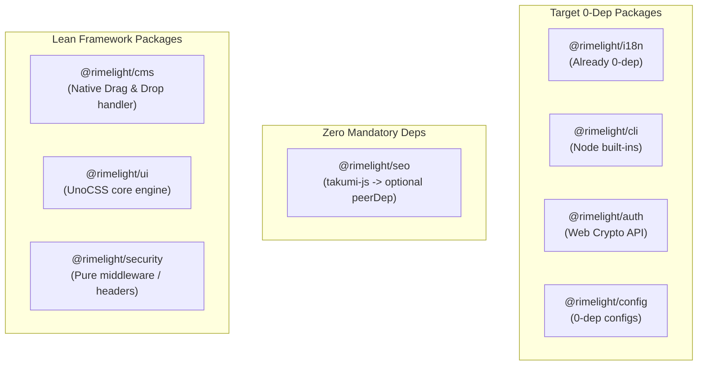

# RFC: Zero-Dependency Architecture & Native Handlers for Rimelight Packages

- **Status**: **Draft**
- **Author(s)**: Rimelight Team
- **Created**: 2026-09-19
- **Last Updated**: 2026-09-19
- **Discussion/PR**: [Pending]

---

## 1. Summary

Following the recent successful transition of `@rimelight/i18n` into a 100% dependency-less library, this RFC proposes extending this philosophy across the entire `@rimelight/*` package suite. By taking advantage of modern JavaScript standards, standard Web APIs (such as Web Crypto API and Pointer/Drag APIs), and modern Node.js built-ins (`node:util.parseArgs`, `node:util.styleText`, `node:readline/promises`, `node:child_process`), we can systematically remove unnecessary external runtime dependencies, reduce supply-chain vulnerability surfaces, eliminate framework conflicts, and drastically shrink install and execution footprints.

---

## 2. Motivation

### Background

In `@rimelight/i18n`, external CLI parsing and utility dependencies were completely eliminated in favor of Node built-ins (`node:util.parseArgs`) and native standard modules. The resulting package is zero-dependency, lightning fast, highly portable across runtime environments (Cloudflare Workers, Node, Bun, Deno), and immune to upstream supply-chain risks.

### Current Pain Points Across Packages

1. **`@rimelight/cli`**: Relies on 4 third-party runtime dependencies (`@clack/prompts`, `cross-spawn`, `mri`, `picocolors`) despite running in Node `>=26.9.0` where native equivalents (`parseArgs`, `styleText`, `spawnSync`, `readline/promises`) are already available out-of-the-box.
2. **`@rimelight/auth`**:
   - Carries unused dependencies (`drizzle-orm` is in `dependencies` and `peerDependencies` but never imported in `src/`).
   - Relies on `jose` for HS256/RS256 operations and JWT parsing, which can be handled directly via standard `globalThis.crypto.subtle` without bundling external crypto libraries into edge workers.
3. **`@rimelight/seo`**:
   - Declares `takumi-js` as a mandatory runtime dependency, even though `takumi-js` is only dynamically imported for OG image card generation (`og.ts`, `assets.ts`). Core SEO features (sitemaps, `robots.txt`, RSS feeds, web manifests, structured data catalog, `security.txt`) are pure string/XML logic.
4. **`@rimelight/cms`**:
   - Uses `sortablejs` for block reordering in the SolidJS admin interface. `sortablejs` mutates the DOM directly, requiring complex prototype monkey-patching (`patchedParentNodeGuard`) and manual DOM node removals prior to SolidJS reconciliation to prevent UI desyncs.

### Goals

- Make `@rimelight/cli` 100% dependency-free using modern Node standard library modules.
- Eliminate unused dependencies (`drizzle-orm`) in `@rimelight/auth` and transition JWT/JWKS verification to the native Web Crypto API (`crypto.subtle`).
- Make `@rimelight/seo` zero mandatory runtime dependencies by making `takumi-js` an optional peer dependency.
- Replace `sortablejs` in `@rimelight/cms` with a lightweight, native HTML5 / Pointer Drag & Drop handler designed specifically for reactive frameworks.
- Preserve 100% backward-compatible public APIs and configuration contracts for all consumers.

### Non-Goals

- Removing core architectural engines from packages where they define the primary functionality (e.g. `drizzle-orm` in `@rimelight/cms`, `unocss` in `@rimelight/ui`, `solid-js` in `@rimelight/cms`).
- Dropping development-time tooling or type-check dependencies.

---

## 3. Detailed Design



### 3.1. `@rimelight/cli` Zero-Dependency Overhaul

#### Replacements

- **`mri` $\rightarrow$ `node:util.parseArgs`**: Standardize on `parseArgs` with `options` and `allowPositionals: true` (mirroring `@rimelight/i18n`).
- **`picocolors` $\rightarrow$ `node:util.styleText`** (or a 20-line ANSI helper): Use native `styleText(format, text)` available in Node 22+.
- **`cross-spawn` $\rightarrow$ `node:child_process.spawnSync`**: Native child process spawning with Windows shell resolution.
- **`@clack/prompts` $\rightarrow$ `node:readline/promises` + Native Terminal Helpers**: Replace interactive prompts with a clean ~80 LOC internal prompter supporting text input, select menus (raw mode key listeners), confirmations, and terminal spinners.

#### Example Implementation

```typescript
import { parseArgs, styleText } from "node:util"
import { spawnSync } from "node:child_process"
import { createInterface } from "node:readline/promises"

// Parse CLI arguments with built-in parseArgs
const { values, positionals } = parseArgs({
  options: {
    "domain": { type: "string", short: "d" },
    "git": { type: "boolean", short: "g" },
    "install": { type: "boolean", short: "i" },
    "package-manager": { type: "string" },
    "help": { type: "boolean", short: "h" },
    "version": { type: "boolean", short: "v" }
  },
  allowPositionals: true
})
```

---

### 3.2. `@rimelight/auth` Web Crypto Transition & Cleanup

#### Changes

1. **Remove `drizzle-orm`**: Delete unused entry from `package.json`.
2. **Replace `jose` with standard `globalThis.crypto.subtle`**:
   - `decodeJwt(token)`: Base64URL decode middle segment (`JSON.parse(Buffer.from(token.split('.')[1], 'base64url').toString('utf-8'))` or cross-platform `atob`).
   - `createSessionToken` / `verifySessionToken` (HS256): Use `crypto.subtle.importKey('raw', ...)`, `crypto.subtle.sign('HMAC', ...)`, and `crypto.subtle.verify('HMAC', ...)`.
   - `verifyAuth0Jwt` (RS256 / JWKS): Fetch JWKS JSON, locate matching key by `kid`, import JWK via `crypto.subtle.importKey('jwk', key, { name: 'RSASSA-PKCS1-v1_5', hash: 'SHA-256' }, ...)` and verify the signature.

#### Native HS256 Handler Example

```typescript
export async function createSessionToken(
  session: Record<string, any>,
  secret: string,
  expiresInSeconds = 7 * 24 * 3600
): Promise<string> {
  const enc = new TextEncoder()
  const header = { alg: "HS256", typ: "JWT" }
  const now = Math.floor(Date.now() / 1000)
  const payload = { ...session, iat: now, exp: now + expiresInSeconds }

  const b64Header = Buffer.from(JSON.stringify(header)).toString("base64url")
  const b64Payload = Buffer.from(JSON.stringify(payload)).toString("base64url")
  const data = `${b64Header}.${b64Payload}`

  const key = await crypto.subtle.importKey(
    "raw",
    enc.encode(secret),
    { name: "HMAC", hash: "SHA-256" },
    false,
    ["sign"]
  )

  const signature = await crypto.subtle.sign("HMAC", key, enc.encode(data))
  const b64Signature = Buffer.from(signature).toString("base64url")

  return `${data}.${b64Signature}`
}
```

---

### 3.3. `@rimelight/seo` Optional Peer Dependency Strategy

#### Changes

1. Move `takumi-js` from `dependencies` to `peerDependencies` with `optional: true` in `peerDependenciesMeta`.
2. Wrap dynamic import in graceful feature check:

```typescript
export async function renderOgResponse(
  vnode: object,
  config: OgRenderConfig = {}
): Promise<Response> {
  try {
    const { render } = await import("takumi-js")
    // ... render OG image
  } catch (err) {
    throw new Error(
      "[@rimelight/seo] 'takumi-js' is required for OG image rendering. Please install 'takumi-js' in your project."
    )
  }
}
```

3. Core features (Sitemaps, `robots.txt`, RSS feeds, `security.txt`, manifest, schema catalog) immediately become 100% dependency-free.

---

### 3.4. `@rimelight/cms` Native Drag-and-Drop Handler

#### Current Problem

`sortablejs` mutates live DOM nodes, conflicting with SolidJS's reactive VDOM/fine-grained rendering and requiring DOM cleanup hacks (`removeChild`, `patchedParentNodeGuard`).

#### Proposed Handler

Implement an internal `createBlockDragDrop` handler utilizing HTML5 Drag and Drop or PointerEvents that:

- Emits clean `(fromIndex, toIndex)` events directly to Solid signals/stores.
- Uses declarative CSS classes for drop indicators without moving DOM elements under the reactive engine's feet.
- Removes `sortablejs` (and `@types/sortablejs`) completely.

---

## 4. Package Audit Overview

| Package               | Current Deps                                                | Proposed Target Deps  | Key Strategy                                       |
| :-------------------- | :---------------------------------------------------------- | :-------------------- | :------------------------------------------------- |
| `@rimelight/i18n`     | **0**                                                       | **0**                 | _Already complete (reference benchmark)_           |
| `@rimelight/cli`      | 4 (`@clack/prompts`, `cross-spawn`, `mri`, `picocolors`)    | **0**                 | `node:util`, `node:readline`, `node:child_process` |
| `@rimelight/auth`     | 2 (`drizzle-orm`, `jose`)                                   | **0**                 | Drop unused `drizzle-orm`, native `crypto.subtle`  |
| `@rimelight/seo`      | 1 (`takumi-js`)                                             | **0** (mandatory)     | Move `takumi-js` to optional `peerDependencies`    |
| `@rimelight/cms`      | 6 (`@rimelight/*`, `drizzle-orm`, `solid-js`, `sortablejs`) | 5 (Drop `sortablejs`) | Custom SolidJS reactive drag/drop handler          |
| `@rimelight/security` | 3 (`@rimelight/*` workspace only)                           | 0 external            | Pure standard Request/Response handlers            |
| `@rimelight/config`   | **0**                                                       | **0**                 | Standard configurations                            |
| `@rimelight/ui`       | 2 (`unocss`, `@unocss/vite`)                                | 2                     | Styling engine                                     |

---

## 5. Drawbacks & Trade-offs

- **Internal Maintenance of Micro-helpers**: Replacing utility libraries means maintaining small internal helpers for CLI prompt rendering and JWT RS256 JWKS verification. However, these are stable, well-specified RFC standards (JWT RFC 7519, JWK RFC 7517) that rarely change.
- **Node Version Requirement**: Native `styleText` and `parseArgs` require modern Node (>=22.0.0 / 26.x), which aligns perfectly with Rimelight's `engines.node: ">=26.9.0"` policy.

---

## 6. Alternatives Considered

1. **Keep existing npm micro-dependencies**: Retaining `mri`, `picocolors`, `cross-spawn`, etc. keeps current code untouched, but incurs unnecessary dependency resolution, audit overhead, and bloat when Node provides first-party native solutions.
2. **Bundle dependencies with `tsup`/`rollup`**: Inlining dependencies hides them from `node_modules` but increases package build size and hides vulnerabilities rather than eliminating the underlying code.

---

## 7. Adoption & Migration Strategy

- **Phase 1 (Immediate / Non-breaking)**:
  - Remove unused `drizzle-orm` from `@rimelight/auth`.
  - Move `takumi-js` to optional peer dependency in `@rimelight/seo`.
- **Phase 2 (`@rimelight/cli`)**:
  - Refactor `packages/cli` to use `node:util.parseArgs`, `node:util.styleText`, `node:child_process`, and native interactive prompts.
  - Verify all CLI commands (`create`, `compare`, `update`) and test suites pass.
- **Phase 3 (`@rimelight/auth` & `@rimelight/cms`)**:
  - Implement native Web Crypto JWT helper in `@rimelight/auth`.
  - Implement SolidJS reactive drag/drop handler in `@rimelight/cms` and remove `sortablejs`.

---

## 8. Verification & Testing Plan

### Automated Tests

Run full monorepo check and test commands across packages:

```bash
pnpm run check
pnpm --filter @rimelight/cli test
pnpm --filter @rimelight/auth test
pnpm --filter @rimelight/seo test
pnpm --filter @rimelight/cms test
```

### Verification Criteria

- `pnpm list --depth 0` shows zero runtime `dependencies` for `@rimelight/i18n`, `@rimelight/cli`, `@rimelight/auth`, `@rimelight/config`, and optional `takumi-js` for `@rimelight/seo`.
- All automated unit tests in `packages/cli/test` (`diff-engine`, `domain-config`, `jsonc-parser-fuzz`) pass cleanly.
- Auth0 and Cloudflare Access verification suites pass using native `crypto.subtle`.

---

## 9. Unresolved Questions

1. **CLI Prompt Fidelity**: Should the internal CLI prompter aim for an identical aesthetic to `@clack/prompts` (magenta step glyphs `◇`, spinners), or use standard terminal prompts? _(Recommendation: Replicate the minimalist Rimelight terminal styling using ANSI codes in a compact internal helper)._
2. **Web Crypto Edge Support**: Ensure RSA key importing (`RSASSA-PKCS1-v1_5` with SHA-256) conforms uniformly between Cloudflare Workers and Node.js `crypto.subtle`.
